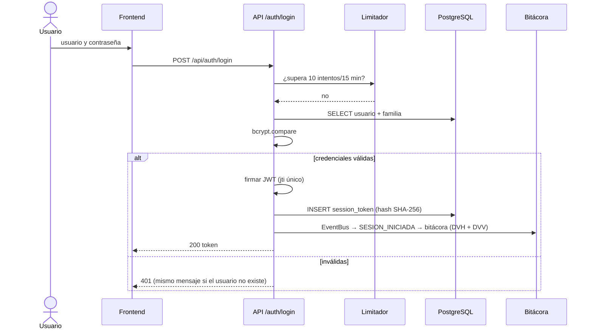
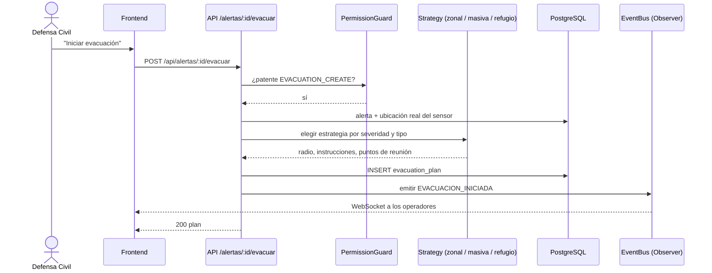
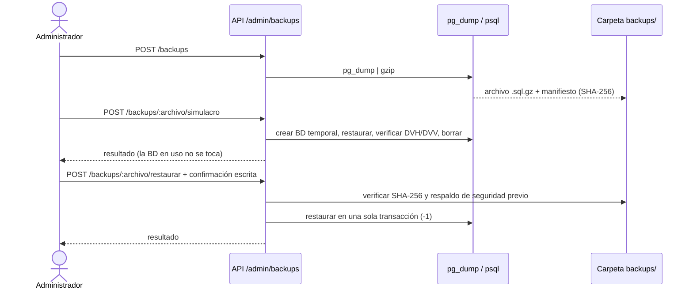
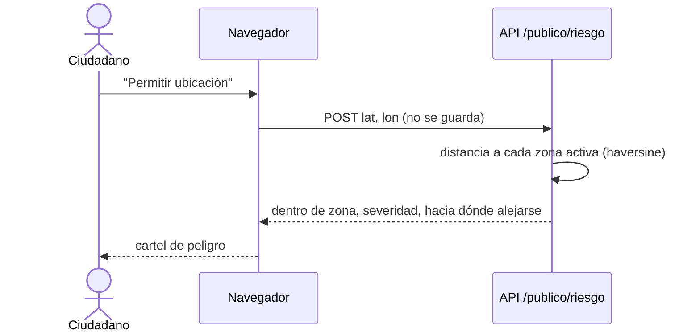

# AEGIS Urban — Especificación del sistema

Complementa el [documento funcional](documento-funcional/README.md), la [arquitectura](01-arquitectura.md) (DER lógico, DVH/DVV) y el [análisis y diseño](02-analisis-diseno.md) (casos de uso, diagrama de clases, patentes y familias). Aquí están la visión, los requerimientos con trazabilidad, la escalabilidad y la especificación dinámica (DSS).

## 1. Visión

**Para** los equipos municipales de operación, tránsito y Defensa Civil **y** para la ciudadanía, **AEGIS Urban es** una plataforma de alerta temprana que reúne telemetría de sensores, alertas, mapa, simulación y planes de evacuación. **A diferencia de** consultar fuentes dispersas, **ofrece** un único lugar con permisos por rol, trazabilidad inalterable de lo que cada persona hizo y una vista pública que distingue datos REAL (clima de Open-Meteo) de datos SIMULADO (sensores de demostración).

Es un prototipo: no reemplaza a los organismos oficiales (911, 100, 103).

## 2. Usuarios

| Familia (rol) | Qué hace | Acceso |
|---|---|---|
| CIUDADANO | Ve clima y avisos, recibe cartel de peligro por ubicación, gestiona sus datos | Vista pública + cuenta verificada |
| TRANSITO | Panel, mapa, sensores y alertas (solo lectura) | Operativo |
| DEFENSA_CIVIL | Reconoce, evacúa y resuelve alertas; crea simulaciones | Operación completa |
| AUDITOR | Lee la bitácora y verifica DVH/DVV | Solo lectura |
| ADMIN_SISTEMA | Usuarios, familias, respaldos y restauración | Administración |

**Qué puede hacer cada rol (verificado con `tests/live/roles.test.ts`, 56 comprobaciones contra la API real):**

| Capacidad | ADMIN_SISTEMA | TRANSITO | DEFENSA_CIVIL | AUDITOR |
|---|---|---|---|---|
| Ver sensores, alertas y panel | Sí | Sí | Sí | Sí |
| Reconocer / resolver alertas, iniciar evacuación | Sí | No | Sí | No |
| Ver escenarios y forzar lecturas simuladas | Sí | No | Sí | No |
| Consultar la bitácora y verificar integridad | Sí | No | No | Sí |
| Usuarios, familias y respaldos | Sí | No | No | No |

DEFENSA_CIVIL hereda de TRANSITO (Composite) y suma las acciones de respuesta. La familia OPERADOR_CRISIS se eliminó (migración 018): tenía exactamente las mismas patentes que TRANSITO, es decir, era el mismo rol con dos nombres.

Las familias agrupan **patentes** (permisos atómicos, p. ej. `EVACUATION_CREATE`) en un árbol Composite; ver [matriz de patentes](02-analisis-diseno.md).

## 3. Requerimientos funcionales

| ID | Requerimiento | Implementación |
|---|---|---|
| RF-01 | Autenticación JWT con revocación por sesión | `auth/*`, tabla `session_token` |
| RF-02 | Autorización por patentes/familias en cada endpoint; la interfaz muestra u oculta botones y secciones según las patentes que devuelve el login (`permisos`), no según el nombre del rol | `PermissionGuard`, tablas `patent` y `family_patent` (recurso + método HTTP) |
| RF-03 | Registro de ciudadanía con consentimientos y verificación de correo y celular | `registro.service`, `verificacion.service` |
| RF-04 | Sensores, lecturas y estadísticas | `sensors/*`, `telemetry/*` |
| RF-05 | Ciclo de vida de alertas (activa → reconocida → resuelta) con filtros y paginación | `alerts/*` |
| RF-06 | Plan de evacuación con estrategia según severidad y tipo (Strategy) | `core/strategies/*` |
| RF-07 | Escenarios de simulación configurables | `simulation/*` |
| RF-08 | Vista pública: clima real, avisos y riesgo por ubicación | `public/*` |
| RF-09 | Bitácora con DVH por fila y DVV encadenado; inmutable | `integrity/*`, migración 016 |
| RF-10 | Respaldo, restauración y simulacro de restauración | `backup/*` |
| RF-11 | Derechos del titular: descargar datos y darse de baja | `auth/mis-datos` |
| RF-12 | Interfaz en español e inglés, con ayuda contextual | `i18n/*`, página `/ayuda` |
| RF-13 | Tiempo real por WebSocket con control de permisos | `websocket/SocketServer` |

## 4. Requerimientos no funcionales

| ID | Categoría | Requerimiento | Cómo se cumple / verifica |
|---|---|---|---|
| RNF-01 | Seguridad | Contraseñas con hash irreversible; datos personales con cifrado reversible | bcrypt (factor 12) y AES-256 (el teléfono se cifra al registrarse; las columnas `full_name_enc` y `dni_enc` están previstas pero hoy el registro no las completa); `integracion.test.ts` |
| RNF-02 | Seguridad | Fuerza bruta limitada y registrada | Limitador compartido (PostgreSQL): 10 intentos / 15 min por usuario e IP; los fallos quedan en la bitácora; `seguridad.test.ts` |
| RNF-03 | Seguridad | Sin inyección SQL ni manipulación de JWT | Consultas parametrizadas, `algorithms: ["HS256"]`; `seguridad.test.ts` |
| RNF-04 | Integridad | La bitácora no se puede alterar sin que se detecte | DVH/DVV + triggers que rechazan UPDATE/DELETE/TRUNCATE |
| RNF-05 | Disponibilidad de datos | Respaldo diario con retención y restauración probada | `backup/*`, simulacro en base temporal |
| RNF-06 | Rendimiento | Lecturas p95 < 100 ms con 20 usuarios concurrentes | [Resultados](05-pruebas-y-rendimiento.md#rendimiento) |
| RNF-07 | Rendimiento | Respuestas comprimidas, caché y precarga | gzip, caché de peticiones con TTL, precarga de rutas, lazy loading |
| RNF-08 | Escalabilidad | Tablas de lecturas particionadas por trimestre | Migración 015 + mantenimiento automático |
| RNF-09 | Usabilidad | Dos idiomas y ayuda | 551 claves es/en con prueba de paridad |
| RNF-10 | Privacidad | Ley 25.326: consentimiento expreso, ubicación opcional y no persistida | Anexo E del documento funcional |
| RNF-11 | Mantenibilidad | Patrones de diseño y pruebas automatizadas | [Estrategia de pruebas](05-pruebas-y-rendimiento.md) |

## 5. Escalabilidad

- **Datos:** `sensor_reading` está particionada por rango trimestral. La función `asegurar_particiones_sensor_reading(n)` crea las particiones futuras y se ejecuta al arrancar y cada 6 horas; antes de la migración 015 las lecturas habrían fallado al llegar a 2027. Escalar el volumen = más particiones, y archivar/borrar una partición vieja es instantáneo.
- **API sin estado:** la sesión vive en JWT + `session_token`, así que se pueden poner varias instancias detrás de un balanceador.
- **Estado compartido (migración 017):** el limitador de tasa y la caché del clima viven en PostgreSQL (`rate_limit` y `shared_cache`), con una sola sentencia atómica por intento, así que todas las instancias cuentan sobre los mismos datos. Si la base falla, degradan a memoria local en lugar de tumbar la petición.
- **Límites actuales (honestos):** los escenarios de simulación siguen en temporizadores del proceso Node; con varias instancias hace falta un worker persistente con exclusión entre instancias. Para tráfico muy alto conviene pasar limitador y caché a Redis (la interfaz está aislada en `shared/store/almacen.ts`).
- **Lecturas calientes:** caché de clima con TTL (120 s) y de avisos (30 s) en el servidor, y caché + deduplicación de peticiones en el cliente.
- **Base de datos:** pool de conexiones configurable; el camino de crecimiento es réplica de lectura para el panel y la vista pública.

## 6. Especificación dinámica (DSS)

### 6.1 Inicio de sesión

### 6.2 Evacuación de una alerta

### 6.3 Respaldo y restauración

### 6.4 Aviso por ubicación (ciudadanía)

## 7. Especificación de casos de uso clave

| CU | Actor | Precondición | Flujo principal | Alternativas | Postcondición |
|---|---|---|---|---|---|
| CU-01 Iniciar sesión | Usuario | Cuenta activa | Ingresa credenciales → API valida → recibe JWT | Credenciales inválidas (401); bloqueo por intentos (429) | Sesión registrada y auditada |
| CU-02 Reconocer alerta | Defensa Civil / Operador con patente | Alerta ACTIVA | Pulsa «Reconocer» → estado ACKNOWLEDGED con actor y fecha | Sin patente (403); alerta ya reconocida | Bitácora con la acción |
| CU-03 Iniciar evacuación | Defensa Civil | Alerta reconocida | Pide plan → estrategia automática → plan visible | Sin permiso (403) | `evacuation_plan` creado |
| CU-04 Registrarse | Ciudadano | — | Datos + consentimientos → códigos por correo y celular → perfil verificado | Código vencido/erróneo (5 intentos) | Cuenta CIUDADANO verificada |
| CU-05 Verificar integridad | Auditor | — | «Verificar integridad» → recalcula DVH/DVV | Fila corrupta: se informa cuál | Resultado mostrado |
| CU-06 Respaldar y restaurar | Administrador | — | Crear → simulacro → restaurar con confirmación | Hash no coincide: se rechaza | Datos recuperados |
| CU-07 Cambiar idioma | Cualquiera | — | Selector ES/EN | — | Preferencia guardada en el navegador |

El diagrama de casos de uso completo (actores, include/extend) está en [02-analisis-diseno.md](02-analisis-diseno.md#sección-1--diagrama-de-casos-de-uso-uml).
