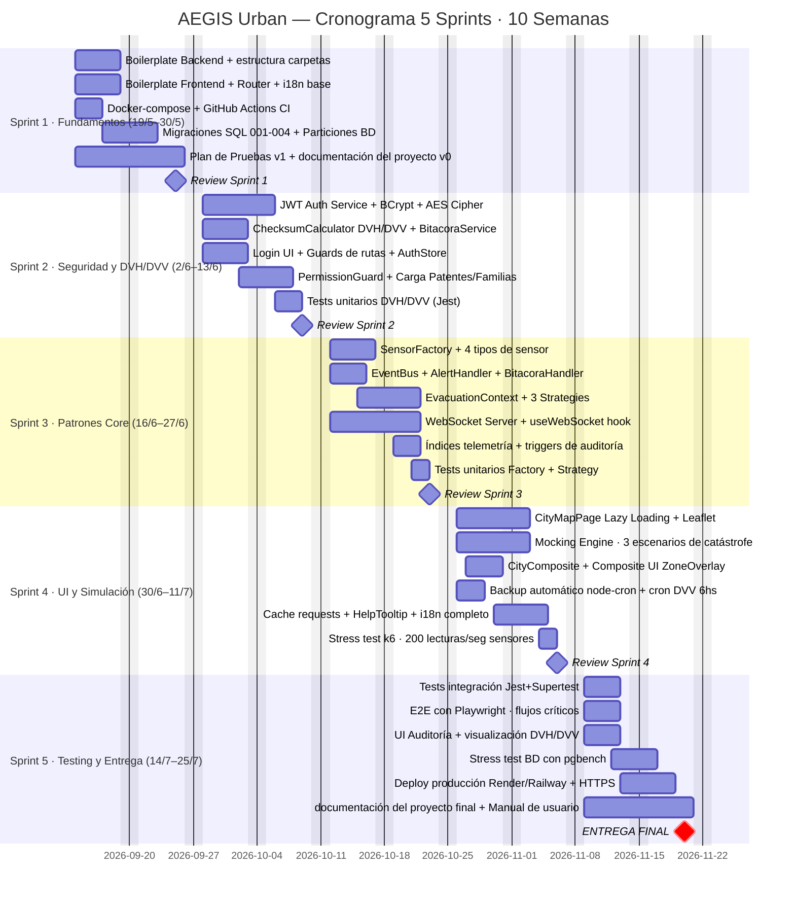
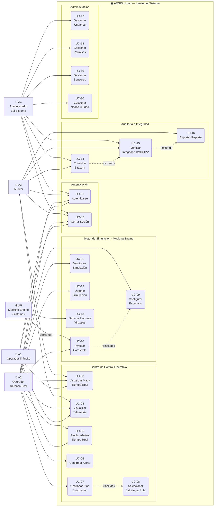
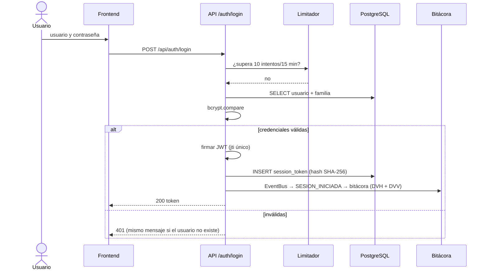
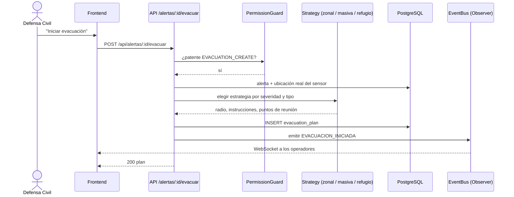
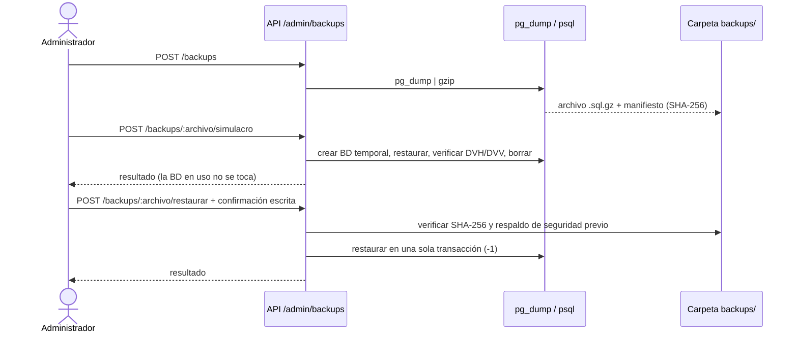
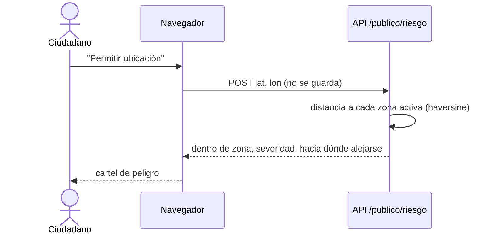

```mermaid
classDiagram
    direction TB

    %% ═══════════════════════════════════════
    %% PATRÓN SINGLETON
    %% ═══════════════════════════════════════
    class EmergencyKernel {
        -instance: EmergencyKernel$
        -sensorFactory: SensorFactory
        -evacuationContext: EvacuationContext
        -eventBus: EventBus
        -activeSensors: Map~string,BaseSensor~
        -activeAlerts: Alert[]
        -EmergencyKernel()
        +getInstance()$ EmergencyKernel
        +registerSensor(type: SensorType, cfg: SensorConfig) void
        +processReading(reading: SensorReading) void
        +dispatchEvacuation(alertId: string, strategy: string) Route
        +getSystemStatus() SystemStatus
    }

    %% ═══════════════════════════════════════
    %% PATRÓN FACTORY METHOD
    %% ═══════════════════════════════════════
    class SensorFactory {
        +createSensor(type: SensorType, cfg: SensorConfig)$ BaseSensor
    }
    class BaseSensor {
        <<abstract>>
        #sensorId: string
        #serialCode: string
        #location: GeoPoint
        #status: SensorStatus
        +read()* SensorReading
        +validate(value: number)* boolean
        +getAlertThreshold()* number
    }
    class FloodSensor {
        -waterLevelThreshold: number
        +read() SensorReading
        +validate(value: number) boolean
        +getAlertThreshold() number
    }
    class FireSensor {
        -temperatureThreshold: number
        +read() SensorReading
        +validate(value: number) boolean
        +getAlertThreshold() number
    }
    class WindSensor {
        -windSpeedThreshold: number
        +read() SensorReading
        +validate(value: number) boolean
        +getAlertThreshold() number
    }

    %% ═══════════════════════════════════════
    %% PATRÓN OBSERVER
    %% ═══════════════════════════════════════
    class EventBus {
        -observers: Map~string,IObserver[]~
        +attach(eventName: string, obs: IObserver) void
        +detach(eventName: string, obs: IObserver) void
        +notify(event: DomainEvent) void
    }
    class IObserver {
        <<interface>>
        +update(event: DomainEvent) Promise~void~
    }
    class AlertHandler {
        -alertService: AlertService
        +update(event: DomainEvent) Promise~void~
    }
    class WebSocketEmitter {
        -socketServer: SocketIOServer
        +update(event: DomainEvent) Promise~void~
    }
    class BitacoraHandler {
        -bitacoraService: BitacoraService
        +update(event: DomainEvent) Promise~void~
    }

    %% ═══════════════════════════════════════
    %% PATRÓN STRATEGY
    %% ═══════════════════════════════════════
    class EvacuationContext {
        -currentStrategy: IEvacuationStrategy
        +setStrategy(strategy: IEvacuationStrategy) void
        +executeRoute(origin: GeoPoint, dest: GeoPoint) Route
    }
    class IEvacuationStrategy {
        <<interface>>
        +calculate(origin: GeoPoint, dest: GeoPoint, graph: CityGraph) Route
    }
    class ShortestPathStrategy {
        +calculate(origin: GeoPoint, dest: GeoPoint, graph: CityGraph) Route
    }
    class SafestPathStrategy {
        -activeDangerZones: Zone[]
        +calculate(origin: GeoPoint, dest: GeoPoint, graph: CityGraph) Route
    }
    class CapacityBasedStrategy {
        -currentLoads: Map~string,number~
        +calculate(origin: GeoPoint, dest: GeoPoint, graph: CityGraph) Route
    }

    %% ═══════════════════════════════════════
    %% PATRÓN COMPOSITE — Jerarquía Ciudad
    %% ═══════════════════════════════════════
    class ICityComponent {
        <<interface>>
        +getName() string
        +getNodeType() NodeType
        +getSensors() BaseSensor[]
        +getChildren() ICityComponent[]
        +add(c: ICityComponent) void
    }
    class CityComposite {
        -name: string
        -nodeType: NodeType
        -children: ICityComponent[]
        +getName() string
        +getNodeType() NodeType
        +getSensors() BaseSensor[]
        +getChildren() ICityComponent[]
        +add(c: ICityComponent) void
    }
    class CityLeaf {
        -name: string
        -sensors: BaseSensor[]
        +getName() string
        +getNodeType() NodeType
        +getSensors() BaseSensor[]
        +getChildren() ICityComponent[]
        +add(c: ICityComponent) void
    }

    %% ═══════════════════════════════════════
    %% PATRÓN COMPOSITE — Patentes y Familias
    %% ═══════════════════════════════════════
    class IPermissionComponent {
        <<interface>>
        +hasPermission(resource: string, method: string) boolean
        +getCode() string
    }
    class FamilyComposite {
        -familyName: string
        -children: IPermissionComponent[]
        +hasPermission(resource: string, method: string) boolean
        +getCode() string
        +add(c: IPermissionComponent) void
    }
    class PatentLeaf {
        -code: string
        -resource: string
        -httpMethod: HttpMethod
        +hasPermission(resource: string, method: string) boolean
        +getCode() string
    }

    %% ═══════════════════════════════════════
    %% INTEGRIDAD DVH/DVV
    %% ═══════════════════════════════════════
    class ChecksumCalculator {
        -SEP: string$
        +calculateDVH(row: AuditLogRow)$ string
        +calculateChainedDVV(prev: string, dvh: string)$ string
        +validateTableIntegrity(rows: AuditLogRow[])$ IntegrityResult
    }
    class BitacoraService {
        -db: Pool
        +logEvent(event: AuditEvent) Promise~void~
        +verifyIntegrity(userId: number) Promise~void~
    }

    %% ═══════════════════════════════════════
    %% RELACIONES
    %% ═══════════════════════════════════════

    EmergencyKernel ..> SensorFactory      : usa ▶ crea sensores
    EmergencyKernel *-- EvacuationContext  : contiene
    EmergencyKernel *-- EventBus           : contiene
    EmergencyKernel o-- BaseSensor         : gestiona activos
    EmergencyKernel ..> CityComposite      : consulta estructura

    SensorFactory ..> BaseSensor    : creates
    BaseSensor <|-- FloodSensor     : extiende
    BaseSensor <|-- FireSensor      : extiende
    BaseSensor <|-- WindSensor      : extiende

    EventBus "1" --> "*" IObserver  : notifica
    IObserver <|.. AlertHandler     : implementa
    IObserver <|.. WebSocketEmitter : implementa
    IObserver <|.. BitacoraHandler  : implementa
    BitacoraHandler --> BitacoraService : delega

    EvacuationContext --> IEvacuationStrategy     : delega
    IEvacuationStrategy <|.. ShortestPathStrategy  : implementa
    IEvacuationStrategy <|.. SafestPathStrategy    : implementa
    IEvacuationStrategy <|.. CapacityBasedStrategy : implementa

    ICityComponent <|.. CityComposite      : implementa
    ICityComponent <|.. CityLeaf           : implementa
    CityComposite "1" *-- "*" ICityComponent : children

    IPermissionComponent <|.. FamilyComposite : implementa
    IPermissionComponent <|.. PatentLeaf      : implementa
    FamilyComposite "1" *-- "*" IPermissionComponent : children

    BitacoraService --> ChecksumCalculator : usa
```

<!-- Archivo generado por docs/unificado/generar-markdown.cjs. No editar: cambiar el maestro o las fuentes y regenerar. -->
[← Volver al README](../README.md) · [Leer por páginas →](documento/00-portada.md) · [Descargar PDF](pdf/AEGIS-Urban-Documento-Funcional-Unificado.pdf)

# AEGIS Urban

**Documento Funcional de Ciclo de Vida**

> Advanced Emergency Geographic Intelligence System — plataforma web de orquestación logística y alerta temprana ante catástrofes climáticas para ciudades inteligentes

### Ficha técnica

| Campo | Detalle |
|---|---|
| Materia | Prácticas Profesionalizantes |
| Curso | 6°3 |
| Metodología | Ciclo de vida del software en 4 etapas, con revisión SQA al cierre de cada una; ejecución ágil en 5 sprints de 2 semanas |
| Duración | 10 semanas (14/09/2026 – 20/11/2026) |
| Versión del documento | v1.0.0 |
| Fecha de edición | 19/11/2026 |
| Estado del producto | Prototipo en desarrollo: no sustituye protocolos ni autoridad de emergencia |

### Integrantes

| N.º | Integrante |
|---|---|
| 1 | Carolina Lobo |
| 2 | Sabrina De Marco |
| 3 | Maximiliano Chaparro |
| 4 | Maximo Casanovas |
| 5 | Melina Cullari |

### Distribución del trabajo

| Integrante | Rol asignado | Fase de intervención | Responsabilidades técnicas y entregables clave |
|---|---|---|---|
| Carolina Lobo | Product Owner y documentadora QA | Sprints 1 a 5; análisis, diseño y release | Documentación del proyecto, criterios de aceptación, plan de pruebas, manual de usuario, checklist de seguridad y coordinación de la demo |
| Sabrina De Marco | Desarrollo frontend | Sprints 1 a 5; diseño de interfaz e implementación | React, enrutamiento con carga diferida, mapa de ciudad, pantallas de alertas y simulación, i18n (ES/EN), ayuda contextual |
| Maximiliano Chaparro | Desarrollo backend core | Sprints 1 a 5; implementación | Node.js/Express, API REST, patrones de diseño (Singleton, Factory, Observer, Strategy), motor de simulación |
| Maximo Casanovas | Seguridad y base de datos | Sprints 1 a 5; diseño de datos, seguridad y pruebas | PostgreSQL, AES/bcrypt, DVH/DVV, patentes y familias, migraciones, respaldos y particiones |
| Melina Cullari | Integración full-stack y WebSockets | Sprints 1 a 5; implementación, pruebas y release | socket.io, integración de módulos, CI/CD en GitHub Actions y pruebas de integración de los flujos |

### Índice general

- [1. Introducción, resumen ejecutivo y alcance](#1-introducción-resumen-ejecutivo-y-alcance)
  - [1.1 Resumen ejecutivo](#11-resumen-ejecutivo)
  - [1.2 Alcance del producto](#12-alcance-del-producto)
  - [1.3 Supuestos y restricciones](#13-supuestos-y-restricciones)
  - [1.4 Las cuatro etapas y sus entregables](#14-las-cuatro-etapas-y-sus-entregables)
- [2. Etapa 1 — Análisis y factibilidad](#2-etapa-1--análisis-y-factibilidad)
  - [2.1 Problema y objetivos](#21-problema-y-objetivos)
  - [2.2 Contexto y actores](#22-contexto-y-actores)
  - [2.3 Fuentes de alertas e investigación (protocolo CAP)](#23-fuentes-de-alertas-e-investigación-protocolo-cap)
  - [2.4 Análisis de factibilidades](#24-análisis-de-factibilidades)
  - [2.5 Límites y alcance](#25-límites-y-alcance)
  - [2.6 Planificación estratégica](#26-planificación-estratégica)
    - [Cronograma General (Gantt)](#cronograma-general-gantt)
    - [Sprint 1 — Fundamentos e Infraestructura (14/09 – 25/09)](#sprint-1--fundamentos-e-infraestructura-1409--2509)
    - [Sprint 2 — Seguridad y Control de Acceso (28/09 – 09/10)](#sprint-2--seguridad-y-control-de-acceso-2809--0910)
    - [Sprint 3 — Patrones Core y Telemetría Real-time (12/10 – 23/10)](#sprint-3--patrones-core-y-telemetría-real-time-1210--2310)
    - [Sprint 4 — UI Ciudad y Motor de Simulación (26/10 – 06/11)](#sprint-4--ui-ciudad-y-motor-de-simulación-2610--0611)
    - [Sprint 5 — Testing, Auditoría UI y Entrega Final (09/11 – 20/11)](#sprint-5--testing-auditoría-ui-y-entrega-final-0911--2011)
    - [Riesgos](#riesgos)
- [3. Etapa 2 — Diseño y arquitectura](#3-etapa-2--diseño-y-arquitectura)
  - [3.1 Elección tecnológica justificada](#31-elección-tecnológica-justificada)
  - [3.2 Diseño de la base de datos](#32-diseño-de-la-base-de-datos)
  - [3.3 Especificación de requerimientos](#33-especificación-de-requerimientos)
    - [Requerimientos funcionales](#requerimientos-funcionales)
    - [Requerimientos no funcionales](#requerimientos-no-funcionales)
  - [3.4 Modelado UML](#34-modelado-uml)
    - [Actores y casos de uso](#actores-y-casos-de-uso)
    - [Diagrama de clases y patrones de diseño](#diagrama-de-clases-y-patrones-de-diseño)
    - [Especificación dinámica (DSS) de los flujos críticos](#especificación-dinámica-dss-de-los-flujos-críticos)
    - [Especificación de casos de uso clave](#especificación-de-casos-de-uso-clave)
  - [3.5 Arquitectura técnica](#35-arquitectura-técnica)
    - [Visión de contexto y componentes](#visión-de-contexto-y-componentes)
    - [Estructura de carpetas](#estructura-de-carpetas)
    - [Modelo entidad-relación (DER lógico)](#modelo-entidad-relación-der-lógico)
    - [Tiempo real con WebSockets](#tiempo-real-con-websockets)
    - [Seguridad: DVH + DVV](#seguridad-dvh--dvv)
    - [Matriz de patentes y familias](#matriz-de-patentes-y-familias)
  - [3.6 Diseño de interfaz](#36-diseño-de-interfaz)
- [4. Etapa 3 — Implementación, construcción y testing](#4-etapa-3--implementación-construcción-y-testing)
  - [4.1 Preparación del entorno](#41-preparación-del-entorno)
  - [4.2 Construcción por módulos y estándares de codificación](#42-construcción-por-módulos-y-estándares-de-codificación)
  - [4.3 Estrategia y evidencia de pruebas](#43-estrategia-y-evidencia-de-pruebas)
  - [4.4 Operación de la base de datos](#44-operación-de-la-base-de-datos)
- [5. Etapa 4 — Release, mantenimiento y cierre](#5-etapa-4--release-mantenimiento-y-cierre)
  - [5.1 Notas de versión v1.0.0](#51-notas-de-versión-v100)
  - [5.2 Checklist pre-release](#52-checklist-pre-release)
  - [5.3 Pruebas de aceptación (UAT)](#53-pruebas-de-aceptación-uat)
    - [Guion y acta de la sesión de aceptación](#guion-y-acta-de-la-sesión-de-aceptación)
  - [5.4 Plan de reversión (vuelta atrás)](#54-plan-de-reversión-vuelta-atrás)
  - [5.5 Manuales de usuario](#55-manuales-de-usuario)
    - [Ciudadanía](#ciudadanía)
    - [Operación y tránsito](#operación-y-tránsito)
    - [Defensa Civil](#defensa-civil)
    - [Auditoría](#auditoría)
    - [Administración](#administración)
    - [Problemas frecuentes](#problemas-frecuentes)
    - [Preguntas frecuentes](#preguntas-frecuentes)
  - [5.6 Plan de mantenimiento](#56-plan-de-mantenimiento)
  - [5.7 Anexos](#57-anexos)
    - [Anexo A — Decisiones de producto](#anexo-a--decisiones-de-producto)
    - [Anexo B — Contratos de API](#anexo-b--contratos-de-api)
    - [Anexo C — Glosario](#anexo-c--glosario)
    - [Anexo D — Backlog priorizado](#anexo-d--backlog-priorizado)
    - [Anexo E — Marco legal (Ley 25.326)](#anexo-e--marco-legal-ley-25326)
  - [5.8 Cierre y trabajo futuro](#58-cierre-y-trabajo-futuro)


---

# 1. Introducción, resumen ejecutivo y alcance

## 1.1 Resumen ejecutivo

**Qué es.** AEGIS Urban centraliza lecturas de sensores urbanos (inundación, incendio, viento, calidad del aire) y las convierte en alertas, planes de evacuación y avisos para la ciudadanía, con permisos por rol y una bitácora cuya integridad se puede verificar.

**Para quién.** Personal de operación y tránsito, Defensa Civil, auditoría y administración, y la ciudadanía a través de una vista pública sin cuenta.

**Qué resuelve.** La información de riesgos suele estar repartida entre sistemas y personas. El prototipo ofrece una vista común, deja rastro inalterable de las acciones, permite ensayar respuestas con sensores simulados y avisa a cada persona si está dentro o cerca de una zona de riesgo. Cada dato se rotula **REAL** (clima de Open-Meteo) o **SIMULADO** (sensores de demostración).

**Stack.** Node.js + TypeScript + Express (API REST y socket.io), React 18 + Vite + TypeScript (interfaz), PostgreSQL 16 (datos), Docker (base de datos local), GitHub Actions (integración continua).

**Estado.** Prototipo funcional con 256 pruebas automatizadas aprobadas: 133 unitarias de backend, 18 de frontend, 99 de integración, seguridad y autorización por rol contra la API y PostgreSQL reales, y 6 de punta a punta con un navegador real. Compilación de backend y frontend aprobada. Pendientes: la sesión de aceptación con usuarios (el guion y el acta están en la sección 5.3) y la primera ejecución del job de CI «en vivo» en GitHub.

**Equipo.** Cinco integrantes con roles de Product Owner/QA, frontend, backend, seguridad y base de datos, e integración (ver portada).

## 1.2 Alcance del producto

**Dentro del alcance:**

- Panel operativo, mapa de ciudad, sensores y alertas con filtros y paginación en el servidor.
- Autenticación JWT, autorización por patentes y familias, y conexiones WebSocket autorizadas.
- Ciclo de vida de alertas, plan de evacuación con estrategia según severidad y tipo, y escenarios de simulación.
- Vista ciudadana: clima y calidad del aire reales, avisos, alerta por ubicación, registro con consentimientos (Ley 25.326) y verificación de perfil por correo y celular.
- Bitácora con DVH/DVV inmutable, respaldo y restauración, particiones, interfaz en español e inglés y ayuda.

**Fuera del alcance:** despacho oficial de servicios de emergencia, navegación peatonal validada, integración con organismos oficiales (CAP), operación de hardware certificado, SMS real, catastro de refugios y garantía de seguridad de personas. Las rutas e instrucciones simuladas son demostrativas y requieren validación profesional antes de cualquier uso real.

## 1.3 Supuestos y restricciones

- El prototipo usa PostgreSQL y servicios Node.js/React; en desarrollo la base corre en Docker.
- La ciudad y sus sensores de ejemplo no representan cobertura real.
- Solo personal con permisos accede a datos operativos y administración; la ciudadanía tiene un rol de solo lectura.
- En una emergencia real: **911** (policía), **100** (bomberos) o **103** (Defensa Civil).

## 1.4 Las cuatro etapas y sus entregables

| Etapa | Qué se hizo | Entregables | Revisión SQA |
|---|---|---|---|
| 1 — Análisis y factibilidad | Problema, objetivos, actores, fuentes de alertas, factibilidades y planificación | Objetivos, factibilidades, plan de 5 sprints y riesgos | Alcance acordado y riesgos identificados |
| 2 — Diseño y arquitectura | Stack, base de datos, requisitos, UML, seguridad e interfaz | RF-01 a RF-13, RNF-01 a RNF-11, DER, clases, casos de uso, DSS y matriz de patentes | Trazabilidad de cada requisito a un módulo del código |
| 3 — Implementación y testing | Construcción por módulos, pruebas, operación de BD | Código, migraciones 001–018, 256 pruebas, script de carga, CI y respaldos | Pruebas automatizadas aprobadas y compilación limpia |
| 4 — Release y mantenimiento | Versión, aceptación, reversión, manuales y cierre | Notas v1.0.0, manuales, plan de mantenimiento y anexos | Checklist de pre-release y brechas declaradas |

---

# 2. Etapa 1 — Análisis y factibilidad

## 2.1 Problema y objetivos

La información sobre amenazas urbanas puede estar repartida entre sensores, tableros internos y canales de organismos distintos. Una vista común puede ayudar a localizar eventos y coordinar tareas, pero un prototipo técnico no sustituye la confirmación ni las instrucciones de una autoridad de emergencia.

**Objetivo general.** Construir una aplicación web que reúna telemetría, alertas y herramientas de ejercicio para apoyar la observación y coordinación operativa en la ciudad, y que informe a la ciudadanía con datos rotulados por su origen.

**Objetivos específicos.**

- Mostrar la condición, última lectura y ubicación de sensores.
- Consultar alertas por estado, severidad, período y zona.
- Conservar responsables y marcas de tiempo de las acciones, con integridad verificable (DVH/DVV).
- Ensayar eventos con escenarios reproducibles y sensores simulados.
- Ofrecer una vista ciudadana con clima real y alerta por ubicación, respetando la Ley 25.326.
- Garantizar respaldo, restauración y trazabilidad de los datos.

## 2.2 Contexto y actores

| Actor | Casos de uso |
|---|---|
| Tránsito | Iniciar y cerrar sesión, revisar mapa, telemetría y alertas |
| Defensa Civil | Reconocer una alerta, solicitar el plan de evacuación, ejecutar simulaciones |
| Auditor | Consultar la bitácora y verificar su integridad |
| Administrador | Gestionar usuarios, familias, respaldos y restauración |
| Ciudadanía | Ver clima y avisos, recibir aviso por ubicación, gestionar sus datos |
| Motor de simulación | Emitir lecturas marcadas como simuladas y activar las reglas de alerta |


## 2.3 Fuentes de alertas e investigación (protocolo CAP)

AEGIS recibe detecciones de sensores y el clima real de Open-Meteo. Cada alerta preserva su origen (REAL o SIMULADO), la hora de emisión, el área afectada y su estado.

El **Common Alerting Protocol (CAP)** es el formato interoperable para comunicar emisor, urgencia, severidad, certeza, período y área geográfica. Si una autoridad no publica CAP, conviene sumar un adaptador dedicado que normalice el aviso al modelo interno sin ocultar su fuente. **Estado actual:** AEGIS no está conectado a ninguna API oficial de alertas; el adaptador CAP es trabajo futuro y no se presenta nada como instrucción oficial.

## 2.4 Análisis de factibilidades

| Factibilidad | Análisis | Conclusión |
|---|---|---|
| Humana | Equipo de 5 personas con roles complementarios (documentación y QA, frontend, backend, seguridad y datos, integración) durante 10 semanas | Viable |
| Técnica | Stack estándar (Node.js, React, PostgreSQL) con herramientas libres; el código corre en un equipo con Docker, y la prueba de carga y las pruebas en vivo lo confirman | Viable y demostrada en el prototipo |
| Económica | Sin licencias: software libre, Open-Meteo gratuito y SMTP de volumen bajo. Un uso público requeriría hosting, SMS real y una fuente oficial | Viable para el prototipo; costos a definir para operar |
| Legal | **Ley 25.326** de Protección de Datos Personales: consentimiento expreso y versionado, ubicación opcional y revocable, derecho de acceso (descarga de datos) y baja con anonimización; la AAIP es la autoridad de control | Aplicada en el código; los textos requieren revisión de un profesional |

## 2.5 Límites y alcance

Quedan fuera de alcance el despacho de equipos de emergencia, el cálculo certificado de rutas, las comunicaciones oficiales de emergencia y la integración con organismos. La operación pública depende de acuerdos, fuentes autorizadas y un responsable institucional para corregir o retirar avisos.

## 2.6 Planificación estratégica

El proyecto se planificó en **5 sprints de 2 semanas (10 semanas)**. El detalle original por área figura a continuación y se contrasta con lo realizado en la sección 5.1.


### Cronograma General (Gantt)



---

### Sprint 1 — Fundamentos e Infraestructura (14/09 – 25/09)

**Objetivo:** El proyecto compila y corre localmente en la máquina de todos al cierre del sprint.  
**Testing:** Setup Jest + Vitest. Test: `GET /api/health` devuelve `200 OK`.

| Área | Tecnología | Tareas |
|---|---|---|
| Documentación y QA | Documentación | Crear repo GitHub + política de ramas (`feat/`, `fix/`, `chore/`). Redactar documentación del proyecto Sección 1. Configurar tablero GitHub Projects. Definir criterios de aceptación. |
| Frontend | React | `Vite + React + TS`. Configurar `AppRouter.tsx` con `React.lazy()`. Instalar `i18next`; crear `es.json` + `en.json` con 20 claves base. Implementar `LoginPage.tsx` (UI sola). Instalar Zustand. |
| Backend | Node.js | Boilerplate `Express + TS`. Estructura de carpetas completa. Middleware global: CORS, helmet, morgan, JSON. Endpoint `GET /api/health`. Configurar `jest.config.ts`. Primer test unitario. |
| Seguridad y BD | PostgreSQL | PostgreSQL 16 local + Docker. Migraciones: `001_users.sql`, `002_patents_families.sql`, `003_sensors.sql`, `004_audit_log.sql`. `SENSOR_READING` con `PARTITION BY RANGE(recorded_at)`. `REVOKE UPDATE, DELETE ON audit_log`. |
| Integración y WebSockets | Integración | `docker-compose.yml` con postgres + backend + frontend. GitHub Actions `ci.yml`. Definir y documentar Git Flow. Verificar `docker compose up` levanta todo. |

---

### Sprint 2 — Seguridad y Control de Acceso (28/09 – 09/10)

**Objetivo:** Auth completo con JWT, Patentes/Familias funcionando, DVH/DVV correctos.  
**Testing:** Tests unitarios `ChecksumCalculator`: insertar fila → DVH correcto; modificar byte → DVH cambia; borrar fila 1 → DVV₂ inválido.

| Área | Tecnología | Tareas |
|---|---|---|
| Documentación y QA | Documentación | Documentar APIs en Swagger (auth, users). Plan de pruebas UC-01, UC-02, DVH/DVV. Actualizar documentación del proyecto Sección 2. |
| Frontend | React | Integrar `LoginPage` con backend. `AuthContext.tsx` con token + árbol de permisos. HOC `ProtectedRoute`. Mostrar/ocultar UI según permisos. `LanguageSwitcher.tsx`. |
| Backend | Node.js | `auth.service.ts` (login, logout, blacklist). `user.service.ts`. `DispatchCore.ts` (Singleton básico). i18n backend con `i18next-node`. `GET /api/users/me`. |
| Seguridad y BD | PostgreSQL | `AESCipher.ts` (AES-256-CBC, IV aleatorio, clave en `.env`). `BCryptHasher.ts` (factor 12). `ChecksumCalculator.ts` + `BitacoraService.ts` completos. `PermissionGuard.ts` middleware. Seeds: familias + patentes + usuario admin. |
| Integración y WebSockets | Integración | Flujo completo `LoginPage → POST /auth/login → JWT → AuthStore → ProtectedRoute`. `TokenRefreshService` (interceptor Axios, renueva JWT 60s antes de vencer). Tests integración login/logout/refresh. |

---

### Sprint 3 — Patrones Core y Telemetría Real-time (12/10 – 23/10)

**Objetivo:** Sensores emiten lecturas, `EventBus` las procesa, alertas se crean, bitácora se escribe, frontend recibe todo via WebSocket sin polling.  
**Testing:** Tests `SensorFactory` (crea tipo correcto). Tests cada Strategy con grafo mock.

| Área | Tecnología | Tareas |
|---|---|---|
| Documentación y QA | Documentación | Documentar APIs sensores + telemetría + alertas. Actualizar DER. Definir escenarios de stress test. |
| Frontend | React | `DashboardPage.tsx` con widgets. `AlertPanel.tsx` + `AlertCard.tsx` + `AlertBadge.tsx`. `SensorCard.tsx`. Conectar `useWebSocket.ts` a `alertStore` + `sensorStore`. |
| Backend | Node.js | `SensorFactory.ts` + `BaseSensor` + 4 subclases. `EventBus.ts`. `AlertHandler.ts` + `BitacoraHandler.ts`. `EvacuationContext.ts` + 3 strategies. `POST /api/telemetry` + `GET /api/alerts`. |
| Seguridad y BD | PostgreSQL | `CREATE INDEX CONCURRENTLY idx_sr_sensor_date ON sensor_reading(id_sensor, recorded_at DESC)`. Trigger `trg_auto_audit` en PL/pgSQL. Verificar `EXPLAIN ANALYZE` usa Partition Pruning. |
| Integración y WebSockets | Integración | `WebSocketServer.ts` con socket.io. `WebSocketEmitter.ts` (Observer). Adjuntar al EventBus en bootstrap. `useWebSocket.ts` en frontend. Probar flujo completo: telemetría crítica → EventBus → WebSocket → frontend. |

---

### Sprint 4 — UI Ciudad y Motor de Simulación (26/10 – 06/11)

**Objetivo:** Mapa de ciudad funcional con Lazy Loading. Mocking Engine inyecta 3 tipos de catástrofe.  
**Testing:** Stress test k6: 200 lecturas/seg durante 60s. Medir P95 latencia WebSocket, CPU backend, tiempo inserción `SENSOR_READING`.

| Área | Tecnología | Tareas |
|---|---|---|
| Documentación y QA | Documentación | UX Review. Documentar 3 escenarios de simulación. Escribir script stress test k6. Reportar bugs. |
| Frontend | React | `CityMapPage.tsx` con `React.lazy()` + Leaflet. `SensorMarker.tsx`, `ZoneOverlay.tsx`, `EvacuationRoute.tsx`. `HelpTooltip.tsx`. Completar traducciones `es.json` + `en.json`. |
| Backend | Node.js | `SimulationEngine.ts` (setInterval configurable). `FloodScenario.ts`, `FireScenario.ts`, `PowerOutScenario.ts`. `CityComposite.ts`/`CityLeaf.ts` + servicio que construye árbol desde BD. `POST /api/simulation/start` + `DELETE /api/simulation/:id/stop`. |
| Seguridad y BD | PostgreSQL | `BackupScheduler.ts` (node-cron: pg_dump diario 03:00hs → `/backups/aegis_YYYYMMDD.sql`). `RestoreService.ts`. Cron verificación DVH/DVV cada 6hs. Script de mantenimiento: genera partición del próximo trimestre automáticamente. |
| Integración y WebSockets | Integración | `RequestCache.ts` frontend (TTL por endpoint). Integrar `SimulationPage.tsx`. Verificar Lazy Loading en DevTools → Network. Ejecutar k6 y reportar resultados. |

---

### Sprint 5 — Testing, Auditoría UI y Entrega Final (09/11 – 20/11)

**Objetivo:** Sistema completo, tests pasando, en producción con HTTPS, documentación del proyecto terminada.  
**Testing:** Jest + Supertest integración completa. Playwright E2E 5 flujos críticos. pgbench stress BD.

| Área | Tecnología | Tareas |
|---|---|---|
| Documentación y QA | Documentación | documentación del proyecto completa (todas las secciones). Manual de usuario. Slides presentación. Checklist OWASP Top 10 básico. Coordinar demo final. |
| Frontend | React | `AuditPage.tsx`: tabla paginada de `AUDIT_LOG` con columnas DVH/DVV. Botón "Verificar Integridad" → `POST /api/audit/verify` → modal con resultado. `ExportButton` (descarga CSV). Ajustes responsive finales. |
| Backend | Node.js | Manejo de errores global completo. Optimizar queries N+1. Swagger documentación completa. Code review final. |
| Seguridad y BD | PostgreSQL | `pgbench -c 50 -j 4 -T 300` sobre `SENSOR_READING`, documentar TPS. Verificar Partition Pruning en producción. Ejecutar verificación DVH/DVV sobre tabla completa, documentar resultado. |
| Integración y WebSockets | Integración | Deploy Render (backend) + Vercel (frontend). HTTPS + variables de entorno prod + CORS producción. E2E Playwright 5 flujos. Suite completa en CI/CD — pipeline debe pasar en `main`. |

---


### Riesgos

| Riesgo | Probabilidad | Impacto | Mitigación |
|---|---|---|---|
| Datos simulados confundidos con oficiales | Media | Alto | Rótulo REAL/SIMULADO en cada aviso y recordatorio de 911/100/103 |
| Fallo de la fuente de clima | Media | Medio | Caché con TTL y mensaje de degradación en la vista ciudadana |
| Pérdida o corrupción de datos | Baja | Alto | Respaldo diario con SHA-256, simulacro de restauración y DVH/DVV |
| Incumplimiento de la Ley 25.326 | Media | Alto | Consentimientos versionados, ubicación opcional y baja con anonimización; revisión legal pendiente |
| Estado en memoria si se escala a varias instancias | Media al escalar | Medio | Limitador y caché ya compartidos en PostgreSQL (migración 017); las simulaciones activas aún requieren un worker persistente |
| Alcance mayor que el tiempo disponible | Alta | Medio | Priorización por sprint; brechas declaradas en la sección 5.1 |

**Revisión SQA de la etapa 1:** objetivos medibles definidos; actores identificados; riesgos con mitigación; factibilidad legal tratada.

---

# 3. Etapa 2 — Diseño y arquitectura

## 3.1 Elección tecnológica justificada


| Componente | Elección | Justificación |
|---|---|---|
| **Backend** | Node.js + TypeScript + Express | Un solo lenguaje en todo el stack (TS), ecosistema npm compartido con el frontend, socket.io nativo para WebSockets (Observer), más fácil de aprender y de mantener |
| **Base de Datos** | PostgreSQL 16 | Soporte nativo de particionamiento por rango (`PARTITION BY RANGE`), `jsonb`, índices parciales, y pg_cron para backups automáticos |
| **Frontend** | React 18 + TypeScript + Vite | |

---


## 3.2 Diseño de la base de datos

El modelo lógico (DER) y su descripción detallada se incluyen en la sección 3.5. El esquema se versiona en `aegis-urban-backend/database/migrations/`; una migración aplicada no se edita, los cambios van en una nueva.

| Migración | Contenido |
|---|---|
| 001 | Usuarios, familias, patentes y tokens de sesión |
| 002 | Nodos de ciudad, tipos de sensor, sensores y lecturas (`sensor_reading` particionada por trimestre) |
| 003 | Alertas, planes de evacuación y escenarios de simulación |
| 004 | Bitácora (`audit_log`) y su control de integridad |
| 005 | Datos iniciales |
| 006–008 | Triggers de telemetría, ciclo de vida de la alerta y calidad del aire |
| 009 | Permisos de la API (recurso y método por patente) |
| 010–011 | Escenarios configurables y fecha de actualización de alertas |
| 012 | Rol CIUDADANO y consentimientos (`user_consent`) |
| 013 | Verificación de perfil por códigos (`verification_code`) |
| 014 | Estrategias de evacuación |
| 015 | Particiones futuras automáticas y respaldos |
| 016 | Bitácora inmutable (triggers contra UPDATE, DELETE y TRUNCATE) |
| 017 | Estado compartido entre instancias: `rate_limit` (limitador) y `shared_cache` (caché) |
| 018 | Unifica OPERADOR_CRISIS en TRANSITO (eran el mismo rol) |

**Particionamiento trimestral.** `sensor_reading` se particiona por rango de fecha, una partición por trimestre. La función `asegurar_particiones_sensor_reading(n)` crea las futuras; corre al arrancar y cada 6 horas. Antes de la migración 015 la última partición terminaba el 31/12/2026 y las lecturas habrían fallado desde el 01/01/2027.


## 3.3 Especificación de requerimientos

### Requerimientos funcionales


| ID | Requerimiento | Implementación |
|---|---|---|
| RF-01 | Autenticación JWT con revocación por sesión | `auth/*`, tabla `session_token` |
| RF-02 | Autorización por patentes/familias en cada endpoint; la interfaz muestra u oculta botones y secciones según las patentes que devuelve el login (`permisos`), no según el nombre del rol | `PermissionGuard`, tablas `patent` y `family_patent` (recurso + método HTTP) |
| RF-03 | Registro de ciudadanía con consentimientos y verificación de correo y celular | `registro.service`, `verificacion.service` |
| RF-04 | Sensores, lecturas y estadísticas | `sensors/*`, `telemetry/*` |
| RF-05 | Ciclo de vida de alertas (activa → reconocida → resuelta) con filtros y paginación | `alerts/*` |
| RF-06 | Plan de evacuación con estrategia según severidad y tipo (Strategy) | `core/strategies/*` |
| RF-07 | Escenarios de simulación configurables | `simulation/*` |
| RF-08 | Vista pública: clima real, avisos y riesgo por ubicación | `public/*` |
| RF-09 | Bitácora con DVH por fila y DVV encadenado; inmutable | `integrity/*`, migración 016 |
| RF-10 | Respaldo, restauración y simulacro de restauración | `backup/*` |
| RF-11 | Derechos del titular: descargar datos y darse de baja | `auth/mis-datos` |
| RF-12 | Interfaz en español e inglés, con ayuda contextual | `i18n/*`, página `/ayuda` |
| RF-13 | Tiempo real por WebSocket con control de permisos | `websocket/SocketServer` |


### Requerimientos no funcionales


| ID | Categoría | Requerimiento | Cómo se cumple / verifica |
|---|---|---|---|
| RNF-01 | Seguridad | Contraseñas con hash irreversible; datos personales con cifrado reversible | bcrypt (factor 12) y AES-256 (el teléfono se cifra al registrarse; las columnas `full_name_enc` y `dni_enc` están previstas pero hoy el registro no las completa); `integracion.test.ts` |
| RNF-02 | Seguridad | Fuerza bruta limitada y registrada | Limitador compartido (PostgreSQL): 10 intentos / 15 min por usuario e IP; los fallos quedan en la bitácora; `seguridad.test.ts` |
| RNF-03 | Seguridad | Sin inyección SQL ni manipulación de JWT | Consultas parametrizadas, `algorithms: ["HS256"]`; `seguridad.test.ts` |
| RNF-04 | Integridad | La bitácora no se puede alterar sin que se detecte | DVH/DVV + triggers que rechazan UPDATE/DELETE/TRUNCATE |
| RNF-05 | Disponibilidad de datos | Respaldo diario con retención y restauración probada | `backup/*`, simulacro en base temporal |
| RNF-06 | Rendimiento | Lecturas p95 < 100 ms con 20 usuarios concurrentes | Resultados |
| RNF-07 | Rendimiento | Respuestas comprimidas, caché y precarga | gzip, caché de peticiones con TTL, precarga de rutas, lazy loading |
| RNF-08 | Escalabilidad | Tablas de lecturas particionadas por trimestre | Migración 015 + mantenimiento automático |
| RNF-09 | Usabilidad | Dos idiomas y ayuda | 551 claves es/en con prueba de paridad |
| RNF-10 | Privacidad | Ley 25.326: consentimiento expreso, ubicación opcional y no persistida | Anexo E del documento funcional |
| RNF-11 | Mantenibilidad | Patrones de diseño y pruebas automatizadas | Estrategia de pruebas |


## 3.4 Modelado UML

### Actores y casos de uso

Los **20 casos de uso** del diseño original (UC-01 a UC-20) son los siguientes. Los UC-16 (exportar reporte de auditoría), UC-19 (gestionar sensores) y UC-20 (gestionar nodos de ciudad) fueron diseñados pero **no están implementados** en esta versión; el resto sí.


#### Actores del Sistema

| ID | Actor | Tipo | Descripción funcional |
|---|---|---|---|
| A1 | Operador Tránsito | Externo — Humano | Monitorea el mapa en tiempo real, visualiza telemetría y recibe alertas automáticas |
| A2 | Operador Defensa Civil | Externo — Humano | Gestiona el ciclo completo de crisis: confirma alertas, activa evacuaciones, opera el Mocking Engine |
| A3 | Auditor | Externo — Humano | Consulta la bitácora inmutable, verifica integridad DVH/DVV y exporta reportes |
| A4 | Administrador Sistema | Externo — Humano | Gestiona usuarios, permisos (Patentes/Familias), sensores y nodos geográficos |
| A5 | Mocking Engine | Interno — **Sistema** | Actor de sistema que genera lecturas virtuales e inyecta escenarios de catástrofe |

#### Catálogo de Casos de Uso

| Código | Nombre | Actor(es) | Módulo |
|---|---|---|---|
| UC-01 | Autenticarse en el Sistema | A1, A2, A3, A4 | Auth |
| UC-02 | Cerrar Sesión | A1, A2, A3, A4 | Auth |
| UC-03 | Visualizar Mapa de Ciudad en Tiempo Real | A1, A2, A3 | Operaciones |
| UC-04 | Visualizar Telemetría de Sensores | A1, A2, A3 | Operaciones |
| UC-05 | Recibir Alertas en Tiempo Real | A1, A2 | Operaciones |
| UC-06 | Confirmar Alerta (Acknowledge) | A2 | Operaciones |
| UC-07 | Gestionar Plan de Evacuación | A2 | Operaciones |
| UC-08 | Seleccionar Estrategia de Evacuación | A2 | Operaciones |
| UC-09 | Configurar Escenario de Simulación | A2 | Simulación |
| UC-10 | Inyectar Catástrofe | A2, A5 | Simulación |
| UC-11 | Monitorear Simulación Activa | A2 | Simulación |
| UC-12 | Detener Simulación | A2 | Simulación |
| UC-13 | Generar Lecturas Virtuales de Sensores | A5 | Simulación |
| UC-14 | Consultar Bitácora de Auditoría | A3, A4 | Auditoría |
| UC-15 | Verificar Integridad DVH/DVV | A3, A4 | Auditoría |
| UC-16 | Exportar Reporte de Auditoría | A3 | Auditoría |
| UC-17 | Gestionar Usuarios | A4 | Administración |
| UC-18 | Gestionar Permisos (Patentes/Familias) | A4 | Administración |
| UC-19 | Gestionar Sensores | A4 | Administración |
| UC-20 | Gestionar Nodos de Ciudad | A4 | Administración |

#### Relaciones Include / Extend

| Relación | Tipo | Explicación |
|---|---|---|
| UC-07 `<<include>>` UC-08 | Include | Gestionar evacuación **siempre** requiere seleccionar una estrategia de ruta |
| UC-10 `<<include>>` UC-09 | Include | Inyectar catástrofe **siempre** requiere un escenario configurado previamente |
| UC-14 `<<extend>>` UC-15 | Extend | Al consultar la bitácora, el usuario **puede opcionalmente** lanzar verificación de integridad |
| UC-15 `<<extend>>` UC-16 | Extend | Al verificar integridad, el usuario **puede opcionalmente** exportar el reporte resultante |
| A5 `<<include>>` UC-10 | Include | El Mocking Engine **siempre** participa en la ejecución de UC-10 como actor interno |

#### Diagrama Mermaid

> **Nota:** Mermaid no soporta diagramas UML de Casos de Uso de forma nativa. Se usa `flowchart LR` como representación equivalente. Actores humanos: rectángulo `[...]`. Actor de sistema (Mocking Engine): doble rectángulo `[[...]]`.



---


### Diagrama de clases y patrones de diseño

Los cinco patrones exigidos están en el código: **Singleton** (`DatabaseConnection`, `EventBus`), **Factory Method** (`core/factory/SensorFactory.ts`), **Observer** (`EventBus` y sus handlers), **Strategy** (estrategias de evacuación en `core/strategies`) y **Composite** (patentes y familias en `core/composite`).


#### Inventario de Patrones

| Patrón | Clase Principal | Propósito en AEGIS Urban |
|---|---|---|
| **Singleton** | `EmergencyKernel` | Única instancia que orquesta sensores, alertas y evacuaciones |
| **Factory Method** | `SensorFactory` | Crea `FloodSensor`, `FireSensor`, etc. según tipo configurado en BD |
| **Observer** | `EventBus` + `IObserver` | Desacopla detección de lecturas críticas de alertas, logs y WebSocket |
| **Strategy** | `EvacuationContext` | Intercambia en runtime el algoritmo de cálculo de rutas de evacuación |
| **Composite (ciudad)** | `ICityComponent` | Trata Bloque individual y Ciudad completa con la misma interfaz recursiva |
| **Composite (permisos)** | `IPermissionComponent` | `FamilyComposite.hasPermission()` evalúa permisos recursivamente |

#### Diagrama Mermaid



---


### Especificación dinámica (DSS) de los flujos críticos


#### Inicio de sesión



#### Evacuación de una alerta



#### Respaldo y restauración



#### Aviso por ubicación (ciudadanía)




### Especificación de casos de uso clave


| CU | Actor | Precondición | Flujo principal | Alternativas | Postcondición |
|---|---|---|---|---|---|
| CU-01 Iniciar sesión | Usuario | Cuenta activa | Ingresa credenciales → API valida → recibe JWT | Credenciales inválidas (401); bloqueo por intentos (429) | Sesión registrada y auditada |
| CU-02 Reconocer alerta | Defensa Civil / Operador con patente | Alerta ACTIVA | Pulsa «Reconocer» → estado ACKNOWLEDGED con actor y fecha | Sin patente (403); alerta ya reconocida | Bitácora con la acción |
| CU-03 Iniciar evacuación | Defensa Civil | Alerta reconocida | Pide plan → estrategia automática → plan visible | Sin permiso (403) | `evacuation_plan` creado |
| CU-04 Registrarse | Ciudadano | — | Datos + consentimientos → códigos por correo y celular → perfil verificado | Código vencido/erróneo (5 intentos) | Cuenta CIUDADANO verificada |
| CU-05 Verificar integridad | Auditor | — | «Verificar integridad» → recalcula DVH/DVV | Fila corrupta: se informa cuál | Resultado mostrado |
| CU-06 Respaldar y restaurar | Administrador | — | Crear → simulacro → restaurar con confirmación | Hash no coincide: se rechaza | Datos recuperados |
| CU-07 Cambiar idioma | Cualquiera | — | Selector ES/EN | — | Preferencia guardada en el navegador |

El diagrama de casos de uso completo (actores, include/extend) está en 02-analisis-diseno.md.


## 3.5 Arquitectura técnica

### Visión de contexto y componentes


### Estructura de carpetas


```
aegis-urban-backend/
│
├── src/
│   │
│   ├── config/                              # Configuración global
│   │   ├── database.ts                      # Pool de conexión PostgreSQL (usa Singleton)
│   │   ├── env.ts                           # Validación y tipado de variables de entorno
│   │   ├── i18n.ts                          # Setup de internacionalización backend
│   │   └── socket.ts                        # Configuración inicial del servidor WebSocket
│   │
│   │
│   ├── core/                                # ★ NÚCLEO DE PATRONES DE DISEÑO ★
│   │   │
│   │   ├── singleton/
│   │   │   └── DispatchCore.ts              # [SINGLETON] Núcleo de despacho central.
│   │   │                                    # Única instancia que coordina alertas,
│   │   │                                    # sensores activos y rutas de evacuación.
│   │   │                                    # getInstance() retorna siempre la misma ref.
│   │   │
│   │   ├── factory/
│   │   │   ├── SensorFactory.ts             # [FACTORY METHOD] createSensor(type: SensorType)
│   │   │   │                                # Decide qué subclase instanciar en runtime.
│   │   │   └── sensors/
│   │   │       ├── BaseSensor.ts            # Clase abstracta con interfaz común
│   │   │       ├── FloodSensor.ts           # Producto concreto: Sensor de inundación
│   │   │       ├── FireSensor.ts            # Producto concreto: Sensor de incendio
│   │   │       ├── WindSensor.ts            # Producto concreto: Sensor de viento
│   │   │       └── AirQualitySensor.ts      # Producto concreto: Calidad del aire
│   │   │
│   │   ├── observer/
│   │   │   ├── EventBus.ts                  # [OBSERVER] Bus de eventos interno del servidor.
│   │   │   │                                # Los sensores son Subject, los handlers son Observer.
│   │   │   ├── interfaces/
│   │   │   │   ├── ISubject.ts              # Interface: attach(), detach(), notify()
│   │   │   │   └── IObserver.ts             # Interface: update(event: DomainEvent)
│   │   │   └── handlers/
│   │   │       ├── AlertHandler.ts          # Observer: escucha lecturas críticas → crea alerta
│   │   │       ├── WebSocketEmitter.ts      # Observer: emite evento al frontend por socket.io
│   │   │       └── BitacoraHandler.ts       # Observer: escribe en la bitácora inmutable
│   │   │
│   │   ├── strategy/
│   │   │   ├── EvacuationContext.ts         # [STRATEGY] Contexto que ejecuta la estrategia activa.
│   │   │   │                                # setStrategy(s) + executeRoute() en runtime.
│   │   │   ├── interfaces/
│   │   │   │   └── IEvacuationStrategy.ts   # Interface: calculate(origin, destination): Route
│   │   │   └── strategies/
│   │   │       ├── ShortestPathStrategy.ts  # Estrategia A: Dijkstra — ruta más corta
│   │   │       ├── SafestPathStrategy.ts    # Estrategia B: evita zonas de peligro activo
│   │   │       └── CapacityBasedStrategy.ts # Estrategia C: balancea carga de personas
│   │   │
│   │   └── composite/
│   │       │
│   │       ├── city/                        # [COMPOSITE] Jerarquía geográfica de la ciudad
│   │       │   ├── ICityComponent.ts        # Interface: getName(), getChildren(), addChild()
│   │       │   ├── CityLeaf.ts              # Hoja: Bloque, Edificio — no tiene hijos
│   │       │   └── CityComposite.ts         # Compuesto: Ciudad > Distrito > Zona
│   │       │                                # Permite operaciones recursivas (ej: getSensors())
│   │       │
│   │       └── patent-family/               # [COMPOSITE] Control de acceso por Patentes/Familias
│   │           ├── IPermissionComponent.ts  # Interface: hasPermission(resource, method): bool
│   │           ├── PatentLeaf.ts            # Hoja: permiso atómico (ej: POST /alerts)
│   │           └── FamilyComposite.ts       # Compuesto: Familia agrupa patentes y subfamilias.
│   │                                        # hasPermission() hace OR recursivo de hijos.
│   │
│   │
│   ├── modules/                             # Módulos de feature (MVC por módulo)
│   │   │
│   │   ├── auth/
│   │   │   ├── auth.controller.ts           # POST /auth/login, POST /auth/logout
│   │   │   ├── auth.service.ts              # Valida credenciales, genera JWT, revoca tokens
│   │   │   ├── auth.middleware.ts           # Verifica JWT en cada request protegido
│   │   │   └── jwt.utils.ts                 # sign(), verify(), blacklist check
│   │   │
│   │   ├── users/
│   │   │   ├── user.controller.ts
│   │   │   ├── user.service.ts              # Gestiona encriptación AES de datos sensibles
│   │   │   ├── user.repository.ts           # Queries a PostgreSQL
│   │   │   └── user.types.ts
│   │   │
│   │   ├── sensors/
│   │   │   ├── sensor.controller.ts         # CRUD de sensores, activa/desactiva
│   │   │   ├── sensor.service.ts            # Usa SensorFactory para instanciar tipo correcto
│   │   │   ├── sensor.repository.ts
│   │   │   └── sensor.types.ts
│   │   │
│   │   ├── telemetry/
│   │   │   ├── telemetry.controller.ts      # POST /telemetry (recibe lecturas)
│   │   │   ├── telemetry.service.ts         # Procesa lectura → dispara EventBus si crítico
│   │   │   └── telemetry.repository.ts      # INSERT en SENSOR_READING (tabla particionada)
│   │   │
│   │   ├── alerts/
│   │   │   ├── alert.controller.ts
│   │   │   ├── alert.service.ts             # Gestión del ciclo de vida de la alerta
│   │   │   └── alert.types.ts
│   │   │
│   │   ├── evacuation/
│   │   │   ├── evacuation.controller.ts
│   │   │   └── evacuation.service.ts        # Usa EvacuationContext para elegir estrategia
│   │   │
│   │   ├── city/
│   │   │   ├── city.controller.ts
│   │   │   └── city.service.ts              # Construye árbol CityComposite desde la BD
│   │   │
│   │   └── simulation/                      # ★ MOCKING ENGINE ★
│   │       ├── simulation.controller.ts     # POST /simulation/start, /stop, /status
│   │       ├── simulation.service.ts        # Orquesta el escenario usando SensorFactory
│   │       ├── simulation.engine.ts         # Loop de simulación: genera lecturas falsas
│   │       └── scenarios/
│   │           ├── BaseScenario.ts
│   │           ├── FloodScenario.ts         # Sube valores de sensores de agua gradualmente
│   │           ├── FireScenario.ts
│   │           └── PowerOutScenario.ts
│   │
│   │
│   ├── security/                            # Implementaciones de seguridad
│   │   ├── encryption/
│   │   │   ├── AESCipher.ts                 # encrypt(plainText): string, decrypt(cipher): string
│   │   │   │                                # Clave en env vars, IV aleatorio por cifrado
│   │   │   └── BCryptHasher.ts              # hash(password): string, compare(): boolean
│   │   └── access-control/
│   │       ├── PermissionGuard.ts           # Middleware: construye FamilyComposite del user
│   │       │                                # y llama hasPermission(resource, method)
│   │       └── patent.repository.ts         # Carga patentes/familias del usuario desde BD
│   │
│   │
│   ├── integrity/                           # ★ SISTEMA DVH + DVV ★
│   │   ├── ChecksumCalculator.ts            # calculateDVH(row), calculateChainedDVV()
│   │   ├── IntegrityValidator.ts            # Valida integridad completa de la tabla
│   │   └── BitacoraService.ts               # logEvent(): inserta en AUDIT_LOG con DVH+DVV
│   │                                        # Usa transacción serializable para evitar races
│   │
│   │
│   ├── database/
│   │   ├── migrations/                      # Migraciones SQL versionadas
│   │   ├── seeds/                           # Datos iniciales (admin user, sensor types, etc.)
│   │   ├── partitions/
│   │   │   └── partition.manager.ts         # Crea automáticamente nueva partición cada trimestre
│   │   └── backup/
│   │       ├── BackupScheduler.ts           # node-cron: ejecuta pg_dump cada 24hs
│   │       └── RestoreService.ts            # Restaura desde backup usando psql subprocess
│   │
│   │
│   ├── websocket/                           # Capa WebSocket (materializa el patrón Observer)
│   │   ├── WebSocketServer.ts               # Inicializa socket.io, gestiona rooms por zona
│   │   └── events/
│   │       ├── alert.events.ts              # Tipos de eventos: 'alert:new', 'alert:resolved'
│   │       └── sensor.events.ts             # 'sensor:reading', 'sensor:fault'
│   │
│   │
│   ├── i18n/                                # Traducciones del backend
│   │   ├── es.json
│   │   └── en.json
│   │
│   │
│   ├── shared/
│   │   ├── errors/
│   │   │   ├── AppError.ts                  # Clase base de errores de dominio
│   │   │   └── error.middleware.ts          # Express error handler global
│   │   ├── types/
│   │   │   ├── domain.types.ts              # Tipos compartidos de dominio
│   │   │   └── express.d.ts                 # Augmenta Request con req.user
│   │   └── utils/
│   │       └── pagination.ts
│   │
│   └── app.ts                               # Bootstrap de Express + middlewares globales
│
├── tests/
│   ├── unit/
│   │   ├── core/                            # Tests de patrones: Singleton, Factory, etc.
│   │   └── integrity/                       # Tests de DVH/DVV (críticos)
│   └── integration/
│
├── docker-compose.yml
├── Dockerfile
├── .env.example
├── package.json
└── tsconfig.json
```

---


```
aegis-urban-frontend/
│
├── public/
│   └── locales/                             # Archivos de traducción para i18next
│       ├── es/
│       │   └── translation.json
│       └── en/
│           └── translation.json
│
├── src/
│   │
│   ├── router/
│   │   └── AppRouter.tsx                    # ★ LAZY LOADING ★ — todas las páginas con
│   │                                        # React.lazy() + <Suspense fallback={<Spinner/>}>
│   │
│   ├── pages/                               # Cada página = chunk separado (code splitting)
│   │   ├── Login/
│   │   │   └── LoginPage.tsx
│   │   ├── Dashboard/
│   │   │   └── DashboardPage.tsx
│   │   ├── CityMap/
│   │   │   └── CityMapPage.tsx              # ← Lazy loaded: librería Leaflet (~500kb)
│   │   │                                    #   se descarga SOLO cuando el usuario navega
│   │   ├── Sensors/
│   │   │   └── SensorsPage.tsx
│   │   ├── Alerts/
│   │   │   └── AlertsPage.tsx
│   │   ├── Simulation/
│   │   │   └── SimulationPage.tsx
│   │   ├── Reports/
│   │   │   └── ReportsPage.tsx
│   │   └── Admin/
│   │       └── AdminPage.tsx
│   │
│   ├── components/
│   │   │
│   │   ├── common/                          # Componentes atómicos reutilizables
│   │   │   ├── Button/
│   │   │   ├── Modal/
│   │   │   ├── Table/
│   │   │   ├── Spinner/
│   │   │   └── HelpTooltip/                 # ★ AYUDA CONTEXTUAL ★
│   │   │       ├── HelpTooltip.tsx          # Recibe helpKey="sensors.filter",
│   │   │       └── helpContent.ts           # muestra texto del JSON de i18n
│   │   │
│   │   ├── map/                             # Componentes del mapa de ciudad
│   │   │   ├── CityMap.tsx                  # Contenedor principal Leaflet
│   │   │   │                                # ★ LAZY LOADING DE TILES ★: solo carga
│   │   │   │                                #   tiles del viewport visible
│   │   │   ├── SensorMarker.tsx             # Marker por sensor con color según estado
│   │   │   ├── ZoneOverlay.tsx              # Polígono de zona (renderiza árbol Composite)
│   │   │   └── EvacuationRoute.tsx          # Dibuja la ruta calculada por Strategy
│   │   │
│   │   ├── alerts/
│   │   │   ├── AlertPanel.tsx               # Panel lateral de alertas activas
│   │   │   ├── AlertCard.tsx
│   │   │   └── AlertBadge.tsx               # Contador en tiempo real (WebSocket)
│   │   │
│   │   ├── simulation/
│   │   │   ├── ScenarioSelector.tsx         # Selector de escenario del Mocking Engine
│   │   │   └── SimulationControls.tsx       # Start / Stop / Speed de simulación
│   │   │
│   │   └── layout/
│   │       ├── Sidebar.tsx
│   │       ├── Header.tsx
│   │       └── LanguageSwitcher.tsx         # Selector ES/EN
│   │
│   ├── hooks/                               # Custom hooks
│   │   ├── useWebSocket.ts                  # ★ OBSERVER (cliente) ★ — conecta socket.io,
│   │   │                                    #   suscribe a eventos y actualiza store global
│   │   ├── useAuth.ts
│   │   ├── useSensors.ts
│   │   └── useI18n.ts
│   │
│   ├── store/                               # Estado global con Zustand
│   │   ├── alertStore.ts
│   │   ├── sensorStore.ts
│   │   ├── authStore.ts
│   │   └── simulationStore.ts
│   │
│   ├── services/                            # ★ MINIMIZACIÓN DE PETICIONES ★
│   │   ├── api.ts                           # Axios + interceptor JWT + deduplicación
│   │   ├── cache/
│   │   │   ├── RequestCache.ts              # Map<url, {data, expiresAt}>: GET /sensors
│   │   │   │                                # cachea 30s antes de re-pedir al servidor
│   │   │   └── PersistentCache.ts           # localStorage para datos entre reloads
│   │   ├── authService.ts
│   │   ├── sensorService.ts
│   │   ├── alertService.ts
│   │   └── evacuationService.ts
│   │
│   ├── i18n/
│   │   └── index.ts                         # i18next: detecta idioma, fallback 'es'
│   │
│   ├── context/
│   │   └── AuthContext.tsx                  # Árbol de permisos del usuario logueado
│   │
│   └── types/
│       ├── sensor.types.ts
│       ├── alert.types.ts
│       └── user.types.ts
│
├── package.json
├── vite.config.ts                           # Configura chunks manuales para code splitting
└── tsconfig.json
```

---


### Modelo entidad-relación (DER lógico)

```mermaid
erDiagram

    %% ════════════════════════════════════════════
    %%  MÓDULO: PATENTES Y FAMILIAS (Composite)
    %% ════════════════════════════════════════════

    PATENT {
        int     id_patent    PK
        varchar code         UK  "Ej: ALERT_CREATE"
        varchar description
        varchar resource         "Ej: /api/alerts"
        varchar http_method      "GET|POST|PUT|DELETE"
        boolean is_active
        timestamp created_at
    }

    FAMILY {
        int     id_family        PK
        varchar name             UK  "Ej: OPERATOR, ADMIN"
        varchar description
        int     id_parent_family FK  "NULL = raíz. Permite jerarquía Composite"
        boolean is_active
        timestamp created_at
    }

    FAMILY_PATENT {
        int id_family  PK,FK
        int id_patent  PK,FK
    }

    %% ════════════════════════════════════════════
    %%  MÓDULO: USUARIOS Y SESIONES
    %% ════════════════════════════════════════════

    USERS {
        int       id_user        PK
        varchar   username       UK
        varchar   email          UK
        varchar   password_hash      "BCrypt — irreversible"
        varchar   full_name_enc      "AES-256-CBC — reversible"
        varchar   dni_enc            "AES-256-CBC — reversible"
        varchar   phone_enc          "AES-256-CBC — reversible"
        int       id_family      FK
        boolean   is_active
        timestamp created_at
        timestamp last_login
    }

    SESSION_TOKEN {
        int       id_token       PK
        int       id_user        FK
        varchar   token_hash         "SHA-256 del JWT completo"
        varchar   ip_address
        varchar   user_agent
        boolean   is_revoked
        timestamp issued_at
        timestamp expires_at
    }

    %% ════════════════════════════════════════════
    %%  MÓDULO: CIUDAD (Composite geográfico)
    %% ════════════════════════════════════════════

    CITY_NODE {
        int      id_node        PK
        varchar  name
        varchar  node_type          "CITY|DISTRICT|ZONE|BLOCK"
        int      id_parent      FK  "NULL = Ciudad raíz"
        decimal  centroid_lat
        decimal  centroid_lon
        jsonb    boundary_geojson   "Polígono para el mapa"
        boolean  is_active
    }

    %% ════════════════════════════════════════════
    %%  MÓDULO: SENSORES (Factory Method)
    %% ════════════════════════════════════════════

    SENSOR_TYPE {
        int     id_sensor_type  PK
        varchar code            UK  "FLOOD|FIRE|WIND|AIR_QUALITY"
        varchar class_name          "FloodSensor — Factory usa esto"
        varchar unit                "mm|°C|km/h|AQI"
        decimal alert_threshold
        decimal critical_threshold
    }

    SENSOR {
        int       id_sensor       PK
        varchar   serial_code     UK
        int       id_sensor_type  FK
        int       id_city_node    FK
        varchar   status              "ACTIVE|INACTIVE|FAULT|SIMULATED"
        decimal   lat
        decimal   lon
        timestamp installed_at
        timestamp last_ping
        boolean   is_simulated
    }

    %% ════════════════════════════════════════════
    %%  MÓDULO: TELEMETRÍA — TABLA PARTICIONADA
    %%  Estrategia: PARTITION BY RANGE (recorded_at)
    %%  Particiones: p_2025_q1, p_2025_q2, p_2026_q1...
    %% ════════════════════════════════════════════

    SENSOR_READING {
        bigint    id_reading      PK  "GENERATED ALWAYS AS IDENTITY"
        int       id_sensor       FK
        decimal   value
        varchar   unit
        varchar   reading_status      "OK|WARNING|CRITICAL"
        boolean   is_simulated
        timestamp recorded_at        "★ PARTITION KEY — índice automático"
    }

    %% ════════════════════════════════════════════
    %%  MÓDULO: ALERTAS Y EVACUACIÓN
    %% ════════════════════════════════════════════

    ALERT {
        int       id_alert        PK
        int       id_sensor       FK
        varchar   level               "WARNING|CRITICAL|CATASTROPHIC"
        varchar   alert_type          "FLOOD|FIRE|WIND|POWER_OUT"
        text      message
        varchar   status              "ACTIVE|ACKNOWLEDGED|RESOLVED"
        int       acknowledged_by FK  "→ USERS"
        timestamp created_at
        timestamp acknowledged_at
        timestamp resolved_at
    }

    EVACUATION_PLAN {
        int       id_plan         PK
        int       id_alert        FK
        varchar   strategy_used       "SHORTEST|SAFEST|CAPACITY"
        jsonb     route_geojson       "LineString con puntos de evacuación"
        int       estimated_people
        varchar   status              "CALCULATED|ACTIVE|COMPLETED"
        timestamp created_at
    }

    %% ════════════════════════════════════════════
    %%  MÓDULO: BITÁCORA INMUTABLE CON DVH + DVV
    %%  ★ NUNCA se hace UPDATE ni DELETE en esta tabla ★
    %% ════════════════════════════════════════════

    AUDIT_LOG {
        bigint    id_log          PK  "Secuencial estricto, sin gaps"
        varchar   action              "LOGIN|LOGOUT|SENSOR_CREATE|ALERT_ACK..."
        varchar   entity_name         "Tabla afectada"
        varchar   entity_id           "PK del registro afectado"
        int       id_user         FK
        varchar   ip_address
        text      old_values          "JSON antes del cambio (NULL en INSERT)"
        text      new_values          "JSON después del cambio (NULL en DELETE)"
        varchar   dvh                 "SHA-256 de los campos de esta fila"
        varchar   dvv                 "Hash encadenado acumulado hasta esta fila"
        timestamp created_at          "Timestamp con timezone"
    }

    AUDIT_LOG_CONTROL {
        int       id_control      PK
        varchar   table_name      UK  "Siempre 'AUDIT_LOG'"
        bigint    total_rows
        varchar   last_dvv            "DVV de la última fila"
        timestamp last_verified
        varchar   verified_by
    }

    %% ════════════════════════════════════════════
    %%  MÓDULO: SIMULACIÓN (Mocking Engine)
    %% ════════════════════════════════════════════

    SIMULATION_SCENARIO {
        int       id_scenario     PK
        varchar   name
        varchar   scenario_type       "FLOOD|FIRE|POWER_OUT|COMBINED"
        jsonb     config              "intensidad, duración, id_city_node objetivo"
        int       created_by      FK  "→ USERS"
        varchar   status              "DRAFT|RUNNING|COMPLETED|ABORTED"
        timestamp started_at
        timestamp ended_at
    }

    SIMULATION_EVENT {
        int       id_event        PK
        int       id_scenario     FK
        int       id_sensor       FK
        decimal   simulated_value
        varchar   trigger_type        "AUTO|MANUAL"
        timestamp fired_at
    }

    %% ════════════════════════════════════════════
    %%  RELACIONES
    %% ════════════════════════════════════════════

    FAMILY         ||--o{  FAMILY         : "es padre de (Composite recursivo)"
    FAMILY         ||--o{  FAMILY_PATENT  : "agrupa"
    PATENT         ||--o{  FAMILY_PATENT  : "pertenece a"
    USERS          }o--||  FAMILY         : "tiene asignada"
    USERS          ||--o{  SESSION_TOKEN  : "genera"

    CITY_NODE      ||--o{  CITY_NODE      : "contiene (Composite recursivo)"
    CITY_NODE      ||--o{  SENSOR         : "aloja"
    SENSOR_TYPE    ||--o{  SENSOR         : "define tipo"

    SENSOR         ||--o{  SENSOR_READING : "produce lecturas"
    SENSOR         ||--o{  ALERT          : "dispara"

    ALERT          ||--o{  EVACUATION_PLAN : "origina"
    USERS          ||--o{  ALERT           : "acknowledges"

    USERS          ||--o{  AUDIT_LOG       : "genera eventos"

    USERS          ||--o{  SIMULATION_SCENARIO : "crea"
    SIMULATION_SCENARIO ||--o{ SIMULATION_EVENT : "contiene"
    SIMULATION_EVENT    }o--|| SENSOR            : "afecta virtualmente"
```




---


### Tiempo real con WebSockets

El servidor usa **socket.io** (`modules/websocket/SocketServer.ts`). Cada conexión se autoriza con el JWT y el servidor emite eventos del `EventBus` (lectura nueva, alerta creada o actualizada, evacuación iniciada) a los clientes autorizados, por lo que el frontend no necesita consultar de forma periódica.

### Seguridad: DVH + DVV


Imagina la `AUDIT_LOG` como una **grilla de datos**. Los Dígitos Verificadores protegen en dos ejes:

```
FILA 1  →  DVH₁ = SHA256(id₁ | action₁ | entity₁ | user₁ | ip₁ | values₁ | ts₁)
FILA 2  →  DVH₂ = SHA256(id₂ | action₂ | entity₂ | user₂ | ip₂ | values₂ | ts₂)
FILA 3  →  DVH₃ = SHA256(...)
                ↓
           DVV₁ = DVH₁
           DVV₂ = SHA256(DVV₁ + "|" + DVH₂)   ← depende de TODAS las anteriores
           DVV₃ = SHA256(DVV₂ + "|" + DVH₃)   ← si se borra fila 1, DVV₂ falla
```

**Lo que detecta cada verificador:**

| Ataque | DVH detecta | DVV detecta |
|---|:---:|:---:|
| Modificar un campo de la fila 5 | ✅ DVH₅ cambia | ✅ DVV₅, DVV₆... cambian |
| Eliminar la fila 3 | ❌ No aplica | ✅ DVV₃ en adelante queda roto |
| Insertar una fila falsa | ❌ Tendría DVH válido | ✅ El DVV de esa posición no coincide |
| Modificar DVH directamente | ❌ DVH falseado | ✅ DVV incluye el DVH original |

---


```sql
-- migrations/005_create_audit_log.sql

CREATE SEQUENCE audit_log_id_log_seq
    START WITH 1
    INCREMENT BY 1
    NO MINVALUE
    NO MAXVALUE
    CACHE 1;

CREATE TABLE audit_log (
    id_log       BIGINT       DEFAULT nextval('audit_log_id_log_seq') PRIMARY KEY,
    action       VARCHAR(50)  NOT NULL,
    entity_name  VARCHAR(100) NOT NULL,
    entity_id    VARCHAR(255) NOT NULL,
    id_user      INTEGER      NOT NULL REFERENCES users(id_user),
    ip_address   VARCHAR(45)  NOT NULL,
    old_values   TEXT,
    new_values   TEXT,
    dvh          CHAR(64)     NOT NULL,  -- SHA-256 = siempre 64 hex chars
    dvv          CHAR(64)     NOT NULL,  -- SHA-256 = siempre 64 hex chars
    created_at   TIMESTAMPTZ  NOT NULL DEFAULT NOW()
);

CREATE INDEX idx_audit_log_user    ON audit_log (id_user);
CREATE INDEX idx_audit_log_created ON audit_log (created_at DESC);

-- ★ REVOCAR UPDATE y DELETE al rol de la aplicación ★
REVOKE UPDATE, DELETE ON audit_log FROM aegis_app_user;

CREATE TABLE audit_log_control (
    id_control    SERIAL       PRIMARY KEY,
    table_name    VARCHAR(100) UNIQUE NOT NULL DEFAULT 'audit_log',
    total_rows    BIGINT       DEFAULT 0,
    last_dvv      CHAR(64),
    last_verified TIMESTAMPTZ,
    verified_by   VARCHAR(100)
);

INSERT INTO audit_log_control (table_name, total_rows) VALUES ('audit_log', 0);
```

---


```
── Fila 1 insertada ───────────────────────────────────────────────
  Datos: id=1 | LOGIN | users | 42 | admin | 192.168.1.1 | 2026-05-17T10:00:00Z

  DVH₁ = SHA256("1\x1FLOGIN\x1Fusers\x1F42\x1Fadmin\x1F192.168.1.1\x1F\x1F...\x1F2026-05-17T10:00:00.000Z")
       = "a3f5c1..." (64 chars hex)

  DVV₁ = DVH₁  (primera fila, no hay anterior)
       = "a3f5c1..."

── Fila 2 insertada ───────────────────────────────────────────────
  DVH₂ = SHA256("2\x1FSENSOR_CREATE\x1F...")
       = "b82e44..."

  DVV₂ = SHA256("a3f5c1...\x1Fb82e44...")
       = "d91a03..."

── Alguien borra la Fila 1 directamente en la BD ──────────────────
  Al validar, la primera fila que se lee ahora es la que tenía id=2:

  Recalculo DVV₂:
    previousDVV = null  (es la primera fila visible)
    expectedDVV = DVH₂ = "b82e44..."

  DVV almacenado en fila 2 = "d91a03..."  ← ¡NO COINCIDE!
  → RESULTADO: IntegrityResult { isValid: false, corruptedRow: 2n,
      reason: "Fila 2: DVV roto — fila eliminada antes de esta posición" }
```

---

*Fin del documento 01 — AEGIS Urban · Arquitectura, DER y DVH/DVV · v1.0 · 17/05/2026*


### Matriz de patentes y familias


#### Fundamento del Patrón

La jerarquía de seguridad usa **Composite** puro: una `FamilyComposite` puede contener tanto `PatentLeaf` (permisos atómicos) como otras `FamilyComposite` (sub-roles). El método `hasPermission(resource, method)` evalúa recursivamente con OR lógico. Esto permite **herencia de permisos** simplemente siendo hijo en la jerarquía.

#### Catálogo de Patentes (Permisos Atómicos)

| Código | Descripción | Recurso HTTP | Método |
|---|---|---|---|
| `AUTH_LOGIN` | Iniciar sesión | `/api/auth/login` | `POST` |
| `AUTH_LOGOUT` | Cerrar sesión | `/api/auth/logout` | `POST` |
| `MAP_VIEW` | Visualizar mapa de ciudad | `/api/city/map` | `GET` |
| `SENSOR_VIEW` | Listar y ver sensores | `/api/sensors` | `GET` |
| `SENSOR_CREATE` | Registrar nuevo sensor | `/api/sensors` | `POST` |
| `SENSOR_EDIT` | Modificar datos de sensor | `/api/sensors/:id` | `PUT` |
| `SENSOR_DELETE` | Eliminar sensor | `/api/sensors/:id` | `DELETE` |
| `TELEMETRY_VIEW` | Ver lecturas de telemetría | `/api/telemetry` | `GET` |
| `TELEMETRY_EXPORT` | Exportar datos de telemetría | `/api/telemetry/export` | `GET` |
| `ALERT_VIEW` | Ver listado de alertas | `/api/alerts` | `GET` |
| `ALERT_ACKNOWLEDGE` | Confirmar recepción de alerta | `/api/alerts/:id/ack` | `PUT` |
| `ALERT_RESOLVE` | Marcar alerta como resuelta | `/api/alerts/:id/resolve` | `PUT` |
| `EVACUATION_VIEW` | Ver planes de evacuación | `/api/evacuation` | `GET` |
| `EVACUATION_CREATE` | Crear plan de evacuación | `/api/evacuation` | `POST` |
| `EVACUATION_ACTIVATE` | Activar plan de evacuación | `/api/evacuation/:id/activate` | `PUT` |
| `EVACUATION_STRATEGY` | Cambiar estrategia de ruta | `/api/evacuation/strategy` | `PUT` |
| `SIMULATION_VIEW` | Ver escenarios y estado | `/api/simulation` | `GET` |
| `SIMULATION_RUN` | Iniciar simulación | `/api/simulation/start` | `POST` |
| `SIMULATION_STOP` | Detener simulación activa | `/api/simulation/:id/stop` | `DELETE` |
| `AUDIT_VIEW_ALL` | Consultar toda la bitácora | `/api/audit` | `GET` |
| `AUDIT_VERIFY` | Verificar integridad DVH/DVV | `/api/audit/verify` | `POST` |
| `AUDIT_EXPORT` | Exportar reporte de auditoría | `/api/audit/export` | `GET` |
| `USER_VIEW` | Listar usuarios | `/api/users` | `GET` |
| `USER_CREATE` | Crear usuario | `/api/users` | `POST` |
| `USER_EDIT` | Editar usuario | `/api/users/:id` | `PUT` |
| `USER_DELETE` | Eliminar usuario | `/api/users/:id` | `DELETE` |
| `USER_PERMISSIONS` | Asignar familia a usuario | `/api/users/:id/family` | `PUT` |
| `CITY_VIEW` | Ver jerarquía de ciudad | `/api/city` | `GET` |
| `CITY_MANAGE` | Crear/editar nodos de ciudad | `/api/city` | `POST`/`PUT` |

#### Estructura Jerárquica de Familias (Composite)

```
FAMILY_ADMIN_SISTEMA  (FamilyComposite — raíz absoluta)
├── Todas las patentes del catálogo anterior
│
FAMILY_TRANSITO  (FamilyComposite — base de la operación, solo lectura)
├── AUTH_ME, AUTH_LOGOUT
├── DASHBOARD_VIEW, DASHBOARD_ACTIVITY
├── MAP_VIEW, SENSOR_VIEW, SENSOR_HISTORY
├── ALERT_VIEW
│   │
│   └── FAMILY_DEFENSA_CIVIL  (hereda de TRANSITO y suma acciones de respuesta)
│       ├── ALERT_ACKNOWLEDGE, ALERT_RESOLVE
│       ├── EVACUATION_CREATE
│       ├── SENSOR_SIMULATE
│       └── SIMULATION_SCENARIOS_VIEW, SIMULATION_SCENARIOS_CREATE, SIMULATION_SCENARIOS_STOP
│
FAMILY_AUDITOR  (FamilyComposite — rama independiente)
├── AUTH_LOGIN, AUTH_LOGOUT
├── MAP_VIEW, SENSOR_VIEW
├── TELEMETRY_VIEW, TELEMETRY_EXPORT
├── ALERT_VIEW
├── AUDIT_VIEW_ALL, AUDIT_VERIFY, AUDIT_EXPORT
└── CITY_VIEW
```

#### Tabla de Asignación Familia → Patentes

| Patente | ADMIN | TRANSITO | DEFENSA_CIVIL | AUDITOR |
|---|:---:|:---:|:---:|:---:|
| `AUTH_LOGIN` / `AUTH_LOGOUT` | ✓ | ✓ | ✓ | ✓ |
| `MAP_VIEW` | ✓ | ✓ | ✓ | ✓ |
| `SENSOR_VIEW` | ✓ | ✓ | ✓ | ✓ |
| `SENSOR_CREATE` / `EDIT` / `DELETE` | ✓ | — | — | — |
| `TELEMETRY_VIEW` | ✓ | ✓ | ✓ | ✓ |
| `TELEMETRY_EXPORT` | ✓ | — | — | ✓ |
| `ALERT_VIEW` | ✓ | ✓ | ✓ | ✓ |
| `ALERT_ACKNOWLEDGE` / `RESOLVE` | ✓ | — | ✓ | — |
| `EVACUATION_VIEW` | ✓ | — | ✓ | — |
| `EVACUATION_CREATE` / `ACTIVATE` / `STRATEGY` | ✓ | — | ✓ | — |
| `SIMULATION_VIEW` | ✓ | — | ✓ | — |
| `SIMULATION_RUN` / `STOP` | ✓ | — | ✓ | — |
| `AUDIT_VIEW_ALL` / `VERIFY` / `EXPORT` | ✓ | — | — | ✓ |
| `USER_CREATE` / `EDIT` / `DELETE` / `PERMISSIONS` | ✓ | — | — | — |
| `CITY_VIEW` | ✓ | — | — | ✓ |
| `CITY_MANAGE` | ✓ | — | — | — |

#### Traza de Evaluación — `FamilyComposite.hasPermission()`

Ejemplo: Operador Tránsito intenta crear un plan de evacuación (`POST /api/evacuation`):

```typescript
// Request: POST /api/evacuation
// Usuario: operador_transito_01 → Family: FAMILY_TRANSITO

const userFamily: FamilyComposite = await patentRepository
  .loadFamilyTree(req.user.id_family);
  // Carga FAMILY_TRANSITO con sus PatentLeafs

const hasAccess = userFamily.hasPermission('/api/evacuation', 'POST');
// FamilyComposite.hasPermission():
//   → itera children de FAMILY_TRANSITO
//   → PatentLeaf('AUTH_LOGIN')     resource=/api/auth/login  ≠  → false
//   → PatentLeaf('MAP_VIEW')       resource=/api/city/map    ≠  → false
//   → PatentLeaf('SENSOR_VIEW')    resource=/api/sensors     ≠  → false
//   → PatentLeaf('TELEMETRY_VIEW') resource=/api/telemetry   ≠  → false
//   → PatentLeaf('ALERT_VIEW')     resource=/api/alerts      ≠  → false
//   → OR de todos = false
//
// hasAccess = false
// → HTTP 403 Forbidden
// → BitacoraService.logEvent({ action: 'UNAUTHORIZED_ACCESS_ATTEMPT', ... })
```

La misma request de un Operador Defensa Civil retorna `true` porque `FAMILY_DEFENSA_CIVIL` contiene `PatentLeaf('EVACUATION_CREATE')` con `resource='/api/evacuation'` y `httpMethod='POST'` que coinciden exactamente.

---

*Fin del documento 02 — AEGIS Urban · Análisis, Diseño y Planificación · v1.0 · 17/05/2026*


Las patentes también gobiernan la interfaz: el login devuelve las patentes efectivas de la familia (`permisos`) y la web muestra u oculta botones y secciones según ellas. La API sigue validando cada petición.

## 3.6 Diseño de interfaz


La aplicación operativa ofrece Panel, Mapa, Sensores, Alertas, Simulación y Administración. Debe mostrar severidad con texto e icono además de color, indicar cuándo se recibió la última lectura y ofrecer recuperación cuando falla una consulta.

La experiencia ciudadana (`/ciudadano`) abre directamente el clima actual, el mapa de zonas de riesgo y la lista de avisos. Cada aviso indica si es **REAL** (clima de Open-Meteo) o **SIMULADO** (sensores de demostración); una simulación nunca se presenta como alerta oficial.

**Alerta por ubicación.** Con el consentimiento expreso de la persona, el navegador comparte su posición y el servidor calcula si está dentro o cerca de una zona de riesgo:

| Estado | Condición | Respuesta de la interfaz |
|---|---|---|
| Seguro | Fuera de toda zona y de su margen | Mensaje tranquilizador |
| Precaución | Zona de severidad baja, o a menos de 1,6 veces el radio de una zona grave | Banner ámbar con la distancia |
| Peligro | Dentro del radio de una zona crítica o catastrófica | Cartel a pantalla completa con la dirección para alejarse, vibración y notificación |

El radio de peligro depende de la severidad (800 m, 1500 m o 2500 m) y se amplía 50 % en incendios. El cálculo está en `aegis-urban-backend/src/core/geo/riesgo.ts` (haversine y rumbo) y tiene pruebas unitarias. Un modo prueba permite ubicarse dentro, cerca o lejos de una zona sin moverse.

**Futuro:** suscripción por zona o amenaza y avisos con la aplicación cerrada (PWA).


**Idiomas y ayuda.** Selector ES/EN con 551 claves por idioma (un test verifica que ambos coincidan), página de ayuda `/ayuda` y ayudas emergentes (ⓘ) en pantallas clave.

**Revisión SQA de la etapa 2:** cada requisito RF/RNF se traza a un módulo; los diagramas se corresponden con el código; los patrones están localizados en archivos concretos; la matriz de permisos coincide con la base.

---

# 4. Etapa 3 — Implementación, construcción y testing

## 4.1 Preparación del entorno

Requisitos: Node.js 20+, Docker Desktop y Git. En Windows, `arrancar.bat` reutiliza o crea el contenedor `aegis_postgres`, aplica las migraciones 006–018 y los datos iniciales, genera el `.env` con secretos aleatorios si falta, instala dependencias y abre el backend (puerto 3001) y el frontend (puerto 5173). `detener.bat` los detiene. `docker-compose.yml` monta las migraciones solo al crear un volumen vacío.

| Dónde | Comando | Qué hace |
|---|---|---|
| backend | `npm run dev` | API con recarga automática |
| backend | `npm test` | 133 pruebas unitarias |
| backend | `npm run test:live` | 99 pruebas de integración y seguridad contra la API y PostgreSQL |
| backend | `npm run test:perf` | Prueba de carga con percentiles |
| backend | `npm run build` | Compila a JavaScript |
| frontend | `npm run dev` / `npm test` / `npm run build` | Web en Vite, 18 pruebas y bundle de producción |
| frontend | `npm run test:e2e` | 6 pruebas de punta a punta con Chrome real (requiere backend y frontend levantados) |

## 4.2 Construcción por módulos y estándares de codificación


```text
AEGIS-Urban-master/
├── aegis-urban-backend/
│   ├── database/migrations/    # Cambios SQL numerados
│   ├── database/seeds/         # Datos iniciales y de ejemplo
│   ├── scripts/                # crear-env.js: genera el .env con secretos aleatorios
│   ├── src/modules/            # Autenticación y registro, alertas, sensores, admin, simulación, public
│   ├── src/core/geo/           # Cálculo de cercanía a zonas de riesgo
│   ├── src/config/legal.ts     # Versiones vigentes de los textos legales
│   ├── src/security/           # Autorización por familia
│   └── tests/                  # Pruebas automatizadas
├── aegis-urban-frontend/
│   └── src/
│       ├── pages/              # Panel, mapa, sensores, alertas, ejercicios, admin, ciudadano, registro y legales
│       ├── components/         # Layout y cartel de peligro
│       ├── legal/              # Textos de Términos y Privacidad (versionados)
│       └── store/              # Sesión y consentimiento de ubicación
├── docs/documento-funcional/   # Etapas y anexos del documento
└── docker-compose.yml
```


- Inicio de sesión, control de permisos en endpoints y autorización de conexiones WebSocket.
- Panel de estado, telemetría, mapa y detalle de sensores.
- Ciclo de alertas con reconocimiento, generación de plan y resolución explícita.
- Búsqueda de alertas por zona y subzonas, fechas, estado, severidad y texto; resultados paginados desde PostgreSQL.
- Escenarios con sensores simulados seleccionados, intensidad, duración e intervalo; registro de eventos y controles de inicio/detención.
- Bitácora con integridad DVH/DVV.
- Interfaz responsive con estados de error y reintento en flujos principales.
- **Vista ciudadana** sin cuenta: clima y calidad del aire reales (Open-Meteo), avisos marcados REAL/SIMULADO, mapa de zonas y modo prueba.
- **Alerta por ubicación** con cartel de zona peligrosa, dirección para alejarse, vibración y notificaciones del navegador.
- **Registro de ciudadanos** con aceptación obligatoria de Términos, Privacidad y edad; ubicación opcional y revocable; evidencia versionada de cada consentimiento.
- **Derechos del titular**: descarga de los datos propios y baja con anonimización.
- Rol `CIUDADANO` de solo lectura, sin acceso a pantallas ni endpoints de gestión.
- Rediseño visual "cian neón + vidrio" con fondo de grilla y mapa oscuro.
- **Verificación de perfil por códigos**: un código de 6 dígitos para el correo y otro para el celular. Se guardan como HMAC, vencen a los 10 minutos, se invalidan tras 5 intentos fallidos y tienen espera entre reenvíos. El **correo se envía de verdad por SMTP** si se activa (`VERIFICACION_EMAIL_REAL`; probado con Resend) y el **SMS es simulado** (SMS de mentira en pantalla). El canal de envío es intercambiable (patrón Strategy) y si el envío real falla el código no queda guardado.
- **Planes de evacuación con la ubicación real del sensor**: el área (círculo de 500 m, 2 km o 1 km según la estrategia) se centra en las coordenadas del sensor y la población se estima con una densidad de referencia (supuesto, no dato censal). Los puntos de encuentro son los dos distritos más cercanos: no existe un catastro de refugios.
- **Errores en rutas asíncronas**: se incorporó `express-async-errors`; antes, un error de base de datos dentro de un handler `async` terminaba el proceso del servidor.
- **Seguridad de sesión**: `JWT_SECRET` y `AES_SECRET_KEY` son obligatorios y se validan al arrancar (sin valores por defecto); el JWT se verifica con el algoritmo fijado (HS256) y el inicio de sesión admite 10 intentos cada 15 minutos por usuario e IP.

Los escenarios se ejecutan en temporizadores del proceso Node. Un cierre ordenado marca los ejercicios activos como abortados; para despliegues multiinstancia o recuperación tras una caída abrupta se requiere un worker persistente.


**Estándares de codificación.** TypeScript con `strict` activado en backend y frontend; identificadores de dominio en español; consultas SQL siempre parametrizadas; validación de entradas en el servidor; errores de rutas asíncronas centralizados (`express-async-errors`); secretos obligatorios validados al arrancar; ramas `feat/`, `fix/` y `chore/` con Pull Request y CI en cada cambio; y una migración nueva por cada cambio de esquema.

## 4.3 Estrategia y evidencia de pruebas


| Nivel | Qué prueba | Dónde | Comando | Cantidad |
|---|---|---|---|---|
| Unitarias backend | Lógica pura: integridad DVH, geometría, estrategias de evacuación, validación de registro, secretos, límite de intentos, respaldos | `aegis-urban-backend/tests/unit` | `npm test` | 133 en 13 suites |
| Unitarias frontend | Almacenes de sesión y verificación, caché de peticiones, **paridad de traducciones es/en** | `aegis-urban-frontend/src/**/*.test.ts` | `npm test` | 18 en 4 archivos |
| Integración | API + PostgreSQL reales: sesiones, patentes, bitácora e integridad, inmutabilidad, particiones, hashes | `tests/live/integracion.test.ts` | `npm run test:live` | 10 |
| Punta a punta (E2E) | Flujos reales en Chrome: ciudadanía, cambio de idioma, login inválido, ruta protegida, Administración con verificación de integridad, alerta → plan de evacuación | `aegis-urban-frontend/e2e/flujos.spec.ts` | `npm run test:e2e` | 6 |
| Seguridad | Autenticación, manipulación de JWT, inyección SQL, recorrido de directorios, cabeceras, CORS, fuerza bruta | `tests/live/seguridad.test.ts` | `npm run test:live` | 29 |
| Rendimiento | Latencia y throughput bajo carga concurrente, compresión | `scripts/rendimiento.mjs` | `npm run test:perf` | 5 endpoints |
| Automatización | Todo lo anterior en cada push y Pull Request | `.github/workflows/ci.yml` | GitHub Actions | 3 jobs |

Las pruebas E2E usan el Chrome instalado (Playwright con `channel: "chrome"`, sin descargar navegadores) y necesitan backend y frontend levantados. Las pruebas «en vivo» necesitan el servidor y PostgreSQL levantados (`arrancar.bat`). Cada ejecución consume intentos del limitador de login del usuario `admin` (10 cada 15 min); si se repiten muchas veces seguidas conviene reiniciar el backend. Las credenciales se pueden cambiar con `TEST_ADMIN_USER` y `TEST_ADMIN_PASS`.

#### Qué cubre la suite de seguridad

- 11 rutas protegidas responden **401** sin token; token basura, firmado con otra clave, con algoritmo `none` y vencido son rechazados.
- El login no revela si el usuario existe (mismo mensaje) y responde 400 sin campos.
- Cuatro cargas de inyección SQL en login y parámetros de consulta no dan 500 ni inician sesión, y las tablas siguen intactas.
- Un nombre de respaldo con `../` no recorre directorios.
- Helmet activo (sin `X-Powered-By`), CORS no refleja orígenes ajenos, la API no devuelve hashes de contraseña ni trazas de pila.
- 12 intentos de login seguidos terminan en **429**, y el contador vive en PostgreSQL.
- Un inicio de sesión fallido queda en la bitácora como `USER_LOGIN_FAILED` (con el motivo, nunca la contraseña) y la integridad DVH/DVV sigue válida.

#### Defecto encontrado y corregido gracias a estas pruebas

Dos inicios de sesión del mismo usuario dentro del mismo segundo generaban un JWT idéntico y la API respondía **500** por la restricción UNIQUE de `session_token.token_hash`. Ahora cada token lleva un `jti` aleatorio. Está cubierto por la prueba de integración «dos inicios de sesión simultáneos».


Medido en el equipo de desarrollo (API en `ts-node-dev` y PostgreSQL en Docker en la misma máquina), 20 conexiones concurrentes durante 6 s por endpoint:

| Endpoint | Peticiones | req/s | p50 | p95 | p99 | Errores |
|---|---|---|---|---|---|---|
| `GET /api/health` | 10 218 | 1 701 | 10,9 ms | 16,9 ms | 21,7 ms | 0 |
| `GET /api/sensores` | 2 174 | 361 | 52,9 ms | 82,6 ms | 101,7 ms | 0 |
| `GET /api/alertas` | 1 853 | 306 | 64,2 ms | 77,2 ms | 86,3 ms | 0 |
| `GET /api/telemetry/estadisticas` | 2 361 | 392 | 50,2 ms | 57,9 ms | 61,0 ms | 0 |
| `GET /api/publico/avisos` | — | — | — | — | — | limitado (ver abajo) |

- `/api/publico/*` tiene limitador de tasa a propósito (protege a la fuente externa de clima), por eso bajo carga responde **429**; el script lo cuenta aparte y no como error.
- La respuesta de `/api/sensores` se comprime con **gzip** (`Content-Encoding: gzip`).
- Son cifras de un entorno de desarrollo, no una garantía de producción: sirven como línea base para comparar cambios.

#### Técnicas de rendimiento aplicadas

| Técnica | Dónde |
|---|---|
| Carga eficiente | Paginación en el servidor para alertas; consultas parametrizadas e índices por sensor/fecha |
| Compresión | `compression` (gzip) en la API; minificación y división en *chunks* del bundle con Vite |
| Caché | Servidor: clima 120 s, avisos 30 s, zonas 10 s con `Cache-Control`. Cliente: caché de peticiones con TTL y deduplicación (`services/cache.ts`) |
| Precarga | Las rutas se precargan al pasar el mouse o enfocar un enlace (`router/paginas.ts`) |
| Lazy loading | Cada página se carga bajo demanda con `React.lazy` y `Suspense` |
| Particionado | `sensor_reading` por trimestre |


| Verificación | Resultado |
|---|---|
| Pruebas unitarias backend | 133 aprobadas |
| Pruebas unitarias frontend | 18 aprobadas |
| Integración, seguridad y roles (en vivo) | 99 aprobadas |
| Punta a punta con navegador (Playwright) | 6 aprobadas |
| Compilación TypeScript backend y frontend | Ver sección de cierre del README |
| Job de CI «en vivo» en GitHub Actions | Definido, aún no ejecutado en GitHub (requiere subir los cambios) |
| Pruebas de aceptación con usuarios | Guion y acta listos en el documento unificado (5.3); falta realizarlas con personas |


## 4.4 Operación de la base de datos


| Aspecto | Cómo funciona |
|---|---|
| Formato | `pg_dump` comprimido con gzip + manifiesto con SHA-256 |
| Modo | `BACKUP_MODO=docker` (usa `docker exec` en el contenedor `aegis_postgres`) o `local` (usa `pg_dump`/`psql` del equipo) |
| Automático | Un respaldo cada 24 h (`BACKUP_AUTOMATICO`), conserva los últimos `BACKUP_RETENCION` (7) |
| Simulacro | Restaura en una base temporal, verifica DVH/DVV y la elimina. No toca la base en uso |
| Restauración | Exige confirmación escrita, verifica el SHA-256, crea antes un respaldo de seguridad y restaura en **una sola transacción** (`-1`): si falla, no queda a medias |
| API | `GET/POST /api/admin/backups`, `POST /api/admin/backups/:archivo/simulacro`, `POST …/restaurar` (solo ADMIN_SISTEMA); el nombre de archivo se valida contra recorrido de directorios |


`sensor_reading` es una tabla particionada por rango (un trimestre por partición). La migración 015 agregó la función `asegurar_particiones_sensor_reading(n)`, que crea las que falten; corre al arrancar y cada 6 horas. Antes, la última partición cubría hasta 31/12/2026 y las lecturas fallaban desde el 01/01/2027.


- **DVH** (dígito verificador horizontal): hash de cada fila de `audit_log`. **DVV** (vertical): cadena que encadena cada fila con la anterior. Ver fundamento matemático.
- `GET /api/admin/integridad` las recalcula; el simulacro de restauración también.
- **Inmutabilidad** (migración 016): triggers que rechazan `UPDATE`, `DELETE` y `TRUNCATE` sobre `audit_log`. Un `REVOKE` no alcanza porque el usuario de la aplicación es superusuario del contenedor de desarrollo. Un superusuario aún podría desactivar el trigger; por eso DVH/DVV sigue siendo la segunda defensa, que detecta la alteración.


| Tipo | Uso | Técnica |
|---|---|---|
| Irreversible | Contraseñas | bcrypt, factor 12 |
| Irreversible | Códigos de verificación | HMAC |
| Reversible | Teléfono (columnas de nombre y DNI previstas, hoy sin uso) | AES-256-CBC (`AES_SECRET_KEY`) |


**Revisión SQA de la etapa 3:** compilación de backend y frontend aprobada; 256 pruebas aprobadas (133 + 18 + 99 + 6); simulacro de restauración disponible; prueba de carga con 0 errores; job de CI definido (sin ejecutar aún en GitHub).

---

# 5. Etapa 4 — Release, mantenimiento y cierre

## 5.1 Notas de versión v1.0.0

**Incluye:** panel operativo, mapa, sensores y alertas con filtros; ciclo de alerta con plan de evacuación por estrategia; escenarios de simulación; vista ciudadana con clima real y alerta por ubicación; registro con consentimientos y verificación por correo (real, opcional) y celular (simulado); bitácora inmutable con DVH/DVV; respaldos, simulacro y restauración; particiones automáticas; interfaz ES/EN con ayuda; patentes aplicadas a la interfaz; pruebas de integración, seguridad y carga.

**Mejoras de cierre:** los inicios de sesión fallidos se registran en la bitácora (`USER_LOGIN_FAILED`, sin la contraseña); el limitador de tasa y la caché del clima se comparten entre instancias vía PostgreSQL; hay pruebas de punta a punta con navegador real.

**Corrección incluida:** dos inicios de sesión del mismo usuario en el mismo segundo producían un error 500 por token duplicado; ahora cada token lleva un identificador único.

**Planificado y no realizado (declarado):**

| Previsto en el plan original | Estado |
|---|---|
| Documentación con Swagger | No realizado; la API se documenta en los anexos |
| Stress test con k6 y pgbench | Reemplazado por `scripts/rendimiento.mjs` (Node, sin dependencias); pgbench no ejecutado |
| Pruebas de punta a punta con Playwright | Realizado: 6 flujos con Chrome real (`npm run test:e2e`) |
| Despliegue en Render y Vercel con HTTPS | No realizado; solo ejecución local |
| Respaldo con node-cron y `BackupScheduler` | Implementado con un temporizador propio (`backup/mantenimiento.ts`) |
| UC-16 exportar reporte, UC-19 gestionar sensores, UC-20 gestionar nodos | No implementados |
| Verificación periódica de DVH/DVV por cron | La verificación es bajo demanda y en el simulacro de restauración |

## 5.2 Checklist pre-release

| Control | Estado |
|---|---|
| Compilación TypeScript de backend y frontend | Aprobada |
| 133 pruebas unitarias backend y 18 de frontend | Aprobadas |
| 99 pruebas en vivo (integración, seguridad y 58 de autorización por rol) | Aprobadas |
| 6 pruebas de punta a punta con navegador (Playwright) | Aprobadas |
| Migraciones 001–017 aplicadas en la base local | Aprobado |
| Respaldo con restauración verificada (simulacro) | Disponible |
| Secretos fuera del código y validados al arrancar | Aprobado |
| Datos simulados rotulados | Aprobado |
| Job de CI con PostgreSQL de servicio | Definido; pendiente de primera ejecución |
| Revisión legal de los textos por un profesional | Pendiente |
| Pruebas de aceptación con usuarios | Pendiente |

## 5.3 Pruebas de aceptación (UAT)


| Escenario | Rol | Criterio de aceptación | Resultado |
|---|---|---|---|
| Consultar y filtrar alertas por zona y período | Tránsito | Resultados respetan filtros y paginación; no habilitan acciones de respuesta | Pendiente |
| Reconocer, iniciar plan y resolver una alerta | Defensa Civil | Cada transición muestra el estado correcto y queda en bitácora | Pendiente |
| Crear ejercicio con sensores simulados y detenerlo | Defensa Civil | Sólo afecta sensores simulados; registra configuración y eventos | Pendiente de probar con migración aplicada |
| Revisar la bitácora | Auditoría | Puede consultar y verificar integridad, sin modificar el estado de alertas | Pendiente |
| Ver clima y avisos sin cuenta | Ciudadano | Muestra clima real y avisos con su origen (REAL/SIMULADO), sin pedir datos | Implementado; pendiente con usuarios |
| Registrarse aceptando términos, privacidad y edad | Ciudadano | El registro se rechaza si falta alguno; la ubicación es opcional; queda la evidencia | Verificado por API |
| Estar dentro de una zona de peligro | Ciudadano | Cartel con dirección para alejarse; precaución cerca del borde | Verificado en modo prueba; GPS real pendiente |
| Verificar el perfil con los códigos de email y celular | Ciudadano | Con ambos códigos correctos el perfil queda verificado; un código vencido, incorrecto o agotado se rechaza | Probado en pruebas unitarias; envío simulado |
| Revocar la ubicación, descargar datos y darse de baja | Ciudadano | Los datos se exportan y la baja anonimiza la cuenta | Verificado por API |
| Consultar un aviso oficial de un organismo | Ciudadano | Requiere un conector oficial (CAP) | Fuera del prototipo |


### Guion y acta de la sesión de aceptación

Los escenarios de la tabla anterior se ejecutan con personas reales (una por perfil) siguiendo este guion. El resultado se registra en el acta y **solo entonces** el estado pasa de «Pendiente» a «Aprobado».

| Paso | Qué hace la persona | Qué se observa | Aprobado | Observaciones |
|---|---|---|---|---|
| 1 | Entra como ciudadanía y mira el clima y los avisos | Entiende qué es REAL y qué es SIMULADO sin ayuda | ☐ Sí ☐ No | |
| 2 | Activa «Permitir ubicación» y prueba el modo prueba | Comprende el cartel de peligro y hacia dónde alejarse | ☐ Sí ☐ No | |
| 3 | Se registra y verifica correo y celular | Completa el registro en menos de 5 minutos | ☐ Sí ☐ No | |
| 4 | Como Defensa Civil reconoce una alerta e inicia la evacuación | Interpreta el plan y sus supuestos | ☐ Sí ☐ No | |
| 5 | Como auditoría verifica la integridad | Entiende el resultado VÁLIDA / COMPROMETIDA | ☐ Sí ☐ No | |
| 6 | Como administración crea un respaldo y hace el simulacro | Distingue el simulacro de la restauración real | ☐ Sí ☐ No | |
| 7 | Cambia el idioma y abre la ayuda | Encuentra la ayuda sin asistencia | ☐ Sí ☐ No | |

**Acta:** fecha ____ / ____ / ______ · Participantes: __________________ · Incidencias: __________________ · Conformidad: ☐ Aprobado ☐ Aprobado con observaciones ☐ Rechazado · Firmas: __________________

## 5.4 Plan de reversión (vuelta atrás)

Antes de una migración se genera un respaldo verificado (`POST /api/admin/backups`) y se prueba con el simulacro. Si la nueva versión de la API falla, se vuelve a la versión previa y se deshabilitan las rutas que dependan de la migración. No se borran escenarios ni eventos para intentar revertir. Para recuperar datos, la restauración exige confirmación escrita, verifica el SHA-256, crea antes un respaldo de seguridad y se ejecuta en una sola transacción. La reversión del esquema se prepara y revisa por separado, preservando la auditoría.

## 5.5 Manuales de usuario

La misma guía está dentro de la aplicación, en `/ayuda`.


Con el selector **ES / EN** de la esquina superior cambia todo el texto de la interfaz. La elección se recuerda en ese navegador.

### Ciudadanía

1. En la pantalla de ingreso, abrí **«Ver como ciudadano»**: no hace falta cuenta.
2. Mirá el **clima actual** y los **avisos**. Cada aviso dice si es **REAL** (clima de Open-Meteo) o **SIMULADO** (sensores de demostración).
3. Si querés alertas por ubicación, tocá **«Permitir ubicación»**. Tu posición se usa solo para calcular la distancia a las zonas de riesgo y no se guarda. Podés revocarlo cuando quieras.
4. Si estás dentro de una zona de peligro vas a ver un **cartel rojo** que indica hacia dónde alejarte. El **modo prueba** simula tu posición para ver el cartel sin moverte.
5. **Crear cuenta:** completá los datos, aceptá los términos y verificá tu correo y tu celular con los códigos de 6 dígitos. En esta versión el SMS es simulado: el código aparece en pantalla.
6. **Mis datos:** *Descargar mis datos* (Ley 25.326) y *Dar de baja mi cuenta*.

### Operación y tránsito

1. Ingresá con tu usuario y contraseña.
2. En el **Panel** mirá el resumen de sensores y alertas.
3. En el **Mapa** ubicá los sensores por zona.
4. En **Alertas** filtrá por severidad, zona, estado o fecha.

### Defensa Civil

1. **Reconocé** la alerta antes de iniciar una evacuación.
2. **Iniciá la evacuación:** el sistema elige la estrategia (zonal, masiva o refugio en el lugar) según la severidad y el tipo, y centra el plan en la ubicación real del sensor. El plan muestra radio afectado, personas estimadas (con una densidad de referencia, no datos del censo), puntos de reunión e instrucciones.
3. En **Simulación** creá ejercicios con sensores simulados, intensidad y duración, y detenelos cuando quieras.
4. **Resolvé** la alerta cuando termina la emergencia.

### Auditoría

1. **Administración → Bitácora** muestra las acciones registradas.
2. **Verificar integridad** recalcula DVH (huella por fila) y DVV (cadena entre filas). Si alguien alteró la bitácora, indica la fila.
3. El acceso es de solo lectura: no se puede cambiar el estado de las alertas.

### Administración

1. **Usuarios y Familias:** revisá quién tiene acceso y con qué rol.
2. **Respaldos:** *Crear respaldo ahora*; hacé el **simulacro de restauración** con regularidad (restaura en una base temporal y verifica la integridad sin tocar la base en uso).
3. **Restaurar** reemplaza los datos actuales: pide una confirmación escrita y antes crea un respaldo de seguridad.
4. Cada 24 h se crea un respaldo automático y se conservan los últimos 7. Detalle técnico: operación de la base de datos.

### Problemas frecuentes

| Problema | Qué hacer |
|---|---|
| No llegó el código | Revisá spam y esperá 30 s para pedir otro. Cada código vence a los 10 minutos y permite 5 intentos |
| «Demasiados intentos de inicio de sesión» | Esperá 15 minutos (límite de 10 intentos) |
| No veo un botón | Tu familia no tiene esa patente; pedíselo a un administrador |


### Preguntas frecuentes

| Pregunta | Respuesta |
|---|---|
| ¿Qué significan REAL y SIMULADO? | REAL es un dato de una fuente externa (clima de Open-Meteo). SIMULADO lo generan los sensores virtuales. Las simulaciones no son alertas oficiales |
| ¿Cómo funciona la alerta por ubicación? | Con tu permiso, el navegador envía tu posición solo para calcular la distancia a cada zona; no se guarda |
| ¿Por qué debo verificar mi perfil? | Para confirmar que el correo y el celular son tuyos mediante un código de 6 dígitos en cada uno |
| ¿Qué son DVH y DVV? | Huellas (hash) de cada fila de la bitácora: el DVH protege cada fila y el DVV las encadena |
| ¿Cómo hago un respaldo? | Administración → Respaldos → «Crear respaldo ahora». Hay uno automático cada 24 h |
| ¿Cómo descargo mis datos o elimino mi cuenta? | En la vista ciudadana, sección «Mis datos» |

## 5.6 Plan de mantenimiento


- Revisar disponibilidad de API, base, WebSocket y retraso de telemetría.
- Aplicar migraciones versionadas y conservar evidencia de resultado.
- Verificar respaldo, restauración, espacio de particiones y bitácora.
- Revisar permisos por familia y revocar accesos innecesarios.
- Para operar ejercicios de forma continua, reemplazar temporizadores en memoria por un worker persistente con recuperación y exclusión entre instancias.
- Antes de alertas públicas, probar actualización, cancelación, expiración y falla de cada fuente externa.


## 5.7 Anexos

### Anexo A — Decisiones de producto


AEGIS debería combinar consulta pública y control operativo por roles. Una persona debe poder ver avisos públicos sin crear una cuenta; suscribirse a notificaciones por área o amenaza debería ser opcional. Los roles siguen controlando quién reconoce, escala, configura o cierra incidentes. Los roles y las notificaciones responden preguntas distintas.

| Clase de información | Qué debe mostrar | Quién la modifica |
|---|---|---|
| Aviso oficial | Organismo emisor, hora, vigencia, zona, severidad, estado y fuente original | Adaptador de una fuente autorizada; cambios de operación bajo permisos institucionales |
| Observación de sensor | Ubicación, lectura, hora y etiqueta de dato automático no confirmado | Sistema de telemetría y personal operativo autorizado |
| Ejercicio simulado | Marca persistente de simulación, sensores y duración | Familias habilitadas para ejercicios |

Conviene priorizar APIs oficiales que publiquen Common Alerting Protocol (CAP), conservando emisor, severidad, certeza, área, vigencia, actualizaciones y cancelaciones. Si la fuente no ofrece CAP, un adaptador específico debe normalizar sus datos sin borrar el origen. Referencias: [OASIS CAP v1.2](https://docs.oasis-open.org/emergency/cap/v1.2/CAP-v1.2.html), [sistema de alerta temprana de UNDRR](https://www.undrr.org/terminology/early-warning-system) y [SINAGIR](https://www.argentina.gob.ar/sinagir).

**Estado:** existe una vista pública (`/ciudadano`) que combina el clima real de Open-Meteo con avisos de sensores simulados, siempre etiquetados. Todavía no hay un conector de APIs oficiales (CAP). Los datos del prototipo no deben confundirse con instrucciones oficiales.


### Anexo B — Contratos de API


#### Alertas

`GET /api/alertas?page=1&pageSize=20&zonaId=3&desde=2026-10-01&hasta=2026-10-28&estado=ACTIVE&nivel=CRITICAL&busqueda=lluvia`

`pageSize` admite de 1 a 100. `zonaId` filtra también sus descendientes. La respuesta contiene `alertas` y `paginacion` (`page`, `pageSize`, `total`, `totalPages`). Las opciones geográficas se consultan en `GET /api/alertas/zonas`.

#### Públicos y de cuenta ciudadana

Los endpoints `/api/publico/*` no requieren sesión, limitan a 60 solicitudes por minuto por IP y no exponen usuarios ni bitácora.

| Método y ruta | Descripción |
|---|---|
| `GET /api/publico/clima?lat&lon` | Clima y calidad del aire (Open-Meteo, caché de 10 min). Sin coordenadas usa Buenos Aires |
| `GET /api/publico/avisos?lat&lon` | Avisos reales del clima más avisos simulados de las últimas 6 horas |
| `GET /api/publico/zonas` | Zonas de riesgo vigentes con centro, radio y severidad |
| `POST /api/publico/riesgo` | Recibe `{lat, lon}` en el cuerpo y devuelve `SEGURO`, `PRECAUCION` o `PELIGRO` con zona, distancia y dirección. Es POST para que la ubicación exacta no quede en los logs |
| `GET /api/auth/legal` | Versiones vigentes de los textos legales |
| `POST /api/auth/registro` | Alta de ciudadano. Exige `telefono`, `aceptaTerminos`, `aceptaPrivacidad`, `declaraEdad` y las versiones leídas; `aceptaUbicacion` es opcional |
| `GET /api/auth/verificacion` | Estado de la verificación (email, celular y perfil) con los datos enmascarados |
| `POST /api/auth/verificacion/reenviar` | Pide un código nuevo para `{canal}` (`EMAIL` o `PHONE`). Espera de 30 s entre códigos y máximo 5 por hora. Solo para un canal simulado la respuesta incluye `codigoSimulado`; un correo real nunca devuelve el código. Si el envío real falla responde 502 |
| `POST /api/auth/verificacion/confirmar` | Confirma `{canal, codigo}`. Responde 400 si es incorrecto, 410 si venció y 429 si se agotaron los 5 intentos |
| `PUT /api/auth/consentimiento-ubicacion` | Otorga o revoca el permiso de ubicación (`{acepta}`) |
| `GET /api/auth/mis-datos` | Derecho de acceso: perfil e historial de consentimientos |
| `DELETE /api/auth/mis-datos` | Derecho de supresión: baja y anonimización de la cuenta |

#### Escenarios

- `GET /api/simulation/scenarios`: devuelve los últimos 100 ejercicios.
- `POST /api/simulation/scenarios`: recibe `name`, `sensorIds`, `intensidad` (`NORMAL`, `WARNING`, `CRITICAL`), `intervaloSegundos` (5–300) y `duracionMinutos` (1–240).
- `POST /api/simulation/scenarios/:id/iniciar`: inicia un ejercicio en borrador.
- `DELETE /api/simulation/scenarios/:id`: detiene un ejercicio activo.

Sólo se aceptan sensores marcados como simulados. El scheduler actual opera en memoria del proceso Node y no está preparado para múltiples instancias ni recuperación automática después de una caída abrupta.


### Anexo C — Glosario


| Término | Significado |
|---|---|
| Telemetría | Lectura con valor, unidad, sensor y hora |
| Sensor simulado | Fuente sintética usada para un ejercicio |
| Reconocer | Confirmar recepción de una alerta, sin resolverla |
| Plan de evacuación | Cálculo que requiere revisión humana; no es instrucción oficial |
| CAP | Formato interoperable para intercambio de alertas públicas |
| DVH | Huella criptográfica de una fila de bitácora |
| DVV | Huella encadenada que ayuda a detectar alteraciones en la secuencia |
| Familia / patente | Agrupación de roles y permiso atómico del modelo de autorización |
| Zona de riesgo | Círculo (centro y radio) derivado de una alerta vigente; el radio depende de la severidad |
| Consentimiento | Aceptación expresa, versionada y registrada de un texto legal o del uso de la ubicación |
| AAIP | Agencia de Acceso a la Información Pública, autoridad de control de la Ley 25.326 |


### Anexo D — Backlog priorizado


| Prioridad | Trabajo pendiente | Criterio de cierre |
|---|---|---|
| P0 | Revisión legal de Términos, Privacidad y consentimiento de ubicación | Un profesional valida los textos antes de un uso con público real |
| P0 | Verificar las migraciones 010–012 en cada base existente | Los filtros, escenarios, rol ciudadano y consentimientos operan contra la base |
| P0 | Pruebas de integración de rol/ruta con PostgreSQL | Matriz permitida/denegada verificada para cada familia y operación sensible |
| P0 | Validar cálculos de rutas, población y protocolos | Aprobación de responsables técnicos y organismos competentes antes de uso operativo |
| P1 | Suscripción por zona y avisos con la app cerrada (PWA) | Notificaciones push probadas en dispositivos móviles |
| P1 | Dominio propio verificado para el correo (Resend solo entrega al dueño de la cuenta sin dominio) y envío real de SMS con un proveedor | Los códigos llegan a cualquier persona; un canal SMS nuevo en `canales-verificacion.ts` con pruebas de entrega |
| P1 | Catastro de refugios y rutas por calles para la evacuación | Los puntos de encuentro y los recorridos salen de datos reales y no de distritos cercanos |
| P1 | Zonas de riesgo como polígonos en lugar de círculos | Cálculo con geometría real de cada zona |
| P1 | Integración con una API oficial de la ciudad/organismo | Adaptador, actualización, cancelación, expiración y manejo de fallas probados |
| P1 | Filtros de mapa y paginación de bitácora | Consulta útil con volumen de datos representativo y permisos revisados |
| P1 | Scheduler persistente de ejercicios | Recuperación tras reinicio y coordinación segura entre instancias |
| P2 | Pruebas de accesibilidad y aceptación ciudadana | Flujos críticos revisados con usuarios, teclado y dispositivos móviles |


### Anexo E — Marco legal (Ley 25.326)


El texto completo está en la aplicación: [Términos y Condiciones](../../aegis-urban-frontend/src/legal/textos.ts) y Política de Privacidad (rutas `/terminos` y `/privacidad`). Son un texto base del prototipo y **requieren revisión de un profesional** antes de un uso real.

| Principio (Ley 25.326 y Decreto 1558/2001) | Cómo se aplica |
|---|---|
| Consentimiento libre, expreso e informado (art. 5) | Casillas sin marcar de antemano; los textos se leen antes de aceptar; la ubicación se pide aparte |
| Calidad y minimización de datos (art. 4) | Solo usuario, correo, celular (cifrado AES-256) y contraseña; sin DNI ni nombre real |
| Seguridad de los datos (art. 9) | Contraseñas con BCrypt, sesiones revocables, control de acceso por rol y bitácora íntegra |
| Derecho de acceso (art. 14) | `GET /api/auth/mis-datos` y botón «Descargar mis datos» |
| Rectificación y supresión (art. 16) | `DELETE /api/auth/mis-datos`: la cuenta se desactiva y se anonimiza |
| Control | Reclamos ante la AAIP (www.argentina.gob.ar/aaip), indicada en la Política de Privacidad |

**Evidencia.** Cada consentimiento se guarda en `user_consent` con tipo (`TERMS`, `PRIVACY`, `AGE`, `LOCATION`), versión del texto, si fue otorgado, fecha e IP. Al cambiar un texto se sube su versión (`backend/src/config/legal.ts` y `frontend/src/legal/textos.ts`) y el servidor rechaza registros hechos con una versión vieja. Aceptar los textos registra `terms_verified_at`; el perfil queda verificado (`verified_at`) cuando se confirman los códigos de email y celular.

**Ubicación.** Las coordenadas exactas viajan por POST, se usan para un único cálculo y no se guardan ni se asocian a la cuenta. Para el clima se envía una posición aproximada (~1 km) a Open-Meteo. El permiso se puede revocar desde la aplicación.

**Verificación de perfil.** Se pide el celular al registrarse y se guarda cifrado (AES-256). El perfil se verifica con un código de 6 dígitos para el correo y otro para el celular. Solo se guarda el HMAC del código (atado al usuario y al canal), que vence a los 10 minutos y se invalida tras 5 intentos fallidos. **El correo se envía de verdad por SMTP** (proveedor Resend; el código nunca se muestra en pantalla ni se escribe en los logs) y **el SMS es simulado**: no sale ningún SMS real y el código se muestra en pantalla. La Política de Privacidad declara ambos hechos y al proveedor de correo. Los derechos de acceso y supresión no dependen de estar verificado.


## 5.8 Cierre y trabajo futuro

AEGIS Urban cumple, como prototipo, el ciclo de vida completo: se analizó el problema, se diseñó y modeló, se construyó con los patrones exigidos, se probó de forma automatizada y se dejó documentado. No está conectado a fuentes oficiales y no debe presentarse como canal de instrucciones de emergencia.

**Prioridades siguientes:** envío real de SMS; catastro de refugios y rutas por calles; revisión legal de los textos; integrar una fuente oficial por CAP; suscripciones por zona y avisos con la aplicación cerrada (PWA); realizar la sesión de aceptación con usuarios; pasar limitador y caché a Redis si el tráfico lo exige; y un worker persistente para las simulaciones activas al escalar a varias instancias.

**Revisión SQA de la etapa 4:** brechas respecto del plan original declaradas (sección 5.1); checklist de pre-release con estado verdadero; manuales por perfil; plan de reversión apoyado en el simulacro de restauración.

---

[← Volver al README](../README.md) · [Leer por páginas →](documento/00-portada.md)
