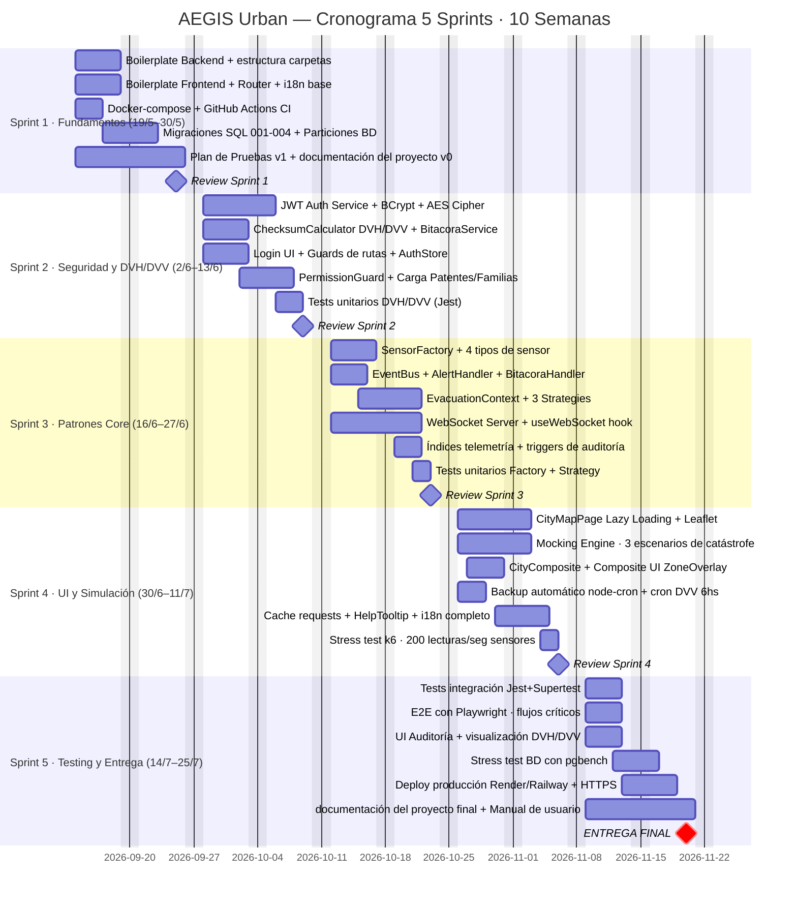

<!-- Archivo generado por docs/unificado/generar-markdown.cjs. No editar: cambiar el maestro o las fuentes y regenerar. -->
[← Introducción y alcance](01-introduccion.md) · [Índice](00-portada.md#índice-general) · [Etapa 2 — Diseño y arquitectura →](03-etapa-2-diseno.md)

# 2. Etapa 1 — Análisis y factibilidad

## 2.1 Problema y objetivos

La información sobre amenazas urbanas puede estar repartida entre sensores, tableros internos y canales de organismos distintos. Una vista común puede ayudar a localizar eventos y coordinar tareas, pero un prototipo técnico no sustituye la confirmación ni las instrucciones de una autoridad de emergencia.

**Objetivo general.** Construir una aplicación web que reúna telemetría, alertas y herramientas de ejercicio para apoyar la observación y coordinación operativa en la ciudad, y que informe a la ciudadanía con datos rotulados por su origen.

**Objetivos específicos.**

- Mostrar la condición, última lectura y ubicación de sensores.
- Consultar alertas por estado, severidad, período y zona.
- Conservar responsables y marcas de tiempo de las acciones, con integridad verificable (DVH/DVV).
- Ensayar eventos con escenarios reproducibles y sensores simulados.
- Ofrecer una vista ciudadana con clima real y alerta por ubicación, respetando la Ley 25.326.
- Garantizar respaldo, restauración y trazabilidad de los datos.

## 2.2 Contexto y actores

| Actor | Casos de uso |
|---|---|
| Tránsito | Iniciar y cerrar sesión, revisar mapa, telemetría y alertas |
| Defensa Civil | Reconocer una alerta, solicitar el plan de evacuación, ejecutar simulaciones |
| Auditor | Consultar la bitácora y verificar su integridad |
| Administrador | Gestionar usuarios, familias, respaldos y restauración |
| Ciudadanía | Ver clima y avisos, recibir aviso por ubicación, gestionar sus datos |
| Motor de simulación | Emitir lecturas marcadas como simuladas y activar las reglas de alerta |

## 2.3 Fuentes de alertas e investigación (protocolo CAP)

AEGIS recibe detecciones de sensores y el clima real de Open-Meteo. Cada alerta preserva su origen (REAL o SIMULADO), la hora de emisión, el área afectada y su estado.

El **Common Alerting Protocol (CAP)** es el formato interoperable para comunicar emisor, urgencia, severidad, certeza, período y área geográfica. Si una autoridad no publica CAP, conviene sumar un adaptador dedicado que normalice el aviso al modelo interno sin ocultar su fuente. **Estado actual:** AEGIS no está conectado a ninguna API oficial de alertas; el adaptador CAP es trabajo futuro y no se presenta nada como instrucción oficial.

## 2.4 Análisis de factibilidades

| Factibilidad | Análisis | Conclusión |
|---|---|---|
| Humana | Equipo de 5 personas con roles complementarios (documentación y QA, frontend, backend, seguridad y datos, integración) durante 10 semanas | Viable |
| Técnica | Stack estándar (Node.js, React, PostgreSQL) con herramientas libres; el código corre en un equipo con Docker, y la prueba de carga y las pruebas en vivo lo confirman | Viable y demostrada en el prototipo |
| Económica | Sin licencias: software libre, Open-Meteo gratuito y SMTP de volumen bajo. Un uso público requeriría hosting, SMS real y una fuente oficial | Viable para el prototipo; costos a definir para operar |
| Legal | **Ley 25.326** de Protección de Datos Personales: consentimiento expreso y versionado, ubicación opcional y revocable, derecho de acceso (descarga de datos) y baja con anonimización; la AAIP es la autoridad de control | Aplicada en el código; los textos requieren revisión de un profesional |

## 2.5 Límites y alcance

Quedan fuera de alcance el despacho de equipos de emergencia, el cálculo certificado de rutas, las comunicaciones oficiales de emergencia y la integración con organismos. La operación pública depende de acuerdos, fuentes autorizadas y un responsable institucional para corregir o retirar avisos.

## 2.6 Planificación estratégica

El proyecto se planificó en **5 sprints de 2 semanas (10 semanas)**. El detalle original por área figura a continuación y se contrasta con lo realizado en la sección 5.1.

### Cronograma General (Gantt)

---

### Sprint 1 — Fundamentos e Infraestructura (14/09 – 25/09)

**Objetivo:** El proyecto compila y corre localmente en la máquina de todos al cierre del sprint.  
**Testing:** Setup Jest + Vitest. Test: `GET /api/health` devuelve `200 OK`.

| Área | Tecnología | Tareas |
|---|---|---|
| Documentación y QA | Documentación | Crear repo GitHub + política de ramas (`feat/`, `fix/`, `chore/`). Redactar documentación del proyecto Sección 1. Configurar tablero GitHub Projects. Definir criterios de aceptación. |
| Frontend | React | `Vite + React + TS`. Configurar `AppRouter.tsx` con `React.lazy()`. Instalar `i18next`; crear `es.json` + `en.json` con 20 claves base. Implementar `LoginPage.tsx` (UI sola). Instalar Zustand. |
| Backend | Node.js | Boilerplate `Express + TS`. Estructura de carpetas completa. Middleware global: CORS, helmet, morgan, JSON. Endpoint `GET /api/health`. Configurar `jest.config.ts`. Primer test unitario. |
| Seguridad y BD | PostgreSQL | PostgreSQL 16 local + Docker. Migraciones: `001_users.sql`, `002_patents_families.sql`, `003_sensors.sql`, `004_audit_log.sql`. `SENSOR_READING` con `PARTITION BY RANGE(recorded_at)`. `REVOKE UPDATE, DELETE ON audit_log`. |
| Integración y WebSockets | Integración | `docker-compose.yml` con postgres + backend + frontend. GitHub Actions `ci.yml`. Definir y documentar Git Flow. Verificar `docker compose up` levanta todo. |

---

### Sprint 2 — Seguridad y Control de Acceso (28/09 – 09/10)

**Objetivo:** Auth completo con JWT, Patentes/Familias funcionando, DVH/DVV correctos.  
**Testing:** Tests unitarios `ChecksumCalculator`: insertar fila → DVH correcto; modificar byte → DVH cambia; borrar fila 1 → DVV₂ inválido.

| Área | Tecnología | Tareas |
|---|---|---|
| Documentación y QA | Documentación | Documentar APIs en Swagger (auth, users). Plan de pruebas UC-01, UC-02, DVH/DVV. Actualizar documentación del proyecto Sección 2. |
| Frontend | React | Integrar `LoginPage` con backend. `AuthContext.tsx` con token + árbol de permisos. HOC `ProtectedRoute`. Mostrar/ocultar UI según permisos. `LanguageSwitcher.tsx`. |
| Backend | Node.js | `auth.service.ts` (login, logout, blacklist). `user.service.ts`. `DispatchCore.ts` (Singleton básico). i18n backend con `i18next-node`. `GET /api/users/me`. |
| Seguridad y BD | PostgreSQL | `AESCipher.ts` (AES-256-CBC, IV aleatorio, clave en `.env`). `BCryptHasher.ts` (factor 12). `ChecksumCalculator.ts` + `BitacoraService.ts` completos. `PermissionGuard.ts` middleware. Seeds: familias + patentes + usuario admin. |
| Integración y WebSockets | Integración | Flujo completo `LoginPage → POST /auth/login → JWT → AuthStore → ProtectedRoute`. `TokenRefreshService` (interceptor Axios, renueva JWT 60s antes de vencer). Tests integración login/logout/refresh. |

---

### Sprint 3 — Patrones Core y Telemetría Real-time (12/10 – 23/10)

**Objetivo:** Sensores emiten lecturas, `EventBus` las procesa, alertas se crean, bitácora se escribe, frontend recibe todo via WebSocket sin polling.  
**Testing:** Tests `SensorFactory` (crea tipo correcto). Tests cada Strategy con grafo mock.

| Área | Tecnología | Tareas |
|---|---|---|
| Documentación y QA | Documentación | Documentar APIs sensores + telemetría + alertas. Actualizar DER. Definir escenarios de stress test. |
| Frontend | React | `DashboardPage.tsx` con widgets. `AlertPanel.tsx` + `AlertCard.tsx` + `AlertBadge.tsx`. `SensorCard.tsx`. Conectar `useWebSocket.ts` a `alertStore` + `sensorStore`. |
| Backend | Node.js | `SensorFactory.ts` + `BaseSensor` + 4 subclases. `EventBus.ts`. `AlertHandler.ts` + `BitacoraHandler.ts`. `EvacuationContext.ts` + 3 strategies. `POST /api/telemetry` + `GET /api/alerts`. |
| Seguridad y BD | PostgreSQL | `CREATE INDEX CONCURRENTLY idx_sr_sensor_date ON sensor_reading(id_sensor, recorded_at DESC)`. Trigger `trg_auto_audit` en PL/pgSQL. Verificar `EXPLAIN ANALYZE` usa Partition Pruning. |
| Integración y WebSockets | Integración | `WebSocketServer.ts` con socket.io. `WebSocketEmitter.ts` (Observer). Adjuntar al EventBus en bootstrap. `useWebSocket.ts` en frontend. Probar flujo completo: telemetría crítica → EventBus → WebSocket → frontend. |

---

### Sprint 4 — UI Ciudad y Motor de Simulación (26/10 – 06/11)

**Objetivo:** Mapa de ciudad funcional con Lazy Loading. Mocking Engine inyecta 3 tipos de catástrofe.  
**Testing:** Stress test k6: 200 lecturas/seg durante 60s. Medir P95 latencia WebSocket, CPU backend, tiempo inserción `SENSOR_READING`.

| Área | Tecnología | Tareas |
|---|---|---|
| Documentación y QA | Documentación | UX Review. Documentar 3 escenarios de simulación. Escribir script stress test k6. Reportar bugs. |
| Frontend | React | `CityMapPage.tsx` con `React.lazy()` + Leaflet. `SensorMarker.tsx`, `ZoneOverlay.tsx`, `EvacuationRoute.tsx`. `HelpTooltip.tsx`. Completar traducciones `es.json` + `en.json`. |
| Backend | Node.js | `SimulationEngine.ts` (setInterval configurable). `FloodScenario.ts`, `FireScenario.ts`, `PowerOutScenario.ts`. `CityComposite.ts`/`CityLeaf.ts` + servicio que construye árbol desde BD. `POST /api/simulation/start` + `DELETE /api/simulation/:id/stop`. |
| Seguridad y BD | PostgreSQL | `BackupScheduler.ts` (node-cron: pg_dump diario 03:00hs → `/backups/aegis_YYYYMMDD.sql`). `RestoreService.ts`. Cron verificación DVH/DVV cada 6hs. Script de mantenimiento: genera partición del próximo trimestre automáticamente. |
| Integración y WebSockets | Integración | `RequestCache.ts` frontend (TTL por endpoint). Integrar `SimulationPage.tsx`. Verificar Lazy Loading en DevTools → Network. Ejecutar k6 y reportar resultados. |

---

### Sprint 5 — Testing, Auditoría UI y Entrega Final (09/11 – 20/11)

**Objetivo:** Sistema completo, tests pasando, en producción con HTTPS, documentación del proyecto terminada.  
**Testing:** Jest + Supertest integración completa. Playwright E2E 5 flujos críticos. pgbench stress BD.

| Área | Tecnología | Tareas |
|---|---|---|
| Documentación y QA | Documentación | documentación del proyecto completa (todas las secciones). Manual de usuario. Slides presentación. Checklist OWASP Top 10 básico. Coordinar demo final. |
| Frontend | React | `AuditPage.tsx`: tabla paginada de `AUDIT_LOG` con columnas DVH/DVV. Botón "Verificar Integridad" → `POST /api/audit/verify` → modal con resultado. `ExportButton` (descarga CSV). Ajustes responsive finales. |
| Backend | Node.js | Manejo de errores global completo. Optimizar queries N+1. Swagger documentación completa. Code review final. |
| Seguridad y BD | PostgreSQL | `pgbench -c 50 -j 4 -T 300` sobre `SENSOR_READING`, documentar TPS. Verificar Partition Pruning en producción. Ejecutar verificación DVH/DVV sobre tabla completa, documentar resultado. |
| Integración y WebSockets | Integración | Deploy Render (backend) + Vercel (frontend). HTTPS + variables de entorno prod + CORS producción. E2E Playwright 5 flujos. Suite completa en CI/CD — pipeline debe pasar en `main`. |

---

### Riesgos

| Riesgo | Probabilidad | Impacto | Mitigación |
|---|---|---|---|
| Datos simulados confundidos con oficiales | Media | Alto | Rótulo REAL/SIMULADO en cada aviso y recordatorio de 911/100/103 |
| Fallo de la fuente de clima | Media | Medio | Caché con TTL y mensaje de degradación en la vista ciudadana |
| Pérdida o corrupción de datos | Baja | Alto | Respaldo diario con SHA-256, simulacro de restauración y DVH/DVV |
| Incumplimiento de la Ley 25.326 | Media | Alto | Consentimientos versionados, ubicación opcional y baja con anonimización; revisión legal pendiente |
| Estado en memoria si se escala a varias instancias | Media al escalar | Medio | Limitador y caché ya compartidos en PostgreSQL (migración 017); las simulaciones activas aún requieren un worker persistente |
| Alcance mayor que el tiempo disponible | Alta | Medio | Priorización por sprint; brechas declaradas en la sección 5.1 |

**Revisión SQA de la etapa 1:** objetivos medibles definidos; actores identificados; riesgos con mitigación; factibilidad legal tratada.

---

---

[← Introducción y alcance](01-introduccion.md) · [Índice](00-portada.md#índice-general) · [Etapa 2 — Diseño y arquitectura →](03-etapa-2-diseno.md)
