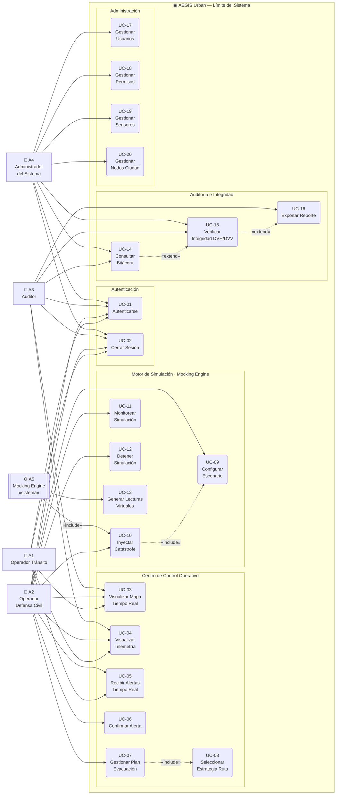
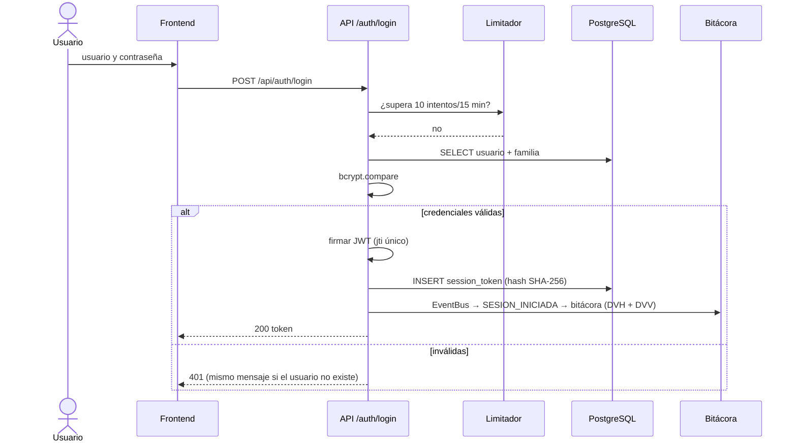
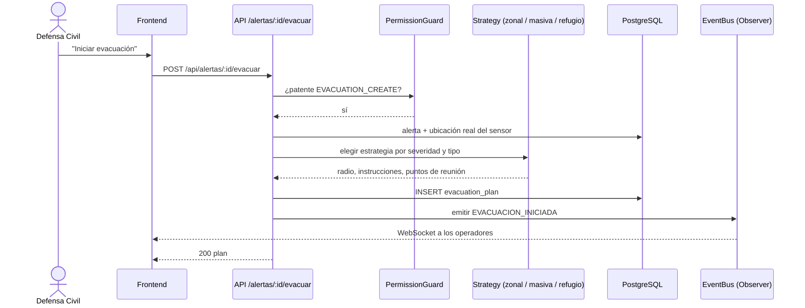
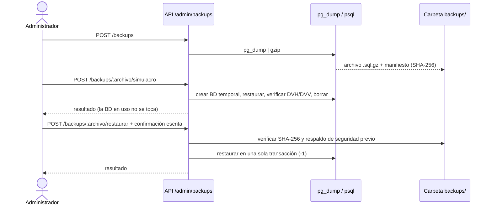
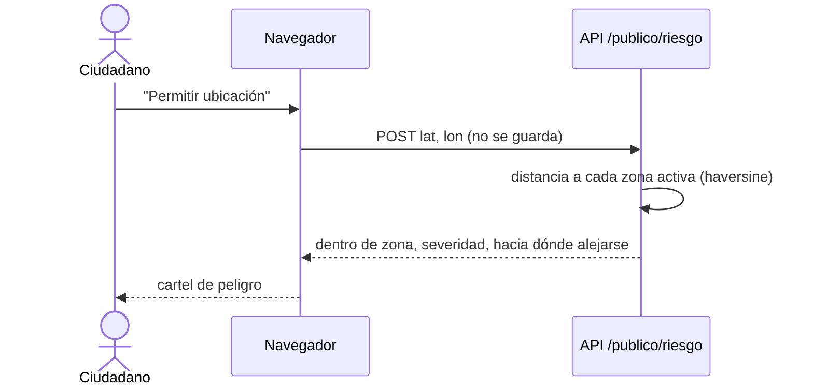

```mermaid
classDiagram
    direction TB

    %% ═══════════════════════════════════════
    %% PATRÓN SINGLETON
    %% ═══════════════════════════════════════
    class EmergencyKernel {
        -instance: EmergencyKernel$
        -sensorFactory: SensorFactory
        -evacuationContext: EvacuationContext
        -eventBus: EventBus
        -activeSensors: Map~string,BaseSensor~
        -activeAlerts: Alert[]
        -EmergencyKernel()
        +getInstance()$ EmergencyKernel
        +registerSensor(type: SensorType, cfg: SensorConfig) void
        +processReading(reading: SensorReading) void
        +dispatchEvacuation(alertId: string, strategy: string) Route
        +getSystemStatus() SystemStatus
    }

    %% ═══════════════════════════════════════
    %% PATRÓN FACTORY METHOD
    %% ═══════════════════════════════════════
    class SensorFactory {
        +createSensor(type: SensorType, cfg: SensorConfig)$ BaseSensor
    }
    class BaseSensor {
        <<abstract>>
        #sensorId: string
        #serialCode: string
        #location: GeoPoint
        #status: SensorStatus
        +read()* SensorReading
        +validate(value: number)* boolean
        +getAlertThreshold()* number
    }
    class FloodSensor {
        -waterLevelThreshold: number
        +read() SensorReading
        +validate(value: number) boolean
        +getAlertThreshold() number
    }
    class FireSensor {
        -temperatureThreshold: number
        +read() SensorReading
        +validate(value: number) boolean
        +getAlertThreshold() number
    }
    class WindSensor {
        -windSpeedThreshold: number
        +read() SensorReading
        +validate(value: number) boolean
        +getAlertThreshold() number
    }

    %% ═══════════════════════════════════════
    %% PATRÓN OBSERVER
    %% ═══════════════════════════════════════
    class EventBus {
        -observers: Map~string,IObserver[]~
        +attach(eventName: string, obs: IObserver) void
        +detach(eventName: string, obs: IObserver) void
        +notify(event: DomainEvent) void
    }
    class IObserver {
        <<interface>>
        +update(event: DomainEvent) Promise~void~
    }
    class AlertHandler {
        -alertService: AlertService
        +update(event: DomainEvent) Promise~void~
    }
    class WebSocketEmitter {
        -socketServer: SocketIOServer
        +update(event: DomainEvent) Promise~void~
    }
    class BitacoraHandler {
        -bitacoraService: BitacoraService
        +update(event: DomainEvent) Promise~void~
    }

    %% ═══════════════════════════════════════
    %% PATRÓN STRATEGY
    %% ═══════════════════════════════════════
    class EvacuationContext {
        -currentStrategy: IEvacuationStrategy
        +setStrategy(strategy: IEvacuationStrategy) void
        +executeRoute(origin: GeoPoint, dest: GeoPoint) Route
    }
    class IEvacuationStrategy {
        <<interface>>
        +calculate(origin: GeoPoint, dest: GeoPoint, graph: CityGraph) Route
    }
    class ShortestPathStrategy {
        +calculate(origin: GeoPoint, dest: GeoPoint, graph: CityGraph) Route
    }
    class SafestPathStrategy {
        -activeDangerZones: Zone[]
        +calculate(origin: GeoPoint, dest: GeoPoint, graph: CityGraph) Route
    }
    class CapacityBasedStrategy {
        -currentLoads: Map~string,number~
        +calculate(origin: GeoPoint, dest: GeoPoint, graph: CityGraph) Route
    }

    %% ═══════════════════════════════════════
    %% PATRÓN COMPOSITE — Jerarquía Ciudad
    %% ═══════════════════════════════════════
    class ICityComponent {
        <<interface>>
        +getName() string
        +getNodeType() NodeType
        +getSensors() BaseSensor[]
        +getChildren() ICityComponent[]
        +add(c: ICityComponent) void
    }
    class CityComposite {
        -name: string
        -nodeType: NodeType
        -children: ICityComponent[]
        +getName() string
        +getNodeType() NodeType
        +getSensors() BaseSensor[]
        +getChildren() ICityComponent[]
        +add(c: ICityComponent) void
    }
    class CityLeaf {
        -name: string
        -sensors: BaseSensor[]
        +getName() string
        +getNodeType() NodeType
        +getSensors() BaseSensor[]
        +getChildren() ICityComponent[]
        +add(c: ICityComponent) void
    }

    %% ═══════════════════════════════════════
    %% PATRÓN COMPOSITE — Patentes y Familias
    %% ═══════════════════════════════════════
    class IPermissionComponent {
        <<interface>>
        +hasPermission(resource: string, method: string) boolean
        +getCode() string
    }
    class FamilyComposite {
        -familyName: string
        -children: IPermissionComponent[]
        +hasPermission(resource: string, method: string) boolean
        +getCode() string
        +add(c: IPermissionComponent) void
    }
    class PatentLeaf {
        -code: string
        -resource: string
        -httpMethod: HttpMethod
        +hasPermission(resource: string, method: string) boolean
        +getCode() string
    }

    %% ═══════════════════════════════════════
    %% INTEGRIDAD DVH/DVV
    %% ═══════════════════════════════════════
    class ChecksumCalculator {
        -SEP: string$
        +calculateDVH(row: AuditLogRow)$ string
        +calculateChainedDVV(prev: string, dvh: string)$ string
        +validateTableIntegrity(rows: AuditLogRow[])$ IntegrityResult
    }
    class BitacoraService {
        -db: Pool
        +logEvent(event: AuditEvent) Promise~void~
        +verifyIntegrity(userId: number) Promise~void~
    }

    %% ═══════════════════════════════════════
    %% RELACIONES
    %% ═══════════════════════════════════════

    EmergencyKernel ..> SensorFactory      : usa ▶ crea sensores
    EmergencyKernel *-- EvacuationContext  : contiene
    EmergencyKernel *-- EventBus           : contiene
    EmergencyKernel o-- BaseSensor         : gestiona activos
    EmergencyKernel ..> CityComposite      : consulta estructura

    SensorFactory ..> BaseSensor    : creates
    BaseSensor <|-- FloodSensor     : extiende
    BaseSensor <|-- FireSensor      : extiende
    BaseSensor <|-- WindSensor      : extiende

    EventBus "1" --> "*" IObserver  : notifica
    IObserver <|.. AlertHandler     : implementa
    IObserver <|.. WebSocketEmitter : implementa
    IObserver <|.. BitacoraHandler  : implementa
    BitacoraHandler --> BitacoraService : delega

    EvacuationContext --> IEvacuationStrategy     : delega
    IEvacuationStrategy <|.. ShortestPathStrategy  : implementa
    IEvacuationStrategy <|.. SafestPathStrategy    : implementa
    IEvacuationStrategy <|.. CapacityBasedStrategy : implementa

    ICityComponent <|.. CityComposite      : implementa
    ICityComponent <|.. CityLeaf           : implementa
    CityComposite "1" *-- "*" ICityComponent : children

    IPermissionComponent <|.. FamilyComposite : implementa
    IPermissionComponent <|.. PatentLeaf      : implementa
    FamilyComposite "1" *-- "*" IPermissionComponent : children

    BitacoraService --> ChecksumCalculator : usa
```

<!-- Archivo generado por docs/unificado/generar-markdown.cjs. No editar: cambiar el maestro o las fuentes y regenerar. -->
[← Etapa 1 — Análisis y factibilidad](02-etapa-1-analisis.md) · [Índice](00-portada.md#índice-general) · [Etapa 3 — Implementación y testing →](04-etapa-3-implementacion.md)

# 3. Etapa 2 — Diseño y arquitectura

## 3.1 Elección tecnológica justificada


| Componente | Elección | Justificación |
|---|---|---|
| **Backend** | Node.js + TypeScript + Express | Un solo lenguaje en todo el stack (TS), ecosistema npm compartido con el frontend, socket.io nativo para WebSockets (Observer), más fácil de aprender y de mantener |
| **Base de Datos** | PostgreSQL 16 | Soporte nativo de particionamiento por rango (`PARTITION BY RANGE`), `jsonb`, índices parciales, y pg_cron para backups automáticos |
| **Frontend** | React 18 + TypeScript + Vite | |

---


## 3.2 Diseño de la base de datos

El modelo lógico (DER) y su descripción detallada se incluyen en la sección 3.5. El esquema se versiona en `aegis-urban-backend/database/migrations/`; una migración aplicada no se edita, los cambios van en una nueva.

| Migración | Contenido |
|---|---|
| 001 | Usuarios, familias, patentes y tokens de sesión |
| 002 | Nodos de ciudad, tipos de sensor, sensores y lecturas (`sensor_reading` particionada por trimestre) |
| 003 | Alertas, planes de evacuación y escenarios de simulación |
| 004 | Bitácora (`audit_log`) y su control de integridad |
| 005 | Datos iniciales |
| 006–008 | Triggers de telemetría, ciclo de vida de la alerta y calidad del aire |
| 009 | Permisos de la API (recurso y método por patente) |
| 010–011 | Escenarios configurables y fecha de actualización de alertas |
| 012 | Rol CIUDADANO y consentimientos (`user_consent`) |
| 013 | Verificación de perfil por códigos (`verification_code`) |
| 014 | Estrategias de evacuación |
| 015 | Particiones futuras automáticas y respaldos |
| 016 | Bitácora inmutable (triggers contra UPDATE, DELETE y TRUNCATE) |
| 017 | Estado compartido entre instancias: `rate_limit` (limitador) y `shared_cache` (caché) |
| 018 | Unifica OPERADOR_CRISIS en TRANSITO (eran el mismo rol) |

**Particionamiento trimestral.** `sensor_reading` se particiona por rango de fecha, una partición por trimestre. La función `asegurar_particiones_sensor_reading(n)` crea las futuras; corre al arrancar y cada 6 horas. Antes de la migración 015 la última partición terminaba el 31/12/2026 y las lecturas habrían fallado desde el 01/01/2027.


## 3.3 Especificación de requerimientos

### Requerimientos funcionales


| ID | Requerimiento | Implementación |
|---|---|---|
| RF-01 | Autenticación JWT con revocación por sesión | `auth/*`, tabla `session_token` |
| RF-02 | Autorización por patentes/familias en cada endpoint; la interfaz muestra u oculta botones y secciones según las patentes que devuelve el login (`permisos`), no según el nombre del rol | `PermissionGuard`, tablas `patent` y `family_patent` (recurso + método HTTP) |
| RF-03 | Registro de ciudadanía con consentimientos y verificación de correo y celular | `registro.service`, `verificacion.service` |
| RF-04 | Sensores, lecturas y estadísticas | `sensors/*`, `telemetry/*` |
| RF-05 | Ciclo de vida de alertas (activa → reconocida → resuelta) con filtros y paginación | `alerts/*` |
| RF-06 | Plan de evacuación con estrategia según severidad y tipo (Strategy) | `core/strategies/*` |
| RF-07 | Escenarios de simulación configurables | `simulation/*` |
| RF-08 | Vista pública: clima real, avisos y riesgo por ubicación | `public/*` |
| RF-09 | Bitácora con DVH por fila y DVV encadenado; inmutable | `integrity/*`, migración 016 |
| RF-10 | Respaldo, restauración y simulacro de restauración | `backup/*` |
| RF-11 | Derechos del titular: descargar datos y darse de baja | `auth/mis-datos` |
| RF-12 | Interfaz en español e inglés, con ayuda contextual | `i18n/*`, página `/ayuda` |
| RF-13 | Tiempo real por WebSocket con control de permisos | `websocket/SocketServer` |


### Requerimientos no funcionales


| ID | Categoría | Requerimiento | Cómo se cumple / verifica |
|---|---|---|---|
| RNF-01 | Seguridad | Contraseñas con hash irreversible; datos personales con cifrado reversible | bcrypt (factor 12) y AES-256 (el teléfono se cifra al registrarse; las columnas `full_name_enc` y `dni_enc` están previstas pero hoy el registro no las completa); `integracion.test.ts` |
| RNF-02 | Seguridad | Fuerza bruta limitada y registrada | Limitador compartido (PostgreSQL): 10 intentos / 15 min por usuario e IP; los fallos quedan en la bitácora; `seguridad.test.ts` |
| RNF-03 | Seguridad | Sin inyección SQL ni manipulación de JWT | Consultas parametrizadas, `algorithms: ["HS256"]`; `seguridad.test.ts` |
| RNF-04 | Integridad | La bitácora no se puede alterar sin que se detecte | DVH/DVV + triggers que rechazan UPDATE/DELETE/TRUNCATE |
| RNF-05 | Disponibilidad de datos | Respaldo diario con retención y restauración probada | `backup/*`, simulacro en base temporal |
| RNF-06 | Rendimiento | Lecturas p95 < 100 ms con 20 usuarios concurrentes | Resultados |
| RNF-07 | Rendimiento | Respuestas comprimidas, caché y precarga | gzip, caché de peticiones con TTL, precarga de rutas, lazy loading |
| RNF-08 | Escalabilidad | Tablas de lecturas particionadas por trimestre | Migración 015 + mantenimiento automático |
| RNF-09 | Usabilidad | Dos idiomas y ayuda | 551 claves es/en con prueba de paridad |
| RNF-10 | Privacidad | Ley 25.326: consentimiento expreso, ubicación opcional y no persistida | Anexo E del documento funcional |
| RNF-11 | Mantenibilidad | Patrones de diseño y pruebas automatizadas | Estrategia de pruebas |


## 3.4 Modelado UML

### Actores y casos de uso

Los **20 casos de uso** del diseño original (UC-01 a UC-20) son los siguientes. Los UC-16 (exportar reporte de auditoría), UC-19 (gestionar sensores) y UC-20 (gestionar nodos de ciudad) fueron diseñados pero **no están implementados** en esta versión; el resto sí.


#### Actores del Sistema

| ID | Actor | Tipo | Descripción funcional |
|---|---|---|---|
| A1 | Operador Tránsito | Externo — Humano | Monitorea el mapa en tiempo real, visualiza telemetría y recibe alertas automáticas |
| A2 | Operador Defensa Civil | Externo — Humano | Gestiona el ciclo completo de crisis: confirma alertas, activa evacuaciones, opera el Mocking Engine |
| A3 | Auditor | Externo — Humano | Consulta la bitácora inmutable, verifica integridad DVH/DVV y exporta reportes |
| A4 | Administrador Sistema | Externo — Humano | Gestiona usuarios, permisos (Patentes/Familias), sensores y nodos geográficos |
| A5 | Mocking Engine | Interno — **Sistema** | Actor de sistema que genera lecturas virtuales e inyecta escenarios de catástrofe |

#### Catálogo de Casos de Uso

| Código | Nombre | Actor(es) | Módulo |
|---|---|---|---|
| UC-01 | Autenticarse en el Sistema | A1, A2, A3, A4 | Auth |
| UC-02 | Cerrar Sesión | A1, A2, A3, A4 | Auth |
| UC-03 | Visualizar Mapa de Ciudad en Tiempo Real | A1, A2, A3 | Operaciones |
| UC-04 | Visualizar Telemetría de Sensores | A1, A2, A3 | Operaciones |
| UC-05 | Recibir Alertas en Tiempo Real | A1, A2 | Operaciones |
| UC-06 | Confirmar Alerta (Acknowledge) | A2 | Operaciones |
| UC-07 | Gestionar Plan de Evacuación | A2 | Operaciones |
| UC-08 | Seleccionar Estrategia de Evacuación | A2 | Operaciones |
| UC-09 | Configurar Escenario de Simulación | A2 | Simulación |
| UC-10 | Inyectar Catástrofe | A2, A5 | Simulación |
| UC-11 | Monitorear Simulación Activa | A2 | Simulación |
| UC-12 | Detener Simulación | A2 | Simulación |
| UC-13 | Generar Lecturas Virtuales de Sensores | A5 | Simulación |
| UC-14 | Consultar Bitácora de Auditoría | A3, A4 | Auditoría |
| UC-15 | Verificar Integridad DVH/DVV | A3, A4 | Auditoría |
| UC-16 | Exportar Reporte de Auditoría | A3 | Auditoría |
| UC-17 | Gestionar Usuarios | A4 | Administración |
| UC-18 | Gestionar Permisos (Patentes/Familias) | A4 | Administración |
| UC-19 | Gestionar Sensores | A4 | Administración |
| UC-20 | Gestionar Nodos de Ciudad | A4 | Administración |

#### Relaciones Include / Extend

| Relación | Tipo | Explicación |
|---|---|---|
| UC-07 `<<include>>` UC-08 | Include | Gestionar evacuación **siempre** requiere seleccionar una estrategia de ruta |
| UC-10 `<<include>>` UC-09 | Include | Inyectar catástrofe **siempre** requiere un escenario configurado previamente |
| UC-14 `<<extend>>` UC-15 | Extend | Al consultar la bitácora, el usuario **puede opcionalmente** lanzar verificación de integridad |
| UC-15 `<<extend>>` UC-16 | Extend | Al verificar integridad, el usuario **puede opcionalmente** exportar el reporte resultante |
| A5 `<<include>>` UC-10 | Include | El Mocking Engine **siempre** participa en la ejecución de UC-10 como actor interno |

#### Diagrama Mermaid

> **Nota:** Mermaid no soporta diagramas UML de Casos de Uso de forma nativa. Se usa `flowchart LR` como representación equivalente. Actores humanos: rectángulo `[...]`. Actor de sistema (Mocking Engine): doble rectángulo `[[...]]`.



---


### Diagrama de clases y patrones de diseño

Los cinco patrones exigidos están en el código: **Singleton** (`DatabaseConnection`, `EventBus`), **Factory Method** (`core/factory/SensorFactory.ts`), **Observer** (`EventBus` y sus handlers), **Strategy** (estrategias de evacuación en `core/strategies`) y **Composite** (patentes y familias en `core/composite`).


#### Inventario de Patrones

| Patrón | Clase Principal | Propósito en AEGIS Urban |
|---|---|---|
| **Singleton** | `EmergencyKernel` | Única instancia que orquesta sensores, alertas y evacuaciones |
| **Factory Method** | `SensorFactory` | Crea `FloodSensor`, `FireSensor`, etc. según tipo configurado en BD |
| **Observer** | `EventBus` + `IObserver` | Desacopla detección de lecturas críticas de alertas, logs y WebSocket |
| **Strategy** | `EvacuationContext` | Intercambia en runtime el algoritmo de cálculo de rutas de evacuación |
| **Composite (ciudad)** | `ICityComponent` | Trata Bloque individual y Ciudad completa con la misma interfaz recursiva |
| **Composite (permisos)** | `IPermissionComponent` | `FamilyComposite.hasPermission()` evalúa permisos recursivamente |

#### Diagrama Mermaid



---


### Especificación dinámica (DSS) de los flujos críticos


#### Inicio de sesión



#### Evacuación de una alerta



#### Respaldo y restauración



#### Aviso por ubicación (ciudadanía)




### Especificación de casos de uso clave


| CU | Actor | Precondición | Flujo principal | Alternativas | Postcondición |
|---|---|---|---|---|---|
| CU-01 Iniciar sesión | Usuario | Cuenta activa | Ingresa credenciales → API valida → recibe JWT | Credenciales inválidas (401); bloqueo por intentos (429) | Sesión registrada y auditada |
| CU-02 Reconocer alerta | Defensa Civil / Operador con patente | Alerta ACTIVA | Pulsa «Reconocer» → estado ACKNOWLEDGED con actor y fecha | Sin patente (403); alerta ya reconocida | Bitácora con la acción |
| CU-03 Iniciar evacuación | Defensa Civil | Alerta reconocida | Pide plan → estrategia automática → plan visible | Sin permiso (403) | `evacuation_plan` creado |
| CU-04 Registrarse | Ciudadano | — | Datos + consentimientos → códigos por correo y celular → perfil verificado | Código vencido/erróneo (5 intentos) | Cuenta CIUDADANO verificada |
| CU-05 Verificar integridad | Auditor | — | «Verificar integridad» → recalcula DVH/DVV | Fila corrupta: se informa cuál | Resultado mostrado |
| CU-06 Respaldar y restaurar | Administrador | — | Crear → simulacro → restaurar con confirmación | Hash no coincide: se rechaza | Datos recuperados |
| CU-07 Cambiar idioma | Cualquiera | — | Selector ES/EN | — | Preferencia guardada en el navegador |

El diagrama de casos de uso completo (actores, include/extend) está en 02-analisis-diseno.md.


## 3.5 Arquitectura técnica

### Visión de contexto y componentes


### Estructura de carpetas


```
aegis-urban-backend/
│
├── src/
│   │
│   ├── config/                              # Configuración global
│   │   ├── database.ts                      # Pool de conexión PostgreSQL (usa Singleton)
│   │   ├── env.ts                           # Validación y tipado de variables de entorno
│   │   ├── i18n.ts                          # Setup de internacionalización backend
│   │   └── socket.ts                        # Configuración inicial del servidor WebSocket
│   │
│   │
│   ├── core/                                # ★ NÚCLEO DE PATRONES DE DISEÑO ★
│   │   │
│   │   ├── singleton/
│   │   │   └── DispatchCore.ts              # [SINGLETON] Núcleo de despacho central.
│   │   │                                    # Única instancia que coordina alertas,
│   │   │                                    # sensores activos y rutas de evacuación.
│   │   │                                    # getInstance() retorna siempre la misma ref.
│   │   │
│   │   ├── factory/
│   │   │   ├── SensorFactory.ts             # [FACTORY METHOD] createSensor(type: SensorType)
│   │   │   │                                # Decide qué subclase instanciar en runtime.
│   │   │   └── sensors/
│   │   │       ├── BaseSensor.ts            # Clase abstracta con interfaz común
│   │   │       ├── FloodSensor.ts           # Producto concreto: Sensor de inundación
│   │   │       ├── FireSensor.ts            # Producto concreto: Sensor de incendio
│   │   │       ├── WindSensor.ts            # Producto concreto: Sensor de viento
│   │   │       └── AirQualitySensor.ts      # Producto concreto: Calidad del aire
│   │   │
│   │   ├── observer/
│   │   │   ├── EventBus.ts                  # [OBSERVER] Bus de eventos interno del servidor.
│   │   │   │                                # Los sensores son Subject, los handlers son Observer.
│   │   │   ├── interfaces/
│   │   │   │   ├── ISubject.ts              # Interface: attach(), detach(), notify()
│   │   │   │   └── IObserver.ts             # Interface: update(event: DomainEvent)
│   │   │   └── handlers/
│   │   │       ├── AlertHandler.ts          # Observer: escucha lecturas críticas → crea alerta
│   │   │       ├── WebSocketEmitter.ts      # Observer: emite evento al frontend por socket.io
│   │   │       └── BitacoraHandler.ts       # Observer: escribe en la bitácora inmutable
│   │   │
│   │   ├── strategy/
│   │   │   ├── EvacuationContext.ts         # [STRATEGY] Contexto que ejecuta la estrategia activa.
│   │   │   │                                # setStrategy(s) + executeRoute() en runtime.
│   │   │   ├── interfaces/
│   │   │   │   └── IEvacuationStrategy.ts   # Interface: calculate(origin, destination): Route
│   │   │   └── strategies/
│   │   │       ├── ShortestPathStrategy.ts  # Estrategia A: Dijkstra — ruta más corta
│   │   │       ├── SafestPathStrategy.ts    # Estrategia B: evita zonas de peligro activo
│   │   │       └── CapacityBasedStrategy.ts # Estrategia C: balancea carga de personas
│   │   │
│   │   └── composite/
│   │       │
│   │       ├── city/                        # [COMPOSITE] Jerarquía geográfica de la ciudad
│   │       │   ├── ICityComponent.ts        # Interface: getName(), getChildren(), addChild()
│   │       │   ├── CityLeaf.ts              # Hoja: Bloque, Edificio — no tiene hijos
│   │       │   └── CityComposite.ts         # Compuesto: Ciudad > Distrito > Zona
│   │       │                                # Permite operaciones recursivas (ej: getSensors())
│   │       │
│   │       └── patent-family/               # [COMPOSITE] Control de acceso por Patentes/Familias
│   │           ├── IPermissionComponent.ts  # Interface: hasPermission(resource, method): bool
│   │           ├── PatentLeaf.ts            # Hoja: permiso atómico (ej: POST /alerts)
│   │           └── FamilyComposite.ts       # Compuesto: Familia agrupa patentes y subfamilias.
│   │                                        # hasPermission() hace OR recursivo de hijos.
│   │
│   │
│   ├── modules/                             # Módulos de feature (MVC por módulo)
│   │   │
│   │   ├── auth/
│   │   │   ├── auth.controller.ts           # POST /auth/login, POST /auth/logout
│   │   │   ├── auth.service.ts              # Valida credenciales, genera JWT, revoca tokens
│   │   │   ├── auth.middleware.ts           # Verifica JWT en cada request protegido
│   │   │   └── jwt.utils.ts                 # sign(), verify(), blacklist check
│   │   │
│   │   ├── users/
│   │   │   ├── user.controller.ts
│   │   │   ├── user.service.ts              # Gestiona encriptación AES de datos sensibles
│   │   │   ├── user.repository.ts           # Queries a PostgreSQL
│   │   │   └── user.types.ts
│   │   │
│   │   ├── sensors/
│   │   │   ├── sensor.controller.ts         # CRUD de sensores, activa/desactiva
│   │   │   ├── sensor.service.ts            # Usa SensorFactory para instanciar tipo correcto
│   │   │   ├── sensor.repository.ts
│   │   │   └── sensor.types.ts
│   │   │
│   │   ├── telemetry/
│   │   │   ├── telemetry.controller.ts      # POST /telemetry (recibe lecturas)
│   │   │   ├── telemetry.service.ts         # Procesa lectura → dispara EventBus si crítico
│   │   │   └── telemetry.repository.ts      # INSERT en SENSOR_READING (tabla particionada)
│   │   │
│   │   ├── alerts/
│   │   │   ├── alert.controller.ts
│   │   │   ├── alert.service.ts             # Gestión del ciclo de vida de la alerta
│   │   │   └── alert.types.ts
│   │   │
│   │   ├── evacuation/
│   │   │   ├── evacuation.controller.ts
│   │   │   └── evacuation.service.ts        # Usa EvacuationContext para elegir estrategia
│   │   │
│   │   ├── city/
│   │   │   ├── city.controller.ts
│   │   │   └── city.service.ts              # Construye árbol CityComposite desde la BD
│   │   │
│   │   └── simulation/                      # ★ MOCKING ENGINE ★
│   │       ├── simulation.controller.ts     # POST /simulation/start, /stop, /status
│   │       ├── simulation.service.ts        # Orquesta el escenario usando SensorFactory
│   │       ├── simulation.engine.ts         # Loop de simulación: genera lecturas falsas
│   │       └── scenarios/
│   │           ├── BaseScenario.ts
│   │           ├── FloodScenario.ts         # Sube valores de sensores de agua gradualmente
│   │           ├── FireScenario.ts
│   │           └── PowerOutScenario.ts
│   │
│   │
│   ├── security/                            # Implementaciones de seguridad
│   │   ├── encryption/
│   │   │   ├── AESCipher.ts                 # encrypt(plainText): string, decrypt(cipher): string
│   │   │   │                                # Clave en env vars, IV aleatorio por cifrado
│   │   │   └── BCryptHasher.ts              # hash(password): string, compare(): boolean
│   │   └── access-control/
│   │       ├── PermissionGuard.ts           # Middleware: construye FamilyComposite del user
│   │       │                                # y llama hasPermission(resource, method)
│   │       └── patent.repository.ts         # Carga patentes/familias del usuario desde BD
│   │
│   │
│   ├── integrity/                           # ★ SISTEMA DVH + DVV ★
│   │   ├── ChecksumCalculator.ts            # calculateDVH(row), calculateChainedDVV()
│   │   ├── IntegrityValidator.ts            # Valida integridad completa de la tabla
│   │   └── BitacoraService.ts               # logEvent(): inserta en AUDIT_LOG con DVH+DVV
│   │                                        # Usa transacción serializable para evitar races
│   │
│   │
│   ├── database/
│   │   ├── migrations/                      # Migraciones SQL versionadas
│   │   ├── seeds/                           # Datos iniciales (admin user, sensor types, etc.)
│   │   ├── partitions/
│   │   │   └── partition.manager.ts         # Crea automáticamente nueva partición cada trimestre
│   │   └── backup/
│   │       ├── BackupScheduler.ts           # node-cron: ejecuta pg_dump cada 24hs
│   │       └── RestoreService.ts            # Restaura desde backup usando psql subprocess
│   │
│   │
│   ├── websocket/                           # Capa WebSocket (materializa el patrón Observer)
│   │   ├── WebSocketServer.ts               # Inicializa socket.io, gestiona rooms por zona
│   │   └── events/
│   │       ├── alert.events.ts              # Tipos de eventos: 'alert:new', 'alert:resolved'
│   │       └── sensor.events.ts             # 'sensor:reading', 'sensor:fault'
│   │
│   │
│   ├── i18n/                                # Traducciones del backend
│   │   ├── es.json
│   │   └── en.json
│   │
│   │
│   ├── shared/
│   │   ├── errors/
│   │   │   ├── AppError.ts                  # Clase base de errores de dominio
│   │   │   └── error.middleware.ts          # Express error handler global
│   │   ├── types/
│   │   │   ├── domain.types.ts              # Tipos compartidos de dominio
│   │   │   └── express.d.ts                 # Augmenta Request con req.user
│   │   └── utils/
│   │       └── pagination.ts
│   │
│   └── app.ts                               # Bootstrap de Express + middlewares globales
│
├── tests/
│   ├── unit/
│   │   ├── core/                            # Tests de patrones: Singleton, Factory, etc.
│   │   └── integrity/                       # Tests de DVH/DVV (críticos)
│   └── integration/
│
├── docker-compose.yml
├── Dockerfile
├── .env.example
├── package.json
└── tsconfig.json
```

---


```
aegis-urban-frontend/
│
├── public/
│   └── locales/                             # Archivos de traducción para i18next
│       ├── es/
│       │   └── translation.json
│       └── en/
│           └── translation.json
│
├── src/
│   │
│   ├── router/
│   │   └── AppRouter.tsx                    # ★ LAZY LOADING ★ — todas las páginas con
│   │                                        # React.lazy() + <Suspense fallback={<Spinner/>}>
│   │
│   ├── pages/                               # Cada página = chunk separado (code splitting)
│   │   ├── Login/
│   │   │   └── LoginPage.tsx
│   │   ├── Dashboard/
│   │   │   └── DashboardPage.tsx
│   │   ├── CityMap/
│   │   │   └── CityMapPage.tsx              # ← Lazy loaded: librería Leaflet (~500kb)
│   │   │                                    #   se descarga SOLO cuando el usuario navega
│   │   ├── Sensors/
│   │   │   └── SensorsPage.tsx
│   │   ├── Alerts/
│   │   │   └── AlertsPage.tsx
│   │   ├── Simulation/
│   │   │   └── SimulationPage.tsx
│   │   ├── Reports/
│   │   │   └── ReportsPage.tsx
│   │   └── Admin/
│   │       └── AdminPage.tsx
│   │
│   ├── components/
│   │   │
│   │   ├── common/                          # Componentes atómicos reutilizables
│   │   │   ├── Button/
│   │   │   ├── Modal/
│   │   │   ├── Table/
│   │   │   ├── Spinner/
│   │   │   └── HelpTooltip/                 # ★ AYUDA CONTEXTUAL ★
│   │   │       ├── HelpTooltip.tsx          # Recibe helpKey="sensors.filter",
│   │   │       └── helpContent.ts           # muestra texto del JSON de i18n
│   │   │
│   │   ├── map/                             # Componentes del mapa de ciudad
│   │   │   ├── CityMap.tsx                  # Contenedor principal Leaflet
│   │   │   │                                # ★ LAZY LOADING DE TILES ★: solo carga
│   │   │   │                                #   tiles del viewport visible
│   │   │   ├── SensorMarker.tsx             # Marker por sensor con color según estado
│   │   │   ├── ZoneOverlay.tsx              # Polígono de zona (renderiza árbol Composite)
│   │   │   └── EvacuationRoute.tsx          # Dibuja la ruta calculada por Strategy
│   │   │
│   │   ├── alerts/
│   │   │   ├── AlertPanel.tsx               # Panel lateral de alertas activas
│   │   │   ├── AlertCard.tsx
│   │   │   └── AlertBadge.tsx               # Contador en tiempo real (WebSocket)
│   │   │
│   │   ├── simulation/
│   │   │   ├── ScenarioSelector.tsx         # Selector de escenario del Mocking Engine
│   │   │   └── SimulationControls.tsx       # Start / Stop / Speed de simulación
│   │   │
│   │   └── layout/
│   │       ├── Sidebar.tsx
│   │       ├── Header.tsx
│   │       └── LanguageSwitcher.tsx         # Selector ES/EN
│   │
│   ├── hooks/                               # Custom hooks
│   │   ├── useWebSocket.ts                  # ★ OBSERVER (cliente) ★ — conecta socket.io,
│   │   │                                    #   suscribe a eventos y actualiza store global
│   │   ├── useAuth.ts
│   │   ├── useSensors.ts
│   │   └── useI18n.ts
│   │
│   ├── store/                               # Estado global con Zustand
│   │   ├── alertStore.ts
│   │   ├── sensorStore.ts
│   │   ├── authStore.ts
│   │   └── simulationStore.ts
│   │
│   ├── services/                            # ★ MINIMIZACIÓN DE PETICIONES ★
│   │   ├── api.ts                           # Axios + interceptor JWT + deduplicación
│   │   ├── cache/
│   │   │   ├── RequestCache.ts              # Map<url, {data, expiresAt}>: GET /sensors
│   │   │   │                                # cachea 30s antes de re-pedir al servidor
│   │   │   └── PersistentCache.ts           # localStorage para datos entre reloads
│   │   ├── authService.ts
│   │   ├── sensorService.ts
│   │   ├── alertService.ts
│   │   └── evacuationService.ts
│   │
│   ├── i18n/
│   │   └── index.ts                         # i18next: detecta idioma, fallback 'es'
│   │
│   ├── context/
│   │   └── AuthContext.tsx                  # Árbol de permisos del usuario logueado
│   │
│   └── types/
│       ├── sensor.types.ts
│       ├── alert.types.ts
│       └── user.types.ts
│
├── package.json
├── vite.config.ts                           # Configura chunks manuales para code splitting
└── tsconfig.json
```

---


### Modelo entidad-relación (DER lógico)

```mermaid
erDiagram

    %% ════════════════════════════════════════════
    %%  MÓDULO: PATENTES Y FAMILIAS (Composite)
    %% ════════════════════════════════════════════

    PATENT {
        int     id_patent    PK
        varchar code         UK  "Ej: ALERT_CREATE"
        varchar description
        varchar resource         "Ej: /api/alerts"
        varchar http_method      "GET|POST|PUT|DELETE"
        boolean is_active
        timestamp created_at
    }

    FAMILY {
        int     id_family        PK
        varchar name             UK  "Ej: OPERATOR, ADMIN"
        varchar description
        int     id_parent_family FK  "NULL = raíz. Permite jerarquía Composite"
        boolean is_active
        timestamp created_at
    }

    FAMILY_PATENT {
        int id_family  PK,FK
        int id_patent  PK,FK
    }

    %% ════════════════════════════════════════════
    %%  MÓDULO: USUARIOS Y SESIONES
    %% ════════════════════════════════════════════

    USERS {
        int       id_user        PK
        varchar   username       UK
        varchar   email          UK
        varchar   password_hash      "BCrypt — irreversible"
        varchar   full_name_enc      "AES-256-CBC — reversible"
        varchar   dni_enc            "AES-256-CBC — reversible"
        varchar   phone_enc          "AES-256-CBC — reversible"
        int       id_family      FK
        boolean   is_active
        timestamp created_at
        timestamp last_login
    }

    SESSION_TOKEN {
        int       id_token       PK
        int       id_user        FK
        varchar   token_hash         "SHA-256 del JWT completo"
        varchar   ip_address
        varchar   user_agent
        boolean   is_revoked
        timestamp issued_at
        timestamp expires_at
    }

    %% ════════════════════════════════════════════
    %%  MÓDULO: CIUDAD (Composite geográfico)
    %% ════════════════════════════════════════════

    CITY_NODE {
        int      id_node        PK
        varchar  name
        varchar  node_type          "CITY|DISTRICT|ZONE|BLOCK"
        int      id_parent      FK  "NULL = Ciudad raíz"
        decimal  centroid_lat
        decimal  centroid_lon
        jsonb    boundary_geojson   "Polígono para el mapa"
        boolean  is_active
    }

    %% ════════════════════════════════════════════
    %%  MÓDULO: SENSORES (Factory Method)
    %% ════════════════════════════════════════════

    SENSOR_TYPE {
        int     id_sensor_type  PK
        varchar code            UK  "FLOOD|FIRE|WIND|AIR_QUALITY"
        varchar class_name          "FloodSensor — Factory usa esto"
        varchar unit                "mm|°C|km/h|AQI"
        decimal alert_threshold
        decimal critical_threshold
    }

    SENSOR {
        int       id_sensor       PK
        varchar   serial_code     UK
        int       id_sensor_type  FK
        int       id_city_node    FK
        varchar   status              "ACTIVE|INACTIVE|FAULT|SIMULATED"
        decimal   lat
        decimal   lon
        timestamp installed_at
        timestamp last_ping
        boolean   is_simulated
    }

    %% ════════════════════════════════════════════
    %%  MÓDULO: TELEMETRÍA — TABLA PARTICIONADA
    %%  Estrategia: PARTITION BY RANGE (recorded_at)
    %%  Particiones: p_2025_q1, p_2025_q2, p_2026_q1...
    %% ════════════════════════════════════════════

    SENSOR_READING {
        bigint    id_reading      PK  "GENERATED ALWAYS AS IDENTITY"
        int       id_sensor       FK
        decimal   value
        varchar   unit
        varchar   reading_status      "OK|WARNING|CRITICAL"
        boolean   is_simulated
        timestamp recorded_at        "★ PARTITION KEY — índice automático"
    }

    %% ════════════════════════════════════════════
    %%  MÓDULO: ALERTAS Y EVACUACIÓN
    %% ════════════════════════════════════════════

    ALERT {
        int       id_alert        PK
        int       id_sensor       FK
        varchar   level               "WARNING|CRITICAL|CATASTROPHIC"
        varchar   alert_type          "FLOOD|FIRE|WIND|POWER_OUT"
        text      message
        varchar   status              "ACTIVE|ACKNOWLEDGED|RESOLVED"
        int       acknowledged_by FK  "→ USERS"
        timestamp created_at
        timestamp acknowledged_at
        timestamp resolved_at
    }

    EVACUATION_PLAN {
        int       id_plan         PK
        int       id_alert        FK
        varchar   strategy_used       "SHORTEST|SAFEST|CAPACITY"
        jsonb     route_geojson       "LineString con puntos de evacuación"
        int       estimated_people
        varchar   status              "CALCULATED|ACTIVE|COMPLETED"
        timestamp created_at
    }

    %% ════════════════════════════════════════════
    %%  MÓDULO: BITÁCORA INMUTABLE CON DVH + DVV
    %%  ★ NUNCA se hace UPDATE ni DELETE en esta tabla ★
    %% ════════════════════════════════════════════

    AUDIT_LOG {
        bigint    id_log          PK  "Secuencial estricto, sin gaps"
        varchar   action              "LOGIN|LOGOUT|SENSOR_CREATE|ALERT_ACK..."
        varchar   entity_name         "Tabla afectada"
        varchar   entity_id           "PK del registro afectado"
        int       id_user         FK
        varchar   ip_address
        text      old_values          "JSON antes del cambio (NULL en INSERT)"
        text      new_values          "JSON después del cambio (NULL en DELETE)"
        varchar   dvh                 "SHA-256 de los campos de esta fila"
        varchar   dvv                 "Hash encadenado acumulado hasta esta fila"
        timestamp created_at          "Timestamp con timezone"
    }

    AUDIT_LOG_CONTROL {
        int       id_control      PK
        varchar   table_name      UK  "Siempre 'AUDIT_LOG'"
        bigint    total_rows
        varchar   last_dvv            "DVV de la última fila"
        timestamp last_verified
        varchar   verified_by
    }

    %% ════════════════════════════════════════════
    %%  MÓDULO: SIMULACIÓN (Mocking Engine)
    %% ════════════════════════════════════════════

    SIMULATION_SCENARIO {
        int       id_scenario     PK
        varchar   name
        varchar   scenario_type       "FLOOD|FIRE|POWER_OUT|COMBINED"
        jsonb     config              "intensidad, duración, id_city_node objetivo"
        int       created_by      FK  "→ USERS"
        varchar   status              "DRAFT|RUNNING|COMPLETED|ABORTED"
        timestamp started_at
        timestamp ended_at
    }

    SIMULATION_EVENT {
        int       id_event        PK
        int       id_scenario     FK
        int       id_sensor       FK
        decimal   simulated_value
        varchar   trigger_type        "AUTO|MANUAL"
        timestamp fired_at
    }

    %% ════════════════════════════════════════════
    %%  RELACIONES
    %% ════════════════════════════════════════════

    FAMILY         ||--o{  FAMILY         : "es padre de (Composite recursivo)"
    FAMILY         ||--o{  FAMILY_PATENT  : "agrupa"
    PATENT         ||--o{  FAMILY_PATENT  : "pertenece a"
    USERS          }o--||  FAMILY         : "tiene asignada"
    USERS          ||--o{  SESSION_TOKEN  : "genera"

    CITY_NODE      ||--o{  CITY_NODE      : "contiene (Composite recursivo)"
    CITY_NODE      ||--o{  SENSOR         : "aloja"
    SENSOR_TYPE    ||--o{  SENSOR         : "define tipo"

    SENSOR         ||--o{  SENSOR_READING : "produce lecturas"
    SENSOR         ||--o{  ALERT          : "dispara"

    ALERT          ||--o{  EVACUATION_PLAN : "origina"
    USERS          ||--o{  ALERT           : "acknowledges"

    USERS          ||--o{  AUDIT_LOG       : "genera eventos"

    USERS          ||--o{  SIMULATION_SCENARIO : "crea"
    SIMULATION_SCENARIO ||--o{ SIMULATION_EVENT : "contiene"
    SIMULATION_EVENT    }o--|| SENSOR            : "afecta virtualmente"
```




---


### Tiempo real con WebSockets

El servidor usa **socket.io** (`modules/websocket/SocketServer.ts`). Cada conexión se autoriza con el JWT y el servidor emite eventos del `EventBus` (lectura nueva, alerta creada o actualizada, evacuación iniciada) a los clientes autorizados, por lo que el frontend no necesita consultar de forma periódica.

### Seguridad: DVH + DVV


Imagina la `AUDIT_LOG` como una **grilla de datos**. Los Dígitos Verificadores protegen en dos ejes:

```
FILA 1  →  DVH₁ = SHA256(id₁ | action₁ | entity₁ | user₁ | ip₁ | values₁ | ts₁)
FILA 2  →  DVH₂ = SHA256(id₂ | action₂ | entity₂ | user₂ | ip₂ | values₂ | ts₂)
FILA 3  →  DVH₃ = SHA256(...)
                ↓
           DVV₁ = DVH₁
           DVV₂ = SHA256(DVV₁ + "|" + DVH₂)   ← depende de TODAS las anteriores
           DVV₃ = SHA256(DVV₂ + "|" + DVH₃)   ← si se borra fila 1, DVV₂ falla
```

**Lo que detecta cada verificador:**

| Ataque | DVH detecta | DVV detecta |
|---|:---:|:---:|
| Modificar un campo de la fila 5 | ✅ DVH₅ cambia | ✅ DVV₅, DVV₆... cambian |
| Eliminar la fila 3 | ❌ No aplica | ✅ DVV₃ en adelante queda roto |
| Insertar una fila falsa | ❌ Tendría DVH válido | ✅ El DVV de esa posición no coincide |
| Modificar DVH directamente | ❌ DVH falseado | ✅ DVV incluye el DVH original |

---


```sql
-- migrations/005_create_audit_log.sql

CREATE SEQUENCE audit_log_id_log_seq
    START WITH 1
    INCREMENT BY 1
    NO MINVALUE
    NO MAXVALUE
    CACHE 1;

CREATE TABLE audit_log (
    id_log       BIGINT       DEFAULT nextval('audit_log_id_log_seq') PRIMARY KEY,
    action       VARCHAR(50)  NOT NULL,
    entity_name  VARCHAR(100) NOT NULL,
    entity_id    VARCHAR(255) NOT NULL,
    id_user      INTEGER      NOT NULL REFERENCES users(id_user),
    ip_address   VARCHAR(45)  NOT NULL,
    old_values   TEXT,
    new_values   TEXT,
    dvh          CHAR(64)     NOT NULL,  -- SHA-256 = siempre 64 hex chars
    dvv          CHAR(64)     NOT NULL,  -- SHA-256 = siempre 64 hex chars
    created_at   TIMESTAMPTZ  NOT NULL DEFAULT NOW()
);

CREATE INDEX idx_audit_log_user    ON audit_log (id_user);
CREATE INDEX idx_audit_log_created ON audit_log (created_at DESC);

-- ★ REVOCAR UPDATE y DELETE al rol de la aplicación ★
REVOKE UPDATE, DELETE ON audit_log FROM aegis_app_user;

CREATE TABLE audit_log_control (
    id_control    SERIAL       PRIMARY KEY,
    table_name    VARCHAR(100) UNIQUE NOT NULL DEFAULT 'audit_log',
    total_rows    BIGINT       DEFAULT 0,
    last_dvv      CHAR(64),
    last_verified TIMESTAMPTZ,
    verified_by   VARCHAR(100)
);

INSERT INTO audit_log_control (table_name, total_rows) VALUES ('audit_log', 0);
```

---


```
── Fila 1 insertada ───────────────────────────────────────────────
  Datos: id=1 | LOGIN | users | 42 | admin | 192.168.1.1 | 2026-05-17T10:00:00Z

  DVH₁ = SHA256("1\x1FLOGIN\x1Fusers\x1F42\x1Fadmin\x1F192.168.1.1\x1F\x1F...\x1F2026-05-17T10:00:00.000Z")
       = "a3f5c1..." (64 chars hex)

  DVV₁ = DVH₁  (primera fila, no hay anterior)
       = "a3f5c1..."

── Fila 2 insertada ───────────────────────────────────────────────
  DVH₂ = SHA256("2\x1FSENSOR_CREATE\x1F...")
       = "b82e44..."

  DVV₂ = SHA256("a3f5c1...\x1Fb82e44...")
       = "d91a03..."

── Alguien borra la Fila 1 directamente en la BD ──────────────────
  Al validar, la primera fila que se lee ahora es la que tenía id=2:

  Recalculo DVV₂:
    previousDVV = null  (es la primera fila visible)
    expectedDVV = DVH₂ = "b82e44..."

  DVV almacenado en fila 2 = "d91a03..."  ← ¡NO COINCIDE!
  → RESULTADO: IntegrityResult { isValid: false, corruptedRow: 2n,
      reason: "Fila 2: DVV roto — fila eliminada antes de esta posición" }
```

---

*Fin del documento 01 — AEGIS Urban · Arquitectura, DER y DVH/DVV · v1.0 · 17/05/2026*


### Matriz de patentes y familias


#### Fundamento del Patrón

La jerarquía de seguridad usa **Composite** puro: una `FamilyComposite` puede contener tanto `PatentLeaf` (permisos atómicos) como otras `FamilyComposite` (sub-roles). El método `hasPermission(resource, method)` evalúa recursivamente con OR lógico. Esto permite **herencia de permisos** simplemente siendo hijo en la jerarquía.

#### Catálogo de Patentes (Permisos Atómicos)

| Código | Descripción | Recurso HTTP | Método |
|---|---|---|---|
| `AUTH_LOGIN` | Iniciar sesión | `/api/auth/login` | `POST` |
| `AUTH_LOGOUT` | Cerrar sesión | `/api/auth/logout` | `POST` |
| `MAP_VIEW` | Visualizar mapa de ciudad | `/api/city/map` | `GET` |
| `SENSOR_VIEW` | Listar y ver sensores | `/api/sensors` | `GET` |
| `SENSOR_CREATE` | Registrar nuevo sensor | `/api/sensors` | `POST` |
| `SENSOR_EDIT` | Modificar datos de sensor | `/api/sensors/:id` | `PUT` |
| `SENSOR_DELETE` | Eliminar sensor | `/api/sensors/:id` | `DELETE` |
| `TELEMETRY_VIEW` | Ver lecturas de telemetría | `/api/telemetry` | `GET` |
| `TELEMETRY_EXPORT` | Exportar datos de telemetría | `/api/telemetry/export` | `GET` |
| `ALERT_VIEW` | Ver listado de alertas | `/api/alerts` | `GET` |
| `ALERT_ACKNOWLEDGE` | Confirmar recepción de alerta | `/api/alerts/:id/ack` | `PUT` |
| `ALERT_RESOLVE` | Marcar alerta como resuelta | `/api/alerts/:id/resolve` | `PUT` |
| `EVACUATION_VIEW` | Ver planes de evacuación | `/api/evacuation` | `GET` |
| `EVACUATION_CREATE` | Crear plan de evacuación | `/api/evacuation` | `POST` |
| `EVACUATION_ACTIVATE` | Activar plan de evacuación | `/api/evacuation/:id/activate` | `PUT` |
| `EVACUATION_STRATEGY` | Cambiar estrategia de ruta | `/api/evacuation/strategy` | `PUT` |
| `SIMULATION_VIEW` | Ver escenarios y estado | `/api/simulation` | `GET` |
| `SIMULATION_RUN` | Iniciar simulación | `/api/simulation/start` | `POST` |
| `SIMULATION_STOP` | Detener simulación activa | `/api/simulation/:id/stop` | `DELETE` |
| `AUDIT_VIEW_ALL` | Consultar toda la bitácora | `/api/audit` | `GET` |
| `AUDIT_VERIFY` | Verificar integridad DVH/DVV | `/api/audit/verify` | `POST` |
| `AUDIT_EXPORT` | Exportar reporte de auditoría | `/api/audit/export` | `GET` |
| `USER_VIEW` | Listar usuarios | `/api/users` | `GET` |
| `USER_CREATE` | Crear usuario | `/api/users` | `POST` |
| `USER_EDIT` | Editar usuario | `/api/users/:id` | `PUT` |
| `USER_DELETE` | Eliminar usuario | `/api/users/:id` | `DELETE` |
| `USER_PERMISSIONS` | Asignar familia a usuario | `/api/users/:id/family` | `PUT` |
| `CITY_VIEW` | Ver jerarquía de ciudad | `/api/city` | `GET` |
| `CITY_MANAGE` | Crear/editar nodos de ciudad | `/api/city` | `POST`/`PUT` |

#### Estructura Jerárquica de Familias (Composite)

```
FAMILY_ADMIN_SISTEMA  (FamilyComposite — raíz absoluta)
├── Todas las patentes del catálogo anterior
│
FAMILY_TRANSITO  (FamilyComposite — base de la operación, solo lectura)
├── AUTH_ME, AUTH_LOGOUT
├── DASHBOARD_VIEW, DASHBOARD_ACTIVITY
├── MAP_VIEW, SENSOR_VIEW, SENSOR_HISTORY
├── ALERT_VIEW
│   │
│   └── FAMILY_DEFENSA_CIVIL  (hereda de TRANSITO y suma acciones de respuesta)
│       ├── ALERT_ACKNOWLEDGE, ALERT_RESOLVE
│       ├── EVACUATION_CREATE
│       ├── SENSOR_SIMULATE
│       └── SIMULATION_SCENARIOS_VIEW, SIMULATION_SCENARIOS_CREATE, SIMULATION_SCENARIOS_STOP
│
FAMILY_AUDITOR  (FamilyComposite — rama independiente)
├── AUTH_LOGIN, AUTH_LOGOUT
├── MAP_VIEW, SENSOR_VIEW
├── TELEMETRY_VIEW, TELEMETRY_EXPORT
├── ALERT_VIEW
├── AUDIT_VIEW_ALL, AUDIT_VERIFY, AUDIT_EXPORT
└── CITY_VIEW
```

#### Tabla de Asignación Familia → Patentes

| Patente | ADMIN | TRANSITO | DEFENSA_CIVIL | AUDITOR |
|---|:---:|:---:|:---:|:---:|
| `AUTH_LOGIN` / `AUTH_LOGOUT` | ✓ | ✓ | ✓ | ✓ |
| `MAP_VIEW` | ✓ | ✓ | ✓ | ✓ |
| `SENSOR_VIEW` | ✓ | ✓ | ✓ | ✓ |
| `SENSOR_CREATE` / `EDIT` / `DELETE` | ✓ | — | — | — |
| `TELEMETRY_VIEW` | ✓ | ✓ | ✓ | ✓ |
| `TELEMETRY_EXPORT` | ✓ | — | — | ✓ |
| `ALERT_VIEW` | ✓ | ✓ | ✓ | ✓ |
| `ALERT_ACKNOWLEDGE` / `RESOLVE` | ✓ | — | ✓ | — |
| `EVACUATION_VIEW` | ✓ | — | ✓ | — |
| `EVACUATION_CREATE` / `ACTIVATE` / `STRATEGY` | ✓ | — | ✓ | — |
| `SIMULATION_VIEW` | ✓ | — | ✓ | — |
| `SIMULATION_RUN` / `STOP` | ✓ | — | ✓ | — |
| `AUDIT_VIEW_ALL` / `VERIFY` / `EXPORT` | ✓ | — | — | ✓ |
| `USER_CREATE` / `EDIT` / `DELETE` / `PERMISSIONS` | ✓ | — | — | — |
| `CITY_VIEW` | ✓ | — | — | ✓ |
| `CITY_MANAGE` | ✓ | — | — | — |

#### Traza de Evaluación — `FamilyComposite.hasPermission()`

Ejemplo: Operador Tránsito intenta crear un plan de evacuación (`POST /api/evacuation`):

```typescript
// Request: POST /api/evacuation
// Usuario: operador_transito_01 → Family: FAMILY_TRANSITO

const userFamily: FamilyComposite = await patentRepository
  .loadFamilyTree(req.user.id_family);
  // Carga FAMILY_TRANSITO con sus PatentLeafs

const hasAccess = userFamily.hasPermission('/api/evacuation', 'POST');
// FamilyComposite.hasPermission():
//   → itera children de FAMILY_TRANSITO
//   → PatentLeaf('AUTH_LOGIN')     resource=/api/auth/login  ≠  → false
//   → PatentLeaf('MAP_VIEW')       resource=/api/city/map    ≠  → false
//   → PatentLeaf('SENSOR_VIEW')    resource=/api/sensors     ≠  → false
//   → PatentLeaf('TELEMETRY_VIEW') resource=/api/telemetry   ≠  → false
//   → PatentLeaf('ALERT_VIEW')     resource=/api/alerts      ≠  → false
//   → OR de todos = false
//
// hasAccess = false
// → HTTP 403 Forbidden
// → BitacoraService.logEvent({ action: 'UNAUTHORIZED_ACCESS_ATTEMPT', ... })
```

La misma request de un Operador Defensa Civil retorna `true` porque `FAMILY_DEFENSA_CIVIL` contiene `PatentLeaf('EVACUATION_CREATE')` con `resource='/api/evacuation'` y `httpMethod='POST'` que coinciden exactamente.

---

*Fin del documento 02 — AEGIS Urban · Análisis, Diseño y Planificación · v1.0 · 17/05/2026*


Las patentes también gobiernan la interfaz: el login devuelve las patentes efectivas de la familia (`permisos`) y la web muestra u oculta botones y secciones según ellas. La API sigue validando cada petición.

## 3.6 Diseño de interfaz


La aplicación operativa ofrece Panel, Mapa, Sensores, Alertas, Simulación y Administración. Debe mostrar severidad con texto e icono además de color, indicar cuándo se recibió la última lectura y ofrecer recuperación cuando falla una consulta.

La experiencia ciudadana (`/ciudadano`) abre directamente el clima actual, el mapa de zonas de riesgo y la lista de avisos. Cada aviso indica si es **REAL** (clima de Open-Meteo) o **SIMULADO** (sensores de demostración); una simulación nunca se presenta como alerta oficial.

**Alerta por ubicación.** Con el consentimiento expreso de la persona, el navegador comparte su posición y el servidor calcula si está dentro o cerca de una zona de riesgo:

| Estado | Condición | Respuesta de la interfaz |
|---|---|---|
| Seguro | Fuera de toda zona y de su margen | Mensaje tranquilizador |
| Precaución | Zona de severidad baja, o a menos de 1,6 veces el radio de una zona grave | Banner ámbar con la distancia |
| Peligro | Dentro del radio de una zona crítica o catastrófica | Cartel a pantalla completa con la dirección para alejarse, vibración y notificación |

El radio de peligro depende de la severidad (800 m, 1500 m o 2500 m) y se amplía 50 % en incendios. El cálculo está en `aegis-urban-backend/src/core/geo/riesgo.ts` (haversine y rumbo) y tiene pruebas unitarias. Un modo prueba permite ubicarse dentro, cerca o lejos de una zona sin moverse.

**Futuro:** suscripción por zona o amenaza y avisos con la aplicación cerrada (PWA).


**Idiomas y ayuda.** Selector ES/EN con 551 claves por idioma (un test verifica que ambos coincidan), página de ayuda `/ayuda` y ayudas emergentes (ⓘ) en pantallas clave.

**Revisión SQA de la etapa 2:** cada requisito RF/RNF se traza a un módulo; los diagramas se corresponden con el código; los patrones están localizados en archivos concretos; la matriz de permisos coincide con la base.

---

---

[← Etapa 1 — Análisis y factibilidad](02-etapa-1-analisis.md) · [Índice](00-portada.md#índice-general) · [Etapa 3 — Implementación y testing →](04-etapa-3-implementacion.md)
